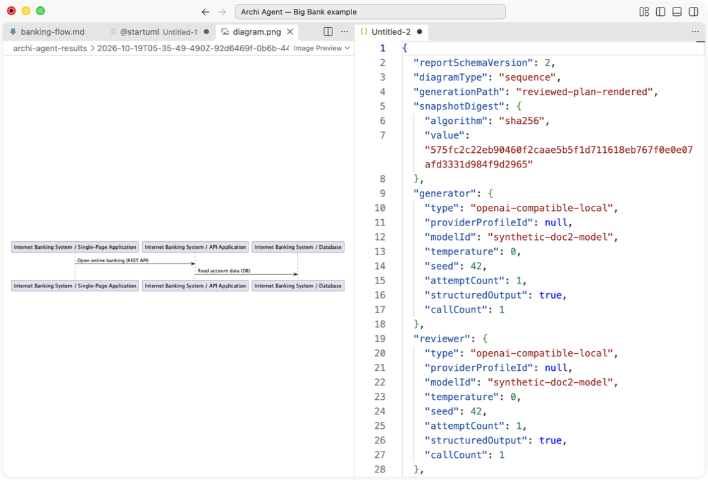
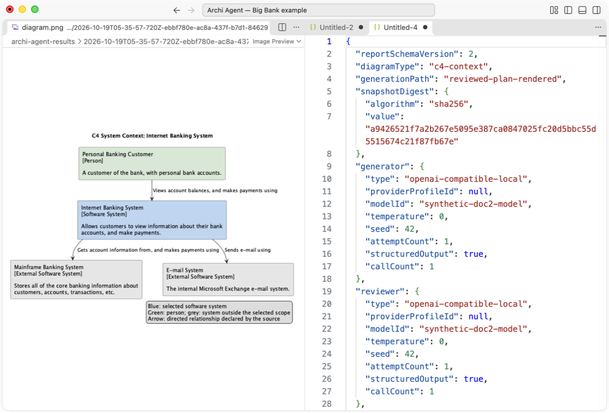
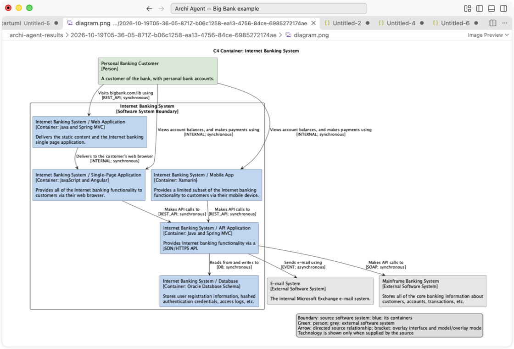
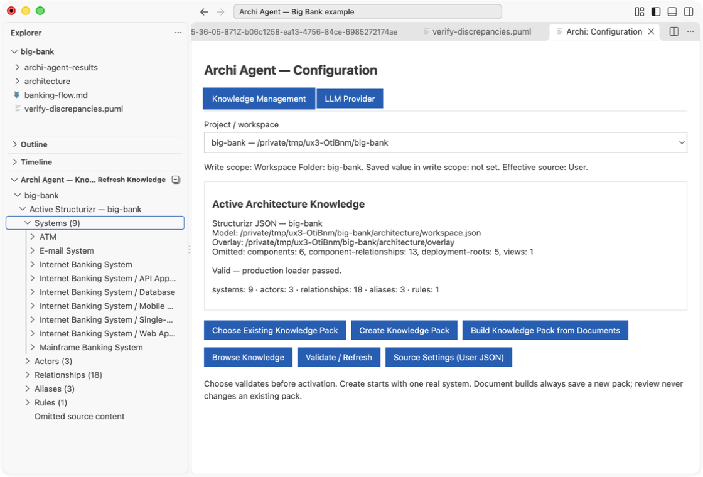
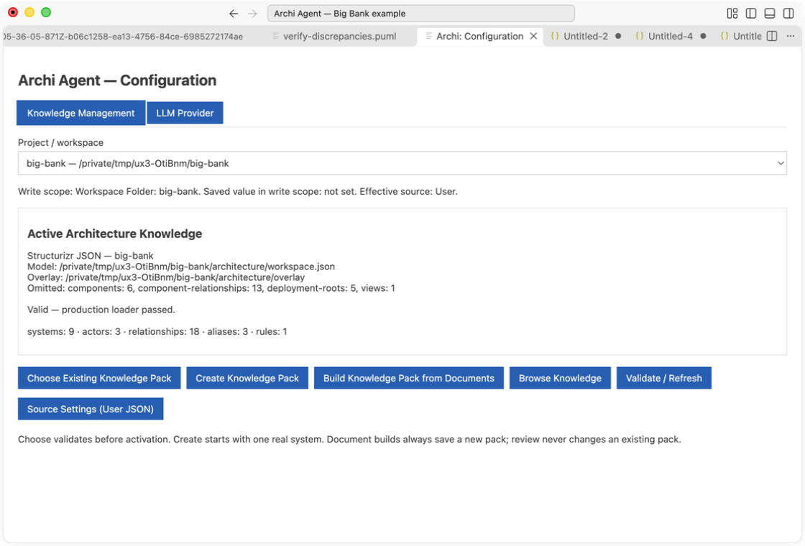

**English** · [Polski](README.pl.md)

# Archi Agent

Turn a flow and architecture knowledge into **Sequence, Component, C4 Context or C4 Container** diagrams with a report showing the names, relationships and evidence used. Verify an existing Sequence or prose against the same knowledge in VS Code, CLI or a PR pipeline.

Inspect the generated Sequence and its original report side by side. The three diagram screens use a **separate local PlantUML 1.2026.6 / Smetana render**, opened as PNG in VS Code. Archi Agent itself opens PlantUML text; graphical preview needs that additional tool or extension.

## See it in action

Explain a software system's users and directly connected systems, with source IDs and hierarchy provenance.

Show containers inside the selected system boundary and the supported external environment.

Find discrepancies and inspect coverage and provenance. Sequence PlantUML verification makes **zero LLM requests**; prose uses one interpretation request. C4 verification is not implemented.

Browse the active architecture, original IDs, supported scope and omissions.

Use Structurizr JSON with an ID-bound overlay, a standalone Markdown pack, or an explicitly configured MCP knowledge source.

These are actual installed **0.3.0-alpha.7** screens on public Big Bank data, captured on macOS ARM64. Model responses are synthetic; the UI and runtime are real. [Gallery and capture provenance PL/EN](docs/assets/screenshots/README.md).

## Install the candidate

The complete SRC1 → VER1 → C4 → MCP1 increment is a **PR candidate**, not a published release. Download Core, Full or CLI/MCP from the PR's successful **Clean-clone CI** run artifacts; inspect its head/merge SHA and checksum. [Current package identities and verification](docs/doc2-pub1-verification.md). The earlier [public alpha.6](https://github.com/Setech-pl/archi-agent/releases/tag/v0.3.0-alpha.6) does not contain these additions.

1. Choose **Core** (`setech-pl.archi-agent-core`) for the shared runtime and text PDF/DOCX/XLSX conversion. Choose **Full** (`setech-pl.archi-agent`) when you need bundled offline PL/EN OCR.
2. Verify SHA-256, then use **Extensions → … → Install from VSIX…** in desktop VS Code. Neither profile needs this repository, npm or a separate Node.js installation.
3. Enable exactly one profile and reload. Both may stay installed, but their static commands/settings/views collide if both are enabled. When switching, shared settings remain; enter cloud keys again for the chosen ID. Keys are not transferred.
4. Open a local project, run **Archi: Open**, configure a provider/model and select your source in **Configuration**. Use **Archi: Help** for the bundled PL/EN guide.

Full adds pinned offline resources; no automatic OCR download occurs. Core stops when a PDF page requires OCR, without returning partial Markdown. A damaged Full reports an installation error. [Installation, profiles and configuration](docs/en/user-guide.md).

## What you can do today

- **Use existing architecture:** local Structurizr `workspace.json` plus `relationships.md`, `aliases.md`, `rules.md` overlay; standalone five-file Markdown packs; or normalized knowledge from one configured stdio MCP server. Direct Structurizr DSL and EA import are not implemented.
- **Acquire knowledge from documents:** convert PDF/DOCX/XLSX locally, extract bounded MD/TXT or document evidence, review/edit candidates and preview five files before creating a new pack. Existing packs are not merged or updated.
- **Generate four diagram types:** Sequence, Component, C4 Context and C4 Container. C4 requires source type/hierarchy metadata; a flat pack without it returns an explicit limitation. Successful generation uses one plan and one review on the same snapshot, without retry/repair.
- **Verify flows:** bounded Sequence PlantUML without LLM, prose with one interpretation request; explicit name decisions and a report distinguishing confirmation, discrepancies and omitted scope. Missing source relationships do not prove nonexistence.
- **Inspect provenance and save deliberately:** source-confirmed facts stay distinct from user-stated facts. ART1 saves the original frozen diagram/report pair to a new folder after confirmation; later editor edits are not silently substituted. SRC1 aliases have a separate guarded native save.
- **Choose a provider:** LM Studio, Ollama, Anthropic, OpenAI or OpenRouter. VS Code keys use SecretStorage; CLI/MCP credentials use named environment variables.

## CLI, PR pipelines and the two MCP directions

The standalone CLI/MCP tarball requires **Node 22.12+**; it contains bundled executable code and needs no repository or runtime dependency installation. `knowledge inspect`, `flow verify` and `diagram generate` use the same runtime as VS Code. In a PR pipeline, run Sequence verification with an explicit configuration/readRoots and check both JSON assessment and process exit code: 0 conformant within scope, 1 discrepancies, 2 inconclusive/partial/unsupported, 3 execution error. Only 0 is a passing verification gate.

**Archi Agent function server** (`archi-agent mcp serve`) exposes `inspect_knowledge`, `verify_flow`, `resolve_flow_names`, `generate_diagram` to an external MCP client. **Archi Agent knowledge client** instead calls `get_knowledge_snapshot` on an explicitly configured knowledge server. These are separate directions; the model chooses neither tools nor executable. The included `archi-agent-knowledge-server` example shares the production Structurizr/K1 code and separates transport from the source adapter.

[CLI/MCP installation, full configuration, commands and PR example](docs/en/cli-mcp.md) · [Knowledge-server adapter example](examples/knowledge-server/README.md).

## Help, limits and status

[English guide](docs/en/user-guide.md) · [Polska instrukcja](docs/pl/user-guide.md) · [Collective owner smoke](docs/testing/mcp1-owner-smoke.md) · [Architecture](docs/en/architecture.md) · [Development](docs/en/development.md).

**Owner smoke DEFERRED; live LLM NOT_RUN; Windows ARM64 runtime NOT_RUN; AUD-003–006 OPEN.** Historical C5 results and current documentation/package checks are recorded separately in the [publication report](docs/doc2-pub1-verification.md). Native UI evidence is macOS ARM64; bundled platform resources do not establish equivalent execution everywhere. Help follows VS Code's display language and works offline; most controls are English. New-folder saves have conditional cleanup, without atomic multi-file publication or crash recovery. No Marketplace release or M1/production readiness is claimed. [Roadmap](docs/product-roadmap.md).

Archi Agent code is [MIT](LICENSE). Bundled components retain their [third-party notices](vscode-extension/THIRD_PARTY_NOTICES.md) and [Full OCR notices](experiments/ux2-ocr/TRIAL_NOTICES.md).
