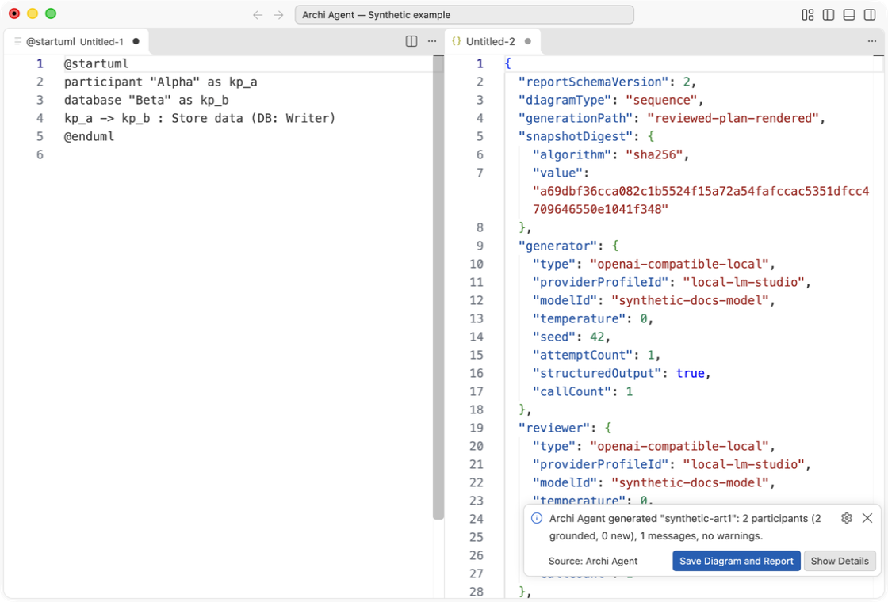
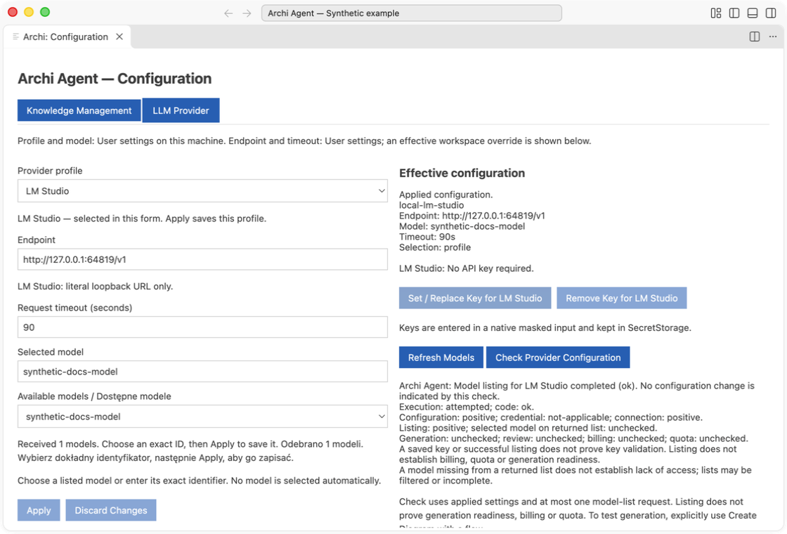
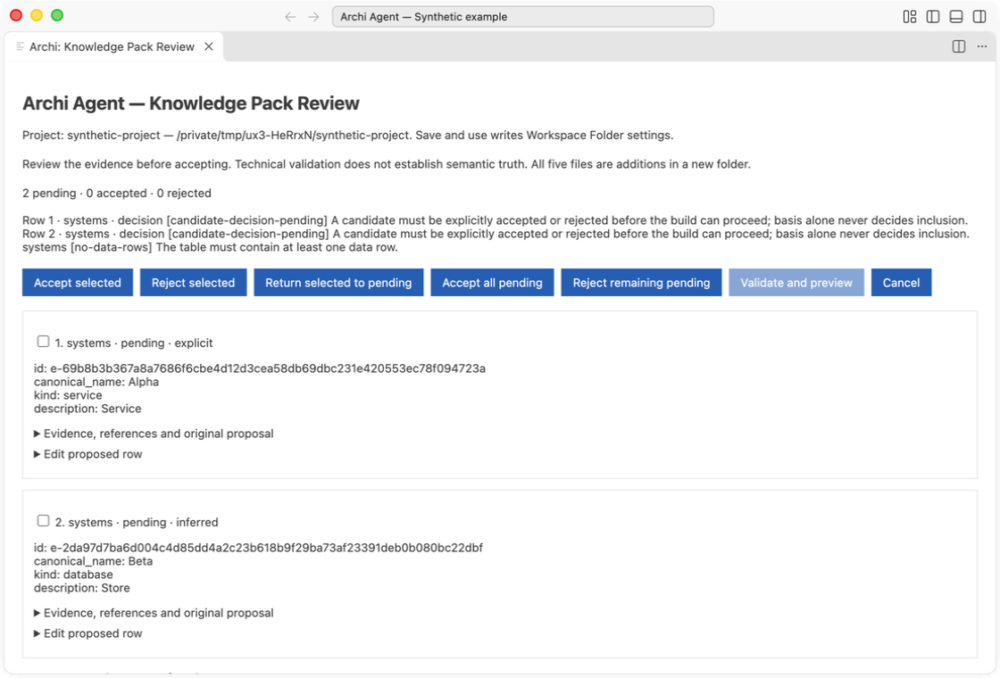
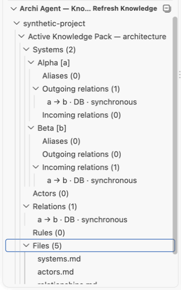
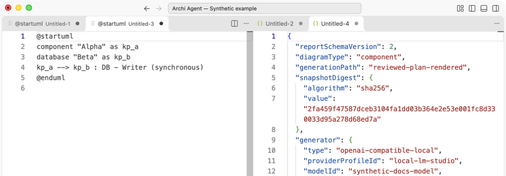

[English](README.md) · **Polski**

# Archi Agent

Zamień opis przepływu i wiedzę o architekturze w diagram Sequence lub Component z raportem pokazującym rozpoznane nazwy i pochodzenie relacji.

Sprawdź przepływ i raport grounding obok siebie przed udostępnieniem wyniku. Ekran pokazuje tekst PlantUML.

Archi Agent pomaga architektom i analitykom dokumentować interakcje usług, wyjaśniać zależności systemów i przeglądać wiedzę proponowaną z dokumentów w VS Code. Wspólny katalog nazw i aliasów ogranicza powtarzanie pracy nad nazewnictwem; raport pomaga sprawdzić podstawy diagramu przed jego udostępnieniem.

## Zobacz w działaniu

Wybierz dokładny ID modelu i zastosuj jedną konfigurację dla generowania diagramów i review.

Sprawdź dowody źródłowe i zdecyduj, które propozycje staną się Twoją wiedzą o architekturze.

Znajdź systemy i prześledź relacje przychodzące i wychodzące w jednym miejscu.

Wyjaśnij zależności usług i baz danych wraz z raportem ich pochodzenia. Ekran pokazuje tekst PlantUML.

[Pełna galeria screenshotów i pochodzenie capture PL/EN](docs/assets/screenshots/README.md) · [Pochodzenie kadrów README](docs/assets/readme/provenance.json)

## Pobierz i uruchom

[Pobierz testowy VSIX — 0.3.0-alpha.6](https://github.com/Setech-pl/archi-agent/releases/download/v0.3.0-alpha.6/archi-agent-0.3.0-alpha.6.vsix) · [SHA-256](https://github.com/Setech-pl/archi-agent/releases/download/v0.3.0-alpha.6/archi-agent-0.3.0-alpha.6.vsix.sha256) · [Release notes](https://github.com/Setech-pl/archi-agent/releases/tag/v0.3.0-alpha.6)

1. Pobierz VSIX i sprawdź checksumę według [instrukcji Mac/Windows](docs/testing/owner-smoke.md).
2. W desktop VS Code wybierz **Extensions → … → Install from VSIX…**, wskaż plik i przeładuj okno, jeśli jest to wymagane. Potwierdź wersję w szczegółach rozszerzenia.
3. Otwórz lokalny projekt i uruchom **Archi: Open**. W **Configuration** skonfiguruj dostawcę/model i wybierz Knowledge Pack.

Pakiet zawiera runtime, lokalną konwersję dokumentów i OCR PL/EN offline. Użytkownik nie potrzebuje repozytorium, npm ani osobnej instalacji Node.js. Diagramy i ekstrakcja wiedzy wymagają dostawcy modelu. To **testowy prerelease**; owner smoke Mac/Windows i Windows ARM64 runtime pozostają **NOT_RUN** do otrzymania raportu. [Help pierwszego użycia](docs/pl/user-guide.md).

## Dostępne funkcje

- **Przygotowanie diagramów Sequence i Component** z pliku przepływu lub wpisanego opisu. Obejrzyj tekst PlantUML i powiązany raport grounding.
- **Uporządkowana wiedza architektoniczna**: systemy, aktorzy, relacje, aliasy i reguły w lokalnym Markdown Knowledge Pack.
- **Spójne nazwy** przez dopasowanie nazw kanonicznych i aliasów, jawne rozstrzyganie niejednoznaczności i świadome potwierdzanie nowych elementów.
- **Ślad grounding** przez odwołania do źródeł i raport odróżniający relacje potwierdzone w źródle od relacji podanych w opisie przepływu.
- **Review propozycji z dokumentów**: evidence, decyzje accept/reject, edycja wierszy i podgląd pięciu plików przed utworzeniem nowego Knowledge Pack. Bez aktualizacji istniejącego packa.
- **Zapis oryginalnej pary diagram/raport** w nowym katalogu projektu po potwierdzeniu lokalizacji.
- **Dostawcy lokalni i chmurowi**: LM Studio, Ollama, Anthropic, OpenAI i OpenRouter. Klucze chmurowe pozostają w SecretStorage VS Code; modele lokalne przygotowujesz osobno.
- **Lokalna konwersja dokumentów i OCR**: PDF, DOCX i XLSX (oraz wejście MD/TXT do ekstrakcji wiedzy); OCR PDF korzysta z modeli polskich/angielskich w paczce bez żądania do dostawcy.

## Krótki przykład pracy

1. **Wiedza:** pack identyfikuje Alpha jako usługę, Beta jako bazę danych i Alpha → Beta jako interfejs Writer.
2. **Przepływ:** wpisz `Alpha stores data in Beta.` i wybierz **Sequence** lub **Component**.
3. **Diagram i raport:** sprawdź interakcje/zależności, evidence, ostrzeżenia i wynik walidacji. Cytat źródłowy ani review modelu nie gwarantują prawdziwości architektonicznej.
4. **Zapis:** wybierz **Save Diagram and Report** i potwierdź lokalizację; rozszerzenie zapisze `diagram.puml` i `report.json` w nowym katalogu wyniku.

[Instrukcja](docs/pl/user-guide.md#kompletny-syntetyczny-pack-z-pięciu-plików) zawiera kompletny syntetyczny pack pięciu plików do tego przykładu.

## Help

[Polska instrukcja](docs/pl/user-guide.md) · [English user guide](docs/en/user-guide.md) · [Lista testów Mac/Windows PL/EN](docs/testing/owner-smoke.md)

W VS Code użyj **Archi: Help**. Te same instrukcje i screenshoty są w VSIX. Help uwzględnia język wyświetlania VS Code, a przełącznik **English / Polski** działa offline. Większość kontrolek produktu ma angielskie etykiety.

## Ograniczenia i kierunek

Sprawdzaj wygenerowane fakty i evidence dokumentów. Walidacja lokalna obejmuje określony podzbiór PlantUML; podgląd graficzny wymaga osobnej obsługi PlantUML. Zapis wiedzy tworzy nowe katalogi, wyniki pozostają w pamięci do zapisu, a zapis pary nie gwarantuje atomowej publikacji ani odtworzenia po awarii. Zasoby platform są w paczce, ale pokrycie pakowania nie potwierdza równoważnego wsparcia natywnego runtime. [Ograniczenia i stan techniczny](docs/project-state.md).

Następny kierunek to weryfikacja względem istniejących modeli architektury, następnie szersza weryfikacja i integracja MCP. **SRC1, VER1 i MCP1 są planowane, nie są dostępnymi funkcjami.** [Roadmapa](docs/product-roadmap.md). Prerelease nie potwierdza M1 ani gotowości produkcyjnej.

## Informacje techniczne i licencja

[Architektura](docs/architecture.md) · [Development](docs/pl/development.md) · [Format Knowledge Pack](docs/knowledge-pack-format.md) · [Dowody CI](docs/ci-clean-clone-icu.md) · [Stan techniczny](docs/project-state.md)

Kod Archi Agent jest na licencji [MIT](LICENSE). Składniki mają własne [third-party notices](vscode-extension/THIRD_PARTY_NOTICES.md) i [notices OCR](experiments/ux2-ocr/TRIAL_NOTICES.md).
