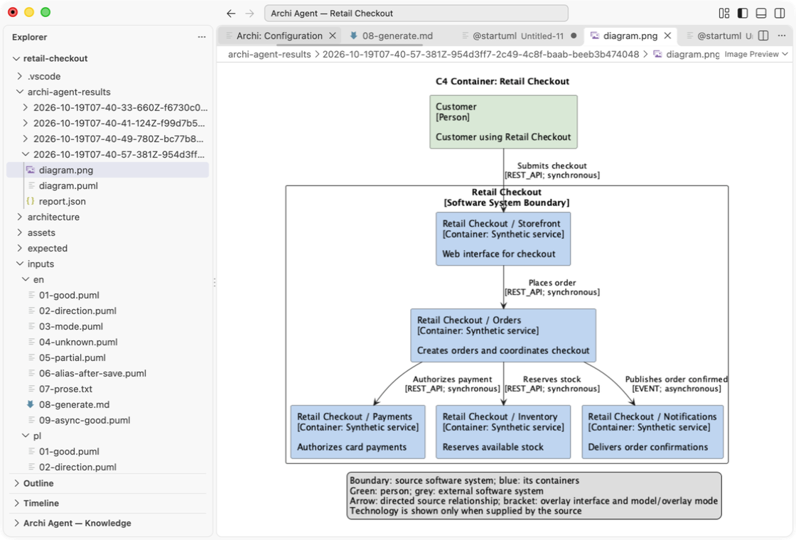

[English](README.md) · **Polski**

# Archi Agent

Zamień przepływ i wiedzę o architekturze w diagram **Sequence, Component, C4 Context lub C4 Container** z raportem użytych nazw, relacji i dowodów. Sprawdź istniejący Sequence lub prozę względem tej samej wiedzy w VS Code, CLI albo pipeline PR.

Przeczytaj wygenerowany Sequence obok oryginalnego raportu. Trzy ekrany diagramów używają **osobnego lokalnego renderu PlantUML 1.2026.6 / Smetana**, otwartego jako PNG w VS Code. Archi Agent sam otwiera tekst PlantUML; podgląd graficzny wymaga tego dodatkowego narzędzia lub rozszerzenia.

## Tutoriale — gotowe projekty

Pobierz ZIP, zainstaluj Core lub Full, otwórz folder i uzyskaj pierwszy **wynik Verify Flow bez LLM**. Syntetyczna wiedza, nakładki i wejścia PL/EN są gotowe. Generowanie, proza i ekstrakcja dokumentów korzystają z Twojego providera.

| Projekt | Pobranie | Tutoriale |
| --- | --- | --- |
| Retail Checkout — klient, zamówienia, płatności, magazyn i powiadomienia | [ZIP projektu](https://github.com/Setech-pl/archi-agent/releases/download/v0.3.0-alpha.7-demo.1/archi-agent-demo-retail-checkout-0.3.0-alpha.7-demo.1.zip) | [Polski](examples/retail-checkout/START-HERE.pl.md) · [English](examples/retail-checkout/START-HERE.en.md) |
| Mission Control — planowanie, telemetria, komendy, archiwum i alarmy; CLI, oba kierunki MCP, K3 i opcjonalny OCR | [ZIP projektu](https://github.com/Setech-pl/archi-agent/releases/download/v0.3.0-alpha.7-demo.1/archi-agent-demo-mission-control-0.3.0-alpha.7-demo.1.zip) | [Polski](examples/mission-control/START-HERE.pl.md) · [English](examples/mission-control/START-HERE.en.md) |

To rzeczywiste ekrany zainstalowanego UI na syntetycznych danych demo i z syntetycznym modelem. PNG diagramu wymagał osobnego lokalnego renderera PlantUML. [Indeks tutoriali](docs/pl/tutorials.md) · [Pokrycie i dowody](docs/demo1-verification.md).

[VSIX Core](https://github.com/Setech-pl/archi-agent/releases/download/v0.3.0-alpha.7-demo.1/archi-agent-core-0.3.0-alpha.7.vsix) · [VSIX Full](https://github.com/Setech-pl/archi-agent/releases/download/v0.3.0-alpha.7-demo.1/archi-agent-full-0.3.0-alpha.7.vsix) · [CLI/MCP (Node 22.12+)](https://github.com/Setech-pl/archi-agent/releases/download/v0.3.0-alpha.7-demo.1/archi-agent-cli-0.3.0-alpha.7.tgz) · [SHA-256](https://github.com/Setech-pl/archi-agent/releases/download/v0.3.0-alpha.7-demo.1/SHA256SUMS) · [Wybór paczek](https://github.com/Setech-pl/archi-agent/releases/download/v0.3.0-alpha.7-demo.1/DOWNLOADS.md).

## Zobacz w działaniu

Pokaż użytkowników systemu i bezpośrednio połączone systemy wraz z ID źródła i pochodzeniem hierarchii.

Pokaż kontenery w granicy wybranego systemu i obsługiwane otoczenie zewnętrzne.

Znajdź rozbieżności i sprawdź pokrycie oraz provenance. Weryfikacja Sequence PlantUML wykonuje **zero żądań LLM**; proza używa jednego żądania interpretacji. Weryfikacja C4 nie jest zaimplementowana.

Przeglądaj aktywną architekturę, oryginalne ID, obsługiwany zakres i pominięcia.

Użyj JSON Structurizr z nakładką powiązaną po ID, samodzielnego packa Markdown albo jawnie skonfigurowanego źródła wiedzy MCP.

To rzeczywiste ekrany zainstalowanego **0.3.0-alpha.7** na publicznych danych Big Bank, przechwycone na macOS ARM64. Odpowiedzi modelu są syntetyczne; UI i runtime są rzeczywiste. [Galeria i pochodzenie zrzutów PL/EN](docs/assets/screenshots/README.md).

## Instalacja prerelease demonstracyjnego

Pełny przyrost SRC1 → VER1 → C4 → MCP1 i projekty DEMO1 są dostępne w [prerelease demonstracyjnym v0.3.0-alpha.7-demo.1](https://github.com/Setech-pl/archi-agent/releases/tag/v0.3.0-alpha.7-demo.1). Pobierz publiczne assets i sprawdź `SHA256SUMS`. [Powiązanie źródeł, testowanego checkoutu i dowodów](docs/demo1-verification.md). Wcześniejsze alpha.6 nie zawiera tych dodatków.

1. Wybierz **Core** (`setech-pl.archi-agent-core`) dla wspólnego runtime i tekstowej konwersji PDF/DOCX/XLSX. Wybierz **Full** (`setech-pl.archi-agent`), gdy potrzebujesz bundlowanego OCR PL/EN offline.
2. Sprawdź SHA-256, następnie wybierz **Extensions → … → Install from VSIX…** w desktopowym VS Code. Żaden profil nie wymaga repozytorium, npm ani osobnej instalacji Node.js.
3. Włącz dokładnie jeden profil i przeładuj okno. Oba mogą pozostać zainstalowane, lecz przy obu włączonych kolidują statyczne komendy/ustawienia/widoki. Przy zmianie profilu wspólne ustawienia pozostają; wprowadź klucze chmurowe ponownie dla wybranego ID. Klucze nie są przenoszone.
4. Otwórz lokalny projekt, uruchom **Archi: Open**, skonfiguruj providera/model i wybierz źródło w **Configuration**. **Archi: Help** otwiera bundlowaną instrukcję PL/EN.

Full dodaje przypięte zasoby offline; OCR nie jest automatycznie pobierane. Core zatrzymuje konwersję, gdy strona PDF wymaga OCR, bez częściowego Markdown. Uszkodzony Full zgłasza błąd instalacji. [Instalacja, profile i konfiguracja](docs/pl/user-guide.md).

## Dostępne możliwości

- **Istniejąca architektura:** lokalny Structurizr `workspace.json` z nakładką `relationships.md`, `aliases.md`, `rules.md`; samodzielny pięcioplikowy pack Markdown; albo znormalizowana wiedza z jednego skonfigurowanego serwera MCP stdio. Bezpośrednia obsługa DSL Structurizr i import EA nie są zaimplementowane.
- **Pozyskiwanie wiedzy z dokumentów:** lokalna konwersja PDF/DOCX/XLSX, ekstrakcja ograniczonego tekstu MD/TXT lub dokumentów z dowodami, review/edycja kandydatów i podgląd pięciu plików przed utworzeniem nowego packa. Istniejące packi nie są scalane ani aktualizowane.
- **Cztery typy diagramów:** Sequence, Component, C4 Context i C4 Container. C4 wymaga metadanych typów/hierarchii; płaski pack bez nich daje jawne ograniczenie. Poprawna generacja używa jednego planu i jednego review na tym samym snapshotcie, bez retry/repair.
- **Weryfikacja przepływów:** ograniczony Sequence PlantUML bez LLM, proza z jednym żądaniem interpretacji; jawne decyzje nazw i raport potwierdzeń, rozbieżności oraz pominiętego zakresu. Brak relacji w źródle nie dowodzi jej nieistnienia.
- **Provenance i kontrolowany zapis:** fakty źródłowe pozostają odróżnialne od podanych przez użytkownika. ART1 zapisuje oryginalną zamrożoną parę diagram/raport do nowego folderu po potwierdzeniu; późniejsze zmiany edytora nie podmieniają jej po cichu. Aliasy SRC1 mają osobny chroniony zapis natywny.
- **Wybór dostawcy:** LM Studio, Ollama, Anthropic, OpenAI lub OpenRouter. Klucze VS Code używają SecretStorage; CLI/MCP używa nazwanych zmiennych środowiska.

## CLI, pipeline PR i dwa kierunki MCP

Samodzielna paczka CLI/MCP wymaga **Node 22.12+**; zawiera bundlowany kod wykonywalny, bez repozytorium i instalacji zależności runtime. `knowledge inspect`, `flow verify` i `diagram generate` używają tego samego runtime co VS Code. W pipeline PR uruchom weryfikację Sequence z jawną konfiguracją/readRoots i sprawdź ocenę JSON oraz kod procesu: 0 zgodność w zakresie, 1 rozbieżności, 2 nierozstrzygnięte/częściowe/nieobsługiwane, 3 błąd wykonania. Tylko 0 zalicza bramkę weryfikacji.

**Serwer funkcji Archi Agent** (`archi-agent mcp serve`) udostępnia zewnętrznemu klientowi MCP `inspect_knowledge`, `verify_flow`, `resolve_flow_names`, `generate_diagram`. **Klient wiedzy Archi Agent** wywołuje natomiast `get_knowledge_snapshot` na jawnie skonfigurowanym serwerze wiedzy. To odrębne kierunki; model nie wybiera tools ani programu. Dostarczony przykład `archi-agent-knowledge-server` współdzieli produkcyjne SRC1/K1 i rozdziela transport od adaptera źródła.

[Instalacja CLI/MCP, pełna konfiguracja, polecenia i przykład PR](docs/pl/cli-mcp.md) · [Przykład adaptera serwera wiedzy](examples/knowledge-server/README.md).

## Pomoc, ograniczenia i status

[Instrukcja polska](docs/pl/user-guide.md) · [English guide](docs/en/user-guide.md) · [Zbiorczy owner smoke](docs/testing/mcp1-owner-smoke.md) · [Architektura](docs/pl/architecture.md) · [Development](docs/pl/development.md).

**Owner smoke DEFERRED; rzeczywisty LLM NOT_RUN; Windows ARM64 runtime NOT_RUN; AUD-003–006 OPEN.** Historyczne C5 i bieżące kontrole dokumentacji/paczek są rozdzielone w [raporcie publikacji](docs/doc2-pub1-verification.md). Dowody natywnego UI dotyczą macOS ARM64; bundlowane zasoby platform nie potwierdzają równoważnego wykonania wszędzie. Help podąża za językiem VS Code i działa offline; większość kontrolek jest angielska. Zapis nowych folderów ma warunkowy cleanup, bez atomowej publikacji wielu plików i crash recovery. Bez wydania Marketplace i deklaracji M1/gotowości produkcyjnej. [Roadmapa](docs/product-roadmap.md).

Kod Archi Agent jest objęty [MIT](LICENSE). Bundlowane komponenty zachowują własne [third-party notices](vscode-extension/THIRD_PARTY_NOTICES.md) i [notices OCR Full](experiments/ux2-ocr/TRIAL_NOTICES.md).
