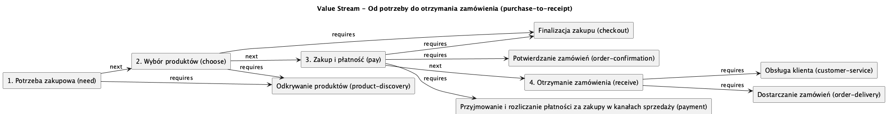
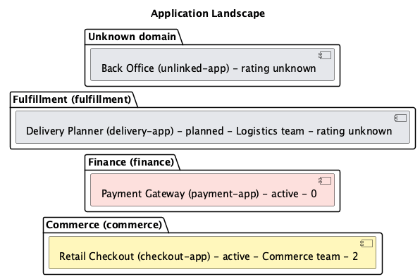

[English](README.md) · **Polski**

# Archi Agent

## Sprawdź integrację, zanim zaczniesz ją budować.

Porównaj projektowany przepływ z modelem architektury. Znajdź nierozpoznane systemy, połączenia nieobecne w modelu i rozbieżności w komunikacji synchronicznej oraz asynchronicznej. Przy każdym ustaleniu zobaczysz odwołania do źródeł.

Następnie przedstaw rozwiązanie na diagramie **Sequence, Component, C4 Context lub C4 Container**, korzystając z tej samej wiedzy o architekturze.

**[Pobierz Core — rekomendowany start](https://github.com/Setech-pl/archi-agent/releases/download/v0.3.0-alpha.8/archi-agent-core-0.3.0-alpha.8.vsix)** · [Pobierz Full — zawiera OCR offline](https://github.com/Setech-pl/archi-agent/releases/download/v0.3.0-alpha.8/archi-agent-full-0.3.0-alpha.8.vsix)

**[Wypróbuj gotowe projekty](docs/pl/tutorials.md)** · [Zacznij w VS Code](docs/pl/user-guide.md) · [Skorzystaj z CLI i MCP](docs/pl/cli-mcp.md)

## Prześledź wartość i zobacz portfel aplikacji

To rendery diagramów z aktualnego syntetycznego katalogu Retail. Zrzuty aplikacji poniżej pokazują rzeczywisty interfejs VS Code.

## Przyjdź na przegląd architektury z konkretnymi ustaleniami

Projekt integracji często obejmuje opis procesu, model systemów i kilka dokumentów. Archi Agent łączy je w jeden tok pracy: sprawdzasz przepływ, analizujesz różnice i udostępniasz diagram wraz z informacjami, na których się opiera.

- **Znajdź rozbieżności przed implementacją.** Sprawdź nazwy systemów, kierunki połączeń i sposób komunikacji względem podłączonego modelu.
- **Ułatw rozmowę o rozwiązaniu.** Pokaż kolejność interakcji albo strukturę systemu na właściwym poziomie szczegółowości.
- **Uporządkuj nazewnictwo.** Świadomie rozstrzygaj niejednoznaczne nazwy i zapisuj zatwierdzone aliasy w nakładce Structurizr do kolejnych sprawdzeń.
- **Zachowaj podstawę decyzji.** Zapisz wygenerowany diagram i powiązany raport razem w projekcie.

Połączenie nieobecne w modelu jest wskazywane jako brak w dostępnej wiedzy. Ty decydujesz, czy uzupełnienia wymaga model, czy zmiany potrzebuje projektowany przepływ.

## Pokaż przepływ. Wyjaśnij strukturę.

### Prześledź komunikację od początku do końca

Przygotuj diagram Sequence na podstawie opisu albo sprawdź istniejący diagram sekwencji względem architektury.

### Umieść system w jego otoczeniu

Diagram C4 Context pokazuje użytkowników systemu i połączenia z pozostałymi systemami.

### Pokaż, co znajduje się wewnątrz

C4 Container pomaga wyjaśnić strukturę systemu, a diagram Component — omówić zależności między elementami rozwiązania. Diagramy C4 wymagają w źródle metadanych typów i hierarchii.

Wynikiem generowania jest edytowalny PlantUML. Podgląd graficzny zapewnia osobne narzędzie lub rozszerzenie PlantUML. [Zobacz galerię](docs/assets/screenshots/README.md).

## Połącz zdolności biznesowe, wartość i aplikacje

Buduj katalog z wybranych materiałów, przeglądaj propozycje i aktualizuj go przez jawne decyzje.
Twórz **Capability Map**, **Capability–Application Map**, **Value Stream** i **Application Landscape**
z jednego lokalnego katalogu lub źródła enterprise MCP. Renderowanie nie wymaga providera i ma zero wywołań LLM.
[Zacznij od Retail](docs/pl/tutorials.md) · [Buduj i aktualizuj katalog](docs/pl/user-guide.md#value-stream-i-application-landscape).

## Wykorzystaj wiedzę, którą już masz

- **Structurizr JSON:** pracuj na istniejącym modelu z nakładką zawierającą aliasy, reguły i metadane interfejsów.
- **Lokalne pakiety wiedzy:** przechowuj systemy, relacje i nazewnictwo w uporządkowanych plikach Markdown.
- **Dokumenty:** wydobywaj propozycje wiedzy z PDF, DOCX, XLSX, Markdown i tekstu, a następnie przeglądaj je przed zapisem nowego pakietu.
- **Źródła wiedzy MCP:** podłącz własny serwer i przygotuj adapter do API, bazy danych lub repozytorium architektury.

[Poznaj źródła architektury](docs/pl/user-guide.md) · [Rozbuduj przykładowy serwer wiedzy](examples/knowledge-server/README.md)

## Wybierz, gdzie pracuje Twój model

Użyj lokalnego modelu przez **LM Studio lub Ollama** albo połącz się z **Anthropic, OpenAI lub OpenRouter**, podając własny klucz API.

Weryfikacja obsługiwanego podzbioru Sequence PlantUML działa bez LLM. Przy opisie tekstowym model rozpoznaje przepływ, a kod porównuje jego interpretację z architekturą.

## Zacznij od kompletnego przykładu

Otwórz gotowy projekt z wiedzą architektoniczną, przykładowymi przepływami i instrukcją krok po kroku.

| Projekt | Co sprawdzisz | Pobieranie | Tutorial |
| --- | --- | --- | --- |
| **Retail Checkout** | Zamówienia, płatności i realizacja zakupu. Weryfikacja przepływów, cztery typy diagramów i źródła stojące za projektem. | [ZIP projektu](https://github.com/Setech-pl/archi-agent/releases/download/v0.3.0-alpha.8/archi-agent-demo-retail-checkout-0.3.0-alpha.8.zip) | [Tutorial po polsku](examples/retail-checkout/START-HERE.pl.md) |
| **Mission Control** | Telemetria, komendy i alarmy. Źródło wiedzy MCP, sprawdzanie przez CLI i pozyskiwanie wiedzy z dokumentów. | [ZIP projektu](https://github.com/Setech-pl/archi-agent/releases/download/v0.3.0-alpha.8/archi-agent-demo-mission-control-0.3.0-alpha.8.zip) | [Tutorial po polsku](examples/mission-control/START-HERE.pl.md) |

Pierwsze sprawdzenie korzysta z Sequence PlantUML i **nie wymaga LLM**. Własny model skonfigurujesz, gdy przejdziesz do generowania diagramów, opisów tekstowych lub ekstrakcji wiedzy z dokumentów.

[Przejdź do tutoriali](docs/pl/tutorials.md)

## Korzystaj z tych samych funkcji poza VS Code

**CLI:** sprawdzaj diagramy sekwencji w pipeline PR i otrzymuj raport do dalszego przetwarzania oraz kod zakończenia procesu. [Pobierz CLI/MCP](https://github.com/Setech-pl/archi-agent/releases/download/v0.3.0-alpha.8/archi-agent-cli-0.3.0-alpha.8.tgz).

**Serwer funkcji MCP:** udostępnij innemu klientowi MCP przeglądanie wiedzy, weryfikację przepływów i generowanie diagramów przez Archi Agent.

**Klient wiedzy MCP:** pobieraj do Archi Agent wiedzę architektoniczną z własnego serwera.

[Instrukcja CLI i MCP](docs/pl/cli-mcp.md)

## Uruchom Archi Agent

Pobierz [prerelease demonstracyjny v0.3.0-alpha.8](https://github.com/Setech-pl/archi-agent/releases/tag/v0.3.0-alpha.8). [Wybór paczek](https://github.com/Setech-pl/archi-agent/releases/download/v0.3.0-alpha.8/DOWNLOADS.md) · [Sumy kontrolne SHA-256](https://github.com/Setech-pl/archi-agent/releases/download/v0.3.0-alpha.8/SHA256SUMS).

1. Wybierz **[Core](https://github.com/Setech-pl/archi-agent/releases/download/v0.3.0-alpha.8/archi-agent-core-0.3.0-alpha.8.vsix)** jako rekomendowany start do diagramów, weryfikacji i pracy ze źródłami architektury. Wybierz **[Full](https://github.com/Setech-pl/archi-agent/releases/download/v0.3.0-alpha.8/archi-agent-full-0.3.0-alpha.8.vsix)**, jeśli potrzebujesz także lokalnego OCR PL/EN dla skanowanych PDF-ów.
2. Sprawdź sumę SHA-256 i zainstaluj wybrany profil w desktopowym VS Code 1.91+ przez **Extensions → … → Install from VSIX…**. Pozostaw włączony dokładnie jeden profil Core/Full i przeładuj okno.
3. Otwórz projekt demonstracyjny, wybierz przygotowane źródło i uruchom **Archi: Verify Flow (Sequence / prose)**.
4. Skonfiguruj model, gdy zechcesz generować diagramy lub pracować z opisami tekstowymi.

Rozszerzenie VS Code zawiera potrzebny runtime: korzystanie z niego nie wymaga klonowania repozytorium, npm ani osobnej instalacji Node.js. CLI/MCP korzysta z Node.js 22.12 lub nowszego.

[Instalacja i pobieranie](docs/pl/user-guide.md) · [Tutoriale](docs/pl/tutorials.md) · [Konfiguracja](docs/pl/user-guide.md#provider-profil-i-model)

## Dokumentacja

[Instrukcja użytkownika](docs/pl/user-guide.md) · [Architektura](docs/pl/architecture.md) · [Dla programistów](docs/pl/development.md) · [Stan techniczny](docs/project-state.md)

Dokumentacja main opisuje aktualny kod; opublikowane paczki identyfikują manifest wydania i dołączony Help.

Archi Agent jest dostępny na [licencji MIT](LICENSE). Dołączone komponenty zachowują własne [informacje licencyjne](vscode-extension/THIRD_PARTY_NOTICES.md) oraz [informacje o komponentach OCR](experiments/ux2-ocr/TRIAL_NOTICES.md).
