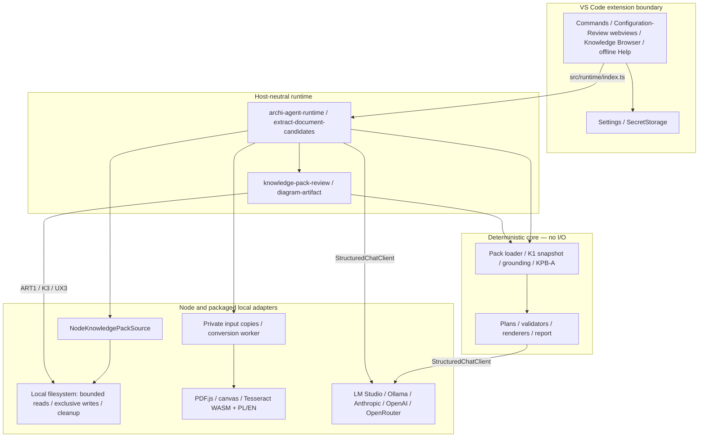
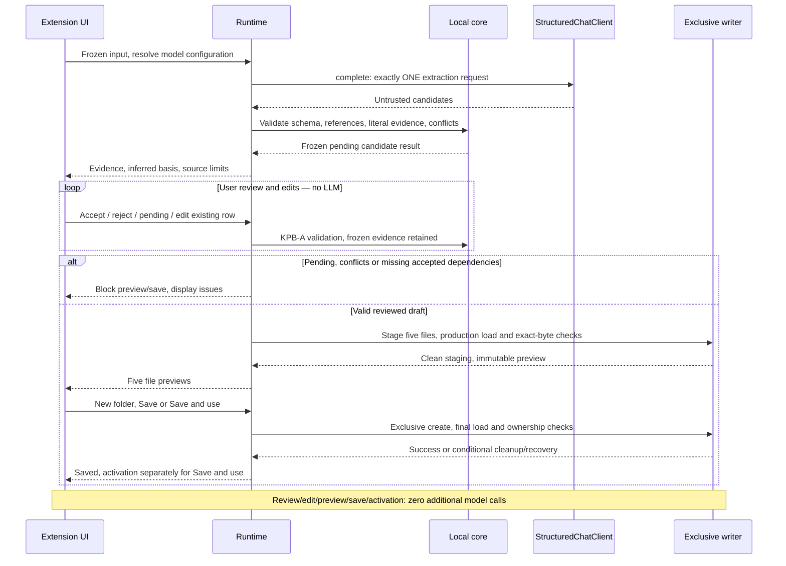
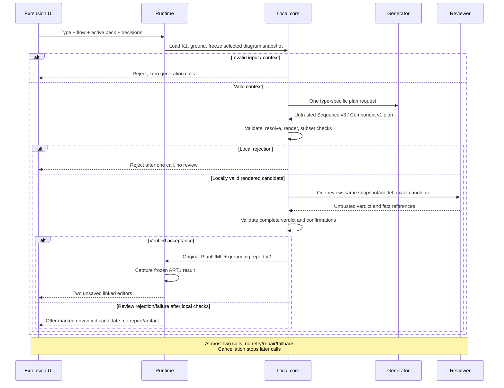
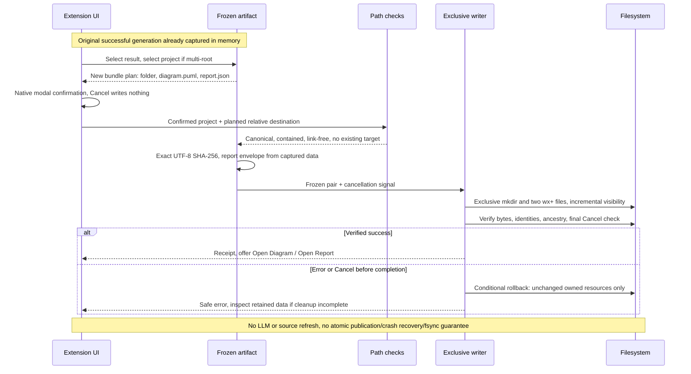

# Archi Agent architecture

Current local architecture includes SRC1, VER1 and D3/D4, on the earlier UX4-FU2 and offline PL/EN Help baseline. [English guide](en/architecture.md) · [Polski](pl/architecture.md). [Historical architecture and superseded pipelines](architecture-history.md) preserve prior decisions; [ADR 0002](adr/0002-deterministic-diagram-plan-renderers.md) records the approved plan/validation/render/review direction.

SRC1 adds a local Structurizr workspace JSON adapter and an ID-bound three-table Markdown overlay.
The pure mapper produces the existing K1 records/indexes and one frozen knowledge snapshot;
Node reads through the existing bounded source port and the host passes source configuration.
Field provenance distinguishes model and overlay origins, and the original ART1 pair preserves
that snapshot. Containers use qualified names; source components/deployment are explicitly omitted.
See the [SRC1 contract](src1-structurizr-source.md) and [local verification](src1-verification.md).

`src/core` defines deterministic contracts, parsing, grounding, plan/evidence/verdict validators, renderers and reports; it has no filesystem or VS Code I/O. Pipeline orchestration calls injected provider ports. `src/node` implements bounded filesystem, exclusive writers and provider transports. `src/runtime` composes those adapters into host-neutral operations exported by `src/runtime/index.ts`. `vscode-extension/src` adapts commands, settings, SecretStorage, progress, editors and webviews; it reaches product code through that runtime entrypoint. Knowledge Browser is a read-only K1 loader projection; Help uses bundled Markdown and no model.

Only bounded selected document text reaches extraction; only the relevant frozen architecture snapshot reaches diagram generation/review. Full architecture repositories and raw XML are not sent. Model outputs and imported sources are untrusted. Local schema/semantic checks remain fail-closed. Generator and semantic reviewer share the configured model but use separate requests and the same snapshot. No retry, repair, fallback or additional call is introduced.

## VER1 and source-bound C4

The current local candidate adds [VER1](ver1-flow-verification.md): a frozen runtime session,
a bounded text-only Sequence parser (zero model calls), one prose interpretation call, existing
K1 name resolution and deterministic assessment. User decisions and exact source fingerprints
survive continuation; changed sources invalidate it. SRC1 aliases use runtime-prepared native
editor edits, conflict checks and post-save production validation; standalone pack decisions are
session-only. Verification does not call the diagram generator or reviewer and does not verify C4.

[D3/D4](c4-diagrams.md) use optional source type/parent/technology metadata on the same K1 records,
with field provenance and digest coverage. Separate Context/Container snapshots, plans, validators
and local renderers feed the existing two-call reviewed pipeline and ART1. Only source-confirmed
relationships are eligible. Create Diagram selects a software system by stable ID; missing hierarchy
is an explicit controlled result. No remote include, C4 dependency or guessed parent/edge is used.
The previous generation/acquisition diagrams below retain the shared boundaries.

## A. Components and boundaries

## B. Documents and frozen input

```mermaid
flowchart LR
  Source["Local documents / active MD-TXT buffer"] --> Capture["Bounded bytes or buffer capture / hashes"]
  Capture --> Convert["Conversion / offline OCR / normalized text"]
  Convert --> Extract["ONE extraction request / untrusted candidates"]
  Extract --> Evidence["Deterministic schema / evidence / references"]
  Evidence --> Review["User decisions / edits / validated preview"]
  Review --> Pack["NEW five-file Knowledge Pack / provenance"]
  Pack --> Snapshot["Loader / K1 snapshot / deterministic grounding"]
  Flow["Flow description / explicit decisions"] --> Snapshot
  Snapshot --> Plan["ONE generator request / type-specific plan"]
  Plan --> Local["Validation / deterministic rendering / subset checks"]
  Local --> Semantic["ONE semantic review request / validated verdict"]
  Semantic --> Result["Original diagram + linked report / frozen ART1 result"]
  Result --> Save["Explicit confirmation / exclusive save / conditional cleanup"]
  Pack --> Browser["Read-only Knowledge Browser"]
```

## C. Extraction, review and new-pack save

## D. Diagram generation and report

## E. ART1 original-pair save

Acquisition staging is temporary; K2 awaits cleanup before returning candidates. The frozen bundle exists before extraction and remains the evidence source throughout review. Builder save validation includes a production load before immutable preview and after final writes. Activation is a separate setting operation.

Diagram review rejection can offer an unverified candidate only after local validation; user cancellation offers nothing. Generator/reviewer share the configured model but use separate contexts. Compatibility sequence uses one request and report v1.

The ART1 menu/palette registry retains results while at least one linked preview remains open; closing both removes the list entry. A still-pending generation notification retains its own original and can invoke save directly after both previews close. Restart/reload removes in-memory results and notifications. Language changes do not count as actual closes. Two-file saving is incrementally visible and rollback is conditional; no atomic directory rename, crash recovery or fsync guarantee is claimed.

## Source map

| Step / krok | Modules / moduły |
| --- | --- |
| UI navigation / nawigacja | [open-menu.ts](../vscode-extension/src/commands/open-menu.ts), [build-knowledge-pack.ts](../vscode-extension/src/commands/build-knowledge-pack.ts), [generate-sequence-diagram.ts](../vscode-extension/src/commands/generate-sequence-diagram.ts), [save-diagram-and-report.ts](../vscode-extension/src/commands/save-diagram-and-report.ts) |
| Boundary / granica | [index.ts](../src/runtime/index.ts), [archi-agent-runtime.ts](../src/runtime/archi-agent-runtime.ts) |
| Acquisition / przechwycenie | [extract-document-candidates.ts](../src/runtime/extract-document-candidates.ts), [convert-document.ts](../src/runtime/convert-document.ts), [convert.mjs](../experiments/ux2-ocr/convert.mjs), [ocr-parent.mjs](../experiments/ux2-ocr/ocr-parent.mjs), [ocr-child.mjs](../experiments/ux2-ocr/ocr-child.mjs) |
| K1 / source / źródło | [knowledge-snapshot.ts](../src/core/knowledge-pack/knowledge-snapshot.ts), [node-knowledge-pack-source.ts](../src/node/node-knowledge-pack-source.ts) |
| Extraction evidence / dowody | [document-candidates.ts](../src/core/knowledge-pack/builder/document-candidates.ts), [knowledge-pack-builder.ts](../src/core/knowledge-pack/builder/knowledge-pack-builder.ts) |
| Review/save | [knowledge-pack-review.ts](../src/runtime/knowledge-pack-review.ts), [knowledge-pack-onboarding.ts](../src/runtime/knowledge-pack-onboarding.ts), [document-provenance.ts](../src/core/knowledge-pack/document-provenance.ts) |
| ART1 | [diagram-artifact.ts](../src/runtime/diagram-artifact.ts), [local-file-path.ts](../src/node/local-file-path.ts) |
| Provider transports / transporty | [local](../src/node/llm/openai-compatible-local-chat-client.ts), [remote OpenAI-compatible](../src/node/llm/openai-compatible-remote-chat-client.ts), [Anthropic](../src/node/llm/anthropic-remote-chat-client.ts) |

Sequence: [reviewed-sequence.ts](../src/core/pipeline/reviewed-sequence.ts), [sequence-diagram-plan.ts](../src/core/pipeline/sequence-diagram-plan.ts). Component: [generate-component-diagram.ts](../src/core/pipeline/generate-component-diagram.ts), [component-diagram-plan.ts](../src/core/pipeline/component-diagram-plan.ts).

## Configuration, limits and failures

Configuration keeps the visible draft separate from applied User settings. Refresh Models uses the draft profile/endpoint/timeout, validates the bounded response and never persists a model. Available models updates Selected model; Apply writes profile and model binding sequentially. Discard restores applied settings and invalidates the draft catalog. External changes make a stale Apply fail; a partial settings failure re-reads actual values. Check Provider Configuration uses applied settings. Profile/model/binding are machine scoped; pack selection is resource scoped. LM Studio endpoint/timeout can have effective workspace overrides, subject to Workspace Trust. Local URLs require literal loopback; cloud adapters use fixed HTTPS allowlists.

Keys are provider-specific VS Code SecretStorage entries. Native masked inputs handle entry; webviews receive only presence, never the secret. Help uses VS Code's display language and bundled Markdown; it makes no provider request and does not introduce an application language switch. Browser reads only the active pack through the production loader; record navigation uses pack line locations and frozen document provenance, with digest checks before opening live editor evidence.

Standalone conversion accepts one file up to 50 MiB and 8 MiB Markdown; non-OCR work has a 120-second deadline, OCR 300 seconds and at most 20 OCR pages. Builder accepts eight sources, 10 MiB each/20 MiB total, 64 KiB text per source/160 KiB serialized bundle, 256 KiB prepared request and 128 candidates. Builder's total work deadline is 360 seconds; extraction is capped at 120 seconds or the shorter provider timeout. AbortSignals propagate to requests/workers/writes; child closure and conditional cleanup may finish after the work deadline. Progress reports reading, conversion/OCR, provider selection, generation and evidence validation. Failures return bounded stage/code outcomes; no partial conversion/candidates or automatic retry/repair/fallback. Full limits: [document contract](document-candidates.md).

## Self-contained build and package

`npm run extension:build` uses esbuild for three sibling CommonJS bundles: extension, host-neutral runtime and conversion worker. The extension externalizes `vscode` and its sibling runtime; runtime externalizes Node built-ins only. `npm run extension:package` rebuilds these bundles and uses the explicit VSIX allowlist, then, for Full only, appends pinned offline OCR resources with their license/hash manifest. Core is the default package profile. Both language instructions are included as `readme.md` and `README.pl.md`. End users use VS Code's bundled Node runtime; no repo-relative runtime lookup, npm or separate Node installation is required.

`npm run extension:verify` checks archive entries, bundle imports/limits, repository-path leakage, pinned OCR hashes and platform resource coverage. Product data, fixtures, tests and development scripts are excluded. Native Mac ARM evidence does not establish equivalent execution on every packaged platform. Historical verification and package identities live in [project-state history](project-state-history.md); current checks and the auditor handoff are in [project state](project-state.md).

## MCP1 host adapters and knowledge transport

The shared runtime is composed by VSIX, CLI and the four-tool MCP function server. Portable results project existing reports without a second assessment engine. The Node MCP knowledge client is a separate source adapter: one configured stdio server, fixed get_knowledge_snapshot call, strict versioned normalized contributions and no LLM tool choice. Runtime pins one immutable snapshot per operation; a fresh fetch precedes a new operation or stale-session check. Production SRC1 parsing/mapping and K1 validation are shared with the standalone example. Remote records keep true references and original IDs; optional local locators are never fabricated. See [contracts and limits](en/cli-mcp.md) and [independent review](mcp1-independent-review.md).

Core and Full use identical runtime/worker bundles. Core excludes OCR dependencies and assets; Full contains pinned offline resources with an installation manifest. Both installed IDs require one enabled profile; no automatic disable or secret transfer. CLI/MCP use explicit readRoots and environment credentials, never VS Code SecretStorage.
