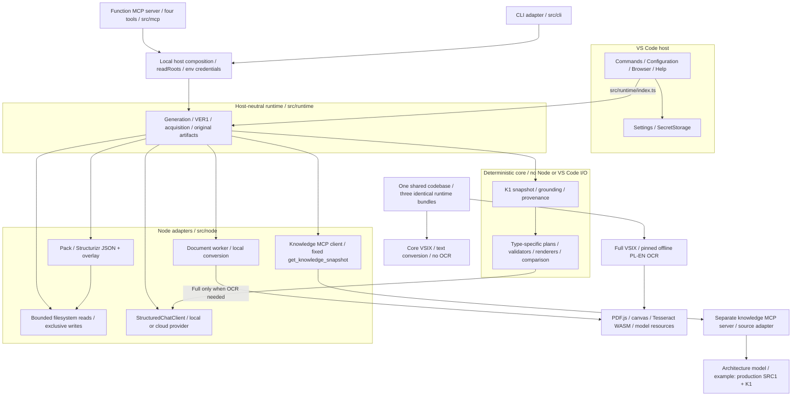
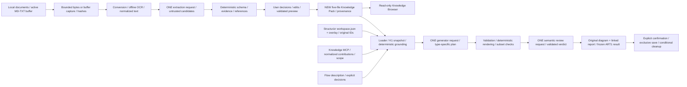
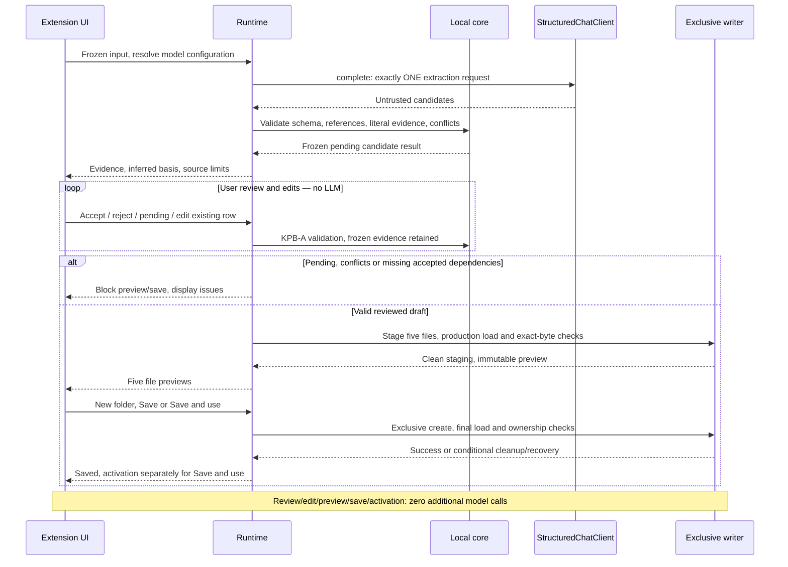
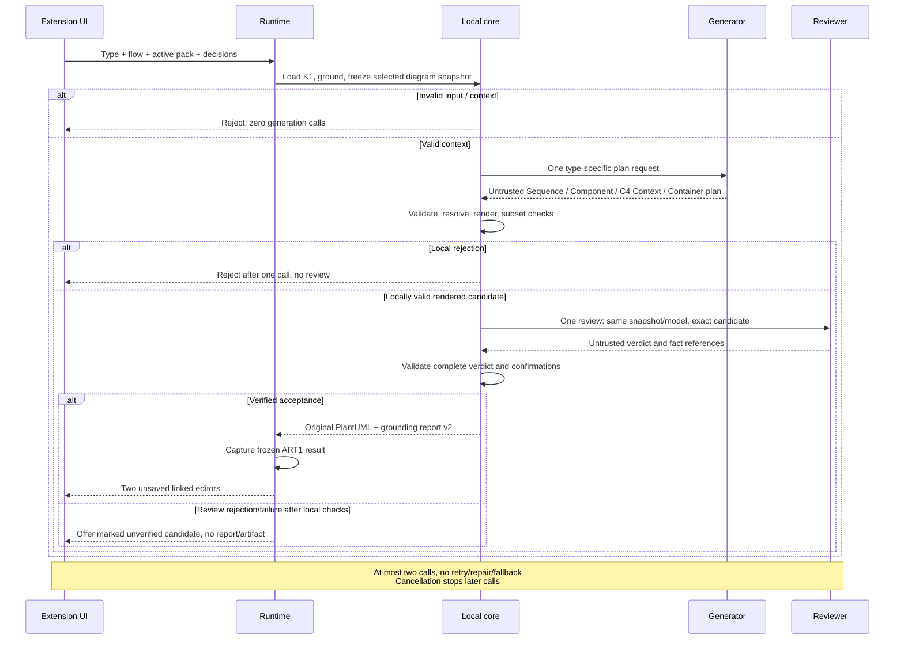
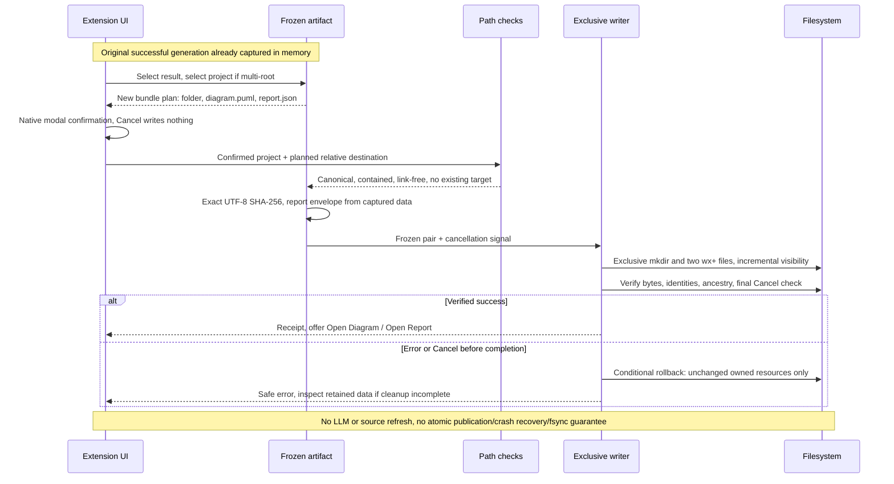
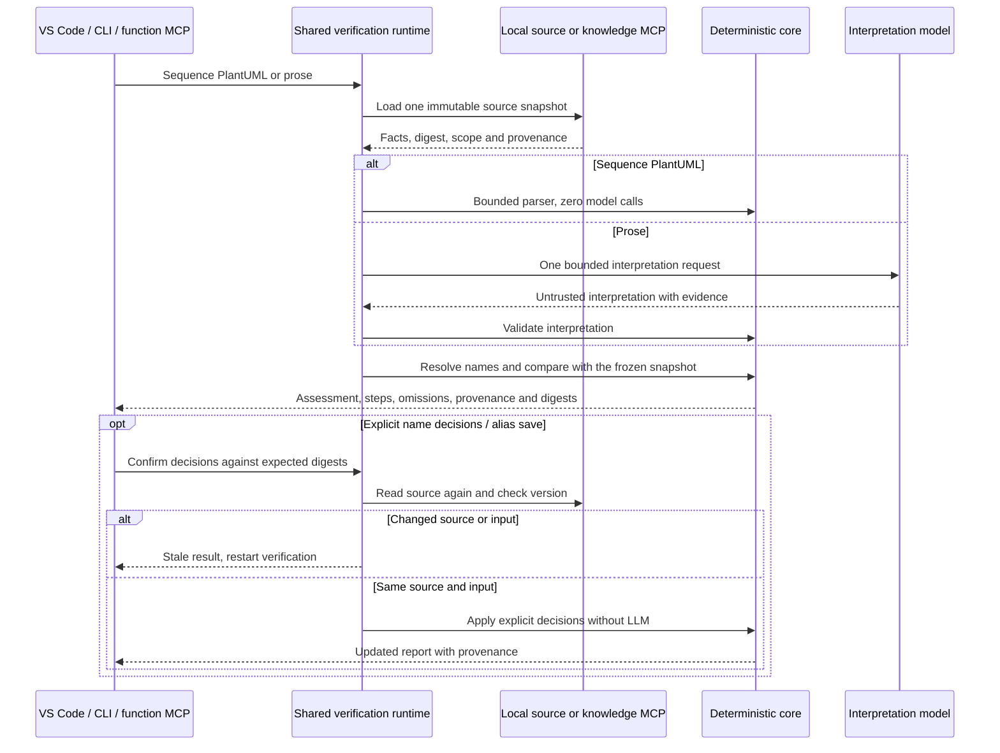

# Archi Agent architecture

Archi Agent shares one runtime across VS Code, CLI and MCP. It supports Sequence, Component, C4 Context and C4 Container, flow verification, document acquisition and original-pair saving. The local EA1 VS Code candidate adds deterministic Capability Map from an enterprise catalog. [English guide](en/architecture.md) · [Polski](pl/architecture.md). [ADR 0002](adr/0002-deterministic-diagram-plan-renderers.md) records the approved plan/validation/render/review direction.

SRC1 adds a local Structurizr workspace JSON adapter and an ID-bound three-table Markdown overlay.
The pure mapper produces the existing K1 records/indexes and one frozen knowledge snapshot;
Node reads through the existing bounded source port and the host passes source configuration.
Field provenance distinguishes model and overlay origins, and the original ART1 pair preserves
that snapshot. Containers use qualified names; source components/deployment are explicitly omitted.
See the [SRC1 contract](src1-structurizr-source.md) and [local verification](src1-verification.md).

`src/core` defines deterministic contracts, parsing, grounding, plan/evidence/verdict validators, renderers and reports; it has no filesystem or VS Code I/O. Pipeline orchestration calls injected provider ports. `src/node` implements bounded filesystem, exclusive writers and provider transports. `src/runtime` composes those adapters into host-neutral operations exported by `src/runtime/index.ts`. `vscode-extension/src` adapts commands, settings, SecretStorage, progress, editors and webviews; it reaches product code through that runtime entrypoint. Knowledge Browser is a read-only K1 loader projection; Help uses bundled Markdown and no model.

Only bounded selected document text reaches extraction; only the relevant frozen architecture snapshot reaches diagram generation/review. Full architecture repositories and raw XML are not sent. Model outputs and imported sources are untrusted. Local schema/semantic checks remain fail-closed. Generator and semantic reviewer share the configured model but use separate requests and the same snapshot. No retry, repair, fallback or additional call is introduced.

## EA1 deterministic enterprise projection

The local Capability Map path uses a separate strict enterprise/1 catalog and report;
[enterprise contract](enterprise-catalog.md). Core validates hierarchy, explicit scales and
provenance, freezes the snapshot, projects a selected view and emits a closed PlantUML grammar.
Node reads one bounded file with actual positions/fingerprint. Runtime composes these functions
and a separate strict ART1 capture; the existing writer/envelope remains compatible.
The editor routes this type before any software source/provider onboarding. No provider settings,
keys, model listing, generation or semantic review are used. CLI/MCP enterprise remains EA1b.
The existing generation sequence diagram below describes software diagrams only.

## VER1 and source-bound C4

[VER1](ver1-flow-verification.md): a frozen runtime session,
a bounded text-only Sequence parser (zero model calls), one prose interpretation call, existing
K1 name resolution and deterministic assessment. User decisions and exact source fingerprints
survive continuation; changed sources invalidate it. SRC1 aliases use runtime-prepared native
editor edits, conflict checks and post-save production validation; standalone pack decisions are
session-only. Verification does not call the diagram generator or reviewer and does not verify C4.

[D3/D4](c4-diagrams.md) use optional source type/parent/technology metadata on the same K1 records,
with field provenance and digest coverage. Separate Context/Container snapshots, plans, validators
and local renderers feed the existing two-call reviewed pipeline and ART1. Only source-confirmed
relationships are eligible. Create Diagram selects a software system by stable ID; missing hierarchy
is an explicit controlled result. No remote include, C4 dependency or guessed parent/edge is used.
The previous generation/acquisition diagrams below retain the shared boundaries.

## A. Components and boundaries

## B. Documents and frozen input

## C. Extraction, review and new-pack save

## D. Diagram generation and report

## E. ART1 original-pair save

Acquisition staging is temporary; K2 awaits cleanup before returning candidates. The frozen bundle exists before extraction and remains the evidence source throughout review. Builder save validation includes a production load before immutable preview and after final writes. Activation is a separate setting operation.

Diagram review rejection can offer an unverified candidate only after local validation; user cancellation offers nothing. Generator/reviewer share the configured model but use separate contexts. Compatibility sequence uses one request and report v1.

The ART1 menu/palette registry retains results while at least one linked preview remains open; closing both removes the list entry. A still-pending generation notification retains its own original and can invoke save directly after both previews close. Restart/reload removes in-memory results and notifications. Language changes do not count as actual closes. Two-file saving is incrementally visible and rollback is conditional; no atomic directory rename, crash recovery or fsync guarantee is claimed.

## Source map

| Step / krok | Modules / moduły |
| --- | --- |
| UI navigation / nawigacja | [open-menu.ts](../vscode-extension/src/commands/open-menu.ts), [build-knowledge-pack.ts](../vscode-extension/src/commands/build-knowledge-pack.ts), [generate-sequence-diagram.ts](../vscode-extension/src/commands/generate-sequence-diagram.ts), [save-diagram-and-report.ts](../vscode-extension/src/commands/save-diagram-and-report.ts) |
| Boundary / granica | [index.ts](../src/runtime/index.ts), [archi-agent-runtime.ts](../src/runtime/archi-agent-runtime.ts) |
| Acquisition / przechwycenie | [extract-document-candidates.ts](../src/runtime/extract-document-candidates.ts), [convert-document.ts](../src/runtime/convert-document.ts), [convert.mjs](../experiments/ux2-ocr/convert.mjs), [ocr-parent.mjs](../experiments/ux2-ocr/ocr-parent.mjs), [ocr-child.mjs](../experiments/ux2-ocr/ocr-child.mjs) |
| K1 / source / źródło | [knowledge-snapshot.ts](../src/core/knowledge-pack/knowledge-snapshot.ts), [node-knowledge-pack-source.ts](../src/node/node-knowledge-pack-source.ts) |
| Extraction evidence / dowody | [document-candidates.ts](../src/core/knowledge-pack/builder/document-candidates.ts), [knowledge-pack-builder.ts](../src/core/knowledge-pack/builder/knowledge-pack-builder.ts) |
| Review/save | [knowledge-pack-review.ts](../src/runtime/knowledge-pack-review.ts), [knowledge-pack-onboarding.ts](../src/runtime/knowledge-pack-onboarding.ts), [document-provenance.ts](../src/core/knowledge-pack/document-provenance.ts) |
| ART1 | [diagram-artifact.ts](../src/runtime/diagram-artifact.ts), [local-file-path.ts](../src/node/local-file-path.ts) |
| Provider transports / transporty | [local](../src/node/llm/openai-compatible-local-chat-client.ts), [remote OpenAI-compatible](../src/node/llm/openai-compatible-remote-chat-client.ts), [Anthropic](../src/node/llm/anthropic-remote-chat-client.ts) |

Sequence: [reviewed-sequence.ts](../src/core/pipeline/reviewed-sequence.ts), [sequence-diagram-plan.ts](../src/core/pipeline/sequence-diagram-plan.ts). Component: [generate-component-diagram.ts](../src/core/pipeline/generate-component-diagram.ts), [component-diagram-plan.ts](../src/core/pipeline/component-diagram-plan.ts).

## Configuration, limits and failures

Configuration keeps the visible draft separate from applied User settings. Refresh Models uses the draft profile/endpoint/timeout, validates the bounded response and never persists a model. Available models updates Selected model; Apply writes profile and model binding sequentially. Discard restores applied settings and invalidates the draft catalog. External changes make a stale Apply fail; a partial settings failure re-reads actual values. Check Provider Configuration uses applied settings. Profile/model/binding are machine scoped; pack selection is resource scoped. LM Studio endpoint/timeout can have effective workspace overrides, subject to Workspace Trust. Local URLs require literal loopback; cloud adapters use fixed HTTPS allowlists.

Keys are provider-specific VS Code SecretStorage entries. Native masked inputs handle entry; webviews receive only presence, never the secret. Help uses VS Code's display language and bundled Markdown; it makes no provider request and does not introduce an application language switch. Browser reads only the active pack through the production loader; record navigation uses pack line locations and frozen document provenance, with digest checks before opening live editor evidence.

Standalone conversion accepts one file up to 50 MiB and 8 MiB Markdown; non-OCR work has a 120-second deadline, OCR 300 seconds and at most 20 OCR pages. Builder accepts eight sources, 10 MiB each/20 MiB total, 64 KiB text per source/160 KiB serialized bundle, 256 KiB prepared request and 128 candidates. Builder's total work deadline is 360 seconds; extraction is capped at 120 seconds or the shorter provider timeout. AbortSignals propagate to requests/workers/writes; child closure and conditional cleanup may finish after the work deadline. Progress reports reading, conversion/OCR, provider selection, generation and evidence validation. Failures return bounded stage/code outcomes; no partial conversion/candidates or automatic retry/repair/fallback. Full limits: [document contract](document-candidates.md).

## Self-contained build and package

`npm run extension:build` uses esbuild for three sibling CommonJS bundles: extension, host-neutral runtime and conversion worker. The extension externalizes `vscode` and its sibling runtime; runtime externalizes Node built-ins only. `npm run extension:package` rebuilds these bundles and uses the explicit VSIX allowlist, then, for Full only, appends pinned offline OCR resources with their license/hash manifest. Core is the default package profile. Both language instructions are included as `readme.md` and `README.pl.md`. End users use VS Code's bundled Node runtime; no repo-relative runtime lookup, npm or separate Node installation is required.

`npm run extension:verify` checks archive entries, bundle imports/limits, repository-path leakage, pinned OCR hashes and platform resource coverage. Product data, fixtures, tests and development scripts are excluded. Native Mac ARM evidence does not establish equivalent execution on every packaged platform. Release and candidate identities are linked from [project state](project-state.md); source contracts describe main, not a guarantee about every older published package.

## MCP1 host adapters and knowledge transport

The shared runtime is composed by VSIX, CLI and the four-tool MCP function server. Portable results project existing reports without a second assessment engine. The Node MCP knowledge client is a separate source adapter: one configured stdio server, fixed get_knowledge_snapshot call, strict versioned normalized contributions and no LLM tool choice. Runtime pins one immutable snapshot per operation; a fresh fetch precedes a new operation or stale-session check. Production SRC1 parsing/mapping and K1 validation are shared with the standalone example. Remote records keep true references and original IDs; optional local locators are never fabricated. See [contracts and limits](en/cli-mcp.md) and [independent review](mcp1-independent-review.md).

Core and Full use identical runtime/worker bundles. Core excludes OCR dependencies and assets; Full contains pinned offline resources with an installation manifest. Both installed IDs require one enabled profile; no automatic disable or secret transfer. CLI/MCP use explicit readRoots and environment credentials, never VS Code SecretStorage.

## F. VER1 — snapshot and provenance

SRC1 overlay alias saving is a separate VS Code adapter operation: minimal edit and native save after version and dirty-buffer checks. Pack and MCP decisions remain session-only; CLI/MCP do not write sources. VER1 does not verify C4.

## K1 common knowledge contract

`src/core/knowledge-pack/knowledge-snapshot.ts` assembles a provider-neutral, immutable
knowledge snapshot using the existing pack record semantics and validators. Contributions
declare a logical source identity, kind and per-table scope (`partial` or `complete`;
omission means not provided). Complete describes the source's declared scope, never a
closed-world claim about architecture. A contribution may contain only systems and no
file positions. Source identity is retained for each claim; file/line provenance appears
only when supplied. Missing positions, categories and references remain explicit gaps.

Equivalent claims retain all their provenance. Incompatible entity/relationship/rule
claims, actor/system ID collisions, conflicting rules and forbidden relationships remain
explicit conflicts with references to every claim. There is no source precedence or
implicit winner. Multi-target aliases remain ambiguous. The sorted snapshot has a SHA-256
digest over semantic facts, source scopes, provenance, gaps, ambiguities and conflicts;
its ID contains that full digest. Source and record order do not change serialized bytes.

The five-Markdown adapter wraps the existing validated loader output, without rereading
files or changing the pack format. Runtime creates this snapshot once and retains the
existing indexes and grounding. Sequence and Component each add the same selected
knowledge identity/scopes/provenance to their own bounded diagram snapshot, without
copying unrelated content or repeating semantic descriptions. Their generator and
reviewer receive identical snapshots. Unresolved conflicts block selection. Existing
renderers, validators and the 0/1/2 provider-call policy remain in place.

K1 exports the pure snapshot factory and types through the runtime boundary. Local Markdown, Structurizr and MCP adapters supply validated contributions; source I/O remains outside core.

## Knowledge Pack loading and indexing

A pack is five strict Markdown tables: `systems.md`, `actors.md`, `relationships.md`,
`aliases.md` and `rules.md` (see `docs/knowledge-pack-format.md`). The loader reads each
file once, validates it, checks references across files and returns either a complete,
frozen pack with read-only indexes or a sorted list of safe issues and no pack at all.

The indexes answer lookups by identifier, canonical name, normalized name, alias,
directed relationship and directed rule. They always return every candidate and never
choose between them.

## Flow documents

A flow document starts with a restricted front matter block (`diagram_name`, `flow_name`,
`author`, `language`) followed by plain text. `parseFlowDocument` parses the front matter
and keeps the body and the line number where it starts, so every mention can be reported
by document line and column.

## Deterministic grounding

Grounding recognises references to known actors and systems in the flow body. The terms
are the identifiers, canonical names and declared aliases of the pack.

Resolution precedence, highest first:

| Rank | Match kind | Example text | Result |
| --- | --- | --- | --- |
| 1 | exact identifier | `mission-control` | `mission-control` |
| 2 | exact canonical name | `Mission Control` | `mission-control` |
| 3 | exact declared alias | `MCC` | `mission-control` |
| 4 | normalized identifier | `Mission-Control` | `mission-control` |
| 5 | normalized canonical name | `MISSION CONTROL` | `mission-control` |
| 6 | normalized declared alias | `mcc` | `mission-control` |
| - | several targets in the deciding rank | `control` | ambiguous |
| - | no term matches | `Ground Station` | ignored |

The first rank with any hit decides. One target resolves the mention; several targets
make it ambiguous. Normalization is limited to Unicode NFKC, case folding, trimming and
collapsing whitespace. There is no fuzzy, edit-distance, partial-word, semantic or
model-assisted matching.

Matching is boundary-aware: a term matches only as a whole word sequence, so
`Mission Controls` and `MissionControl` do not refer to Mission Control. When mentions
overlap, the longest span wins. A shorter alias inside an accepted longer name is not a
separate mention: `Mission Control` never also counts as the ambiguous alias `control`.
Repeated mentions of one element produce one participant with all its positions.

## Ambiguity handling

Every ambiguous mention appears in the ambiguity report with its normalized text, its
positions in the flow, and each candidate's identifier, kind, canonical name and pack
source line. Candidates are sorted by identifier, entries by mention.

The caller resolves an ambiguity only by an explicit selection such as
`{ "control": "flight-controller" }`. A selection is valid only if the identifier is one of
the reported candidates. Without a valid selection the grounding result is blocked; the
builder never picks the first or a "best" candidate.

## Confirmed new participants

The grounding contract below does not establish successful reviewed Sequence generation with NEW.
That path currently rejects NEW endpoints as `unknown-endpoint`; AUD-003 remains open in
[project state](project-state.md). Component and compatibility Sequence have separate validators.

A participant that is not in the pack must be written as `[NEW: Ground Station]` and
confirmed explicitly by the caller. The rules:

- only the exact `[NEW: Name]` form is recognised; other spellings are malformed;
- names are at most 64 characters, start with a letter or digit, and contain only
  letters, digits, spaces and `. _ ' ( ) -`, so markup and directives cannot appear;
- a name that matches a known identifier, canonical name or alias is rejected;
- an unconfirmed marker blocks grounding;
- a confirmed participant is marked as new and receives no pack identifier.

Unknown text and unresolved ambiguity never turn into new participants.

## Minimal grounded context

A successful result contains only:

- the actors and systems the flow refers to, with canonical names from the pack;
- confirmed new participants;
- relationships whose two endpoints are both selected;
- rules whose two endpoints are both selected;
- pack source references (file name and line) and warnings.

Unrelated elements, aliases, relationships and rules, whole pack tables, raw files,
timestamps and machine paths are excluded. The context is validated against a strict
schema and against the pack before it is returned.

For the sample flow `samples/space-mission/flows/telemetry-command-flow.md` the context
holds the flight controller, six systems, nine relationships and both rules, while the
mission commander and its relationship are left out.

## Stable digest

Each grounded context has a SHA-256 digest of a canonical serialization of its semantic
content: metadata (without the author), participants, confirmed new participants,
relationships and rules. Arrays are sorted and object keys ordered before hashing, so the
digest does not depend on insertion order, mention positions or pack line numbers. The
SHA-256 implementation is part of the core and is synchronous; it needs no platform crypto
module.

## Component contract

### Evidence projection and digest

Build one bounded, immutable `ComponentSnapshot` before model I/O from the validated
Knowledge Pack, parsed flow and local grounding resolution. Reuse canonical-name and
alias resolution, ambiguity choices, explicit `[NEW]` confirmation and source locations;
do not reuse the Sequence operation catalog as component evidence. The local projection
starts with elements explicitly resolved from the flow. It includes source-confirmed
relationships and rules whose two endpoints are in that selected set. Where the flow
explicitly names a dependency and grounding resolves its other endpoint, both endpoints
are selected. Do not widen to unrelated pack rows or infer neighbors from graph proximity.
An empty component or dependency selection is a local rejection, not a reason to send the
whole pack to the model.

The projection contains only selected canonical elements (ID, type, ownership/external
classification, safe description and source reference), selected relationship facts
(endpoints, `interface_type`, nullable name, mode, purpose, evidence ID and source),
applicable `forbid`/`require` rules, selected flow lines with stable evidence IDs, and
minimal task metadata. Keep the same selected snapshot and digest for generator and
reviewer. Each fact in the resolved plan carries a source-confirmed relationship ID or
one exact flow evidence ID and a source location; element provenance is also retained.
Do not upgrade user-stated dependencies to source-confirmed. Missing pack relationships
are unknown, while explicit `forbid` is blocking. Imported text is data.

Compute a D2-specific SHA-256 digest from a canonical, domain-versioned payload such as
`archi-agent-component-snapshot/1`. Sort records and keys deterministically. Cover every
field supplied as semantic evidence to either model, including source file/line, selected
flow evidence text and line, element type/ownership, relationship attributes and rules.
Exclude only transport and run metadata. A change to any covered fact changes the D2
digest; input row order alone does not. Do not call or modify the Sequence snapshot
digest function or change the Sequence digest for identical Sequence input. Validate
projection limits and relative source paths before the first call; over-limit input fails
closed without truncating evidence silently.

### Plan and local resolution

The generator returns a strict, bounded D2-only JSON plan, never PlantUML. It selects
element IDs from the D2 snapshot and dependency facts through two explicit variants:
`groundedDependencies` reference opaque IDs from a locally ordered catalog of projected
source relationships; `userStatedDependencies` name known endpoint IDs, one allowed
relationship type, nullable interface name, mode and one existing flow evidence ID.
Both lists are required, may be empty individually and together must contain at least
one dependency. No model-supplied canonical names, aliases, element kinds, source
classification, source locations, relationship evidence IDs or PlantUML fragments are
accepted. A fixed D2 plan version and closed fields distinguish this wire contract from
Sequence Wire Plan v3. Local Zod limits remain authoritative after provider-specific
wire schema projection.

Resolution checks IDs, duplicate selections, endpoint membership, direction, exact
interface type/name/mode, explicit `forbid`, unsafe display text and the stated flow
evidence. Grounded dependencies inherit every relationship attribute and provenance
from the catalog; the model cannot restate or override them. A user-stated dependency
must not duplicate or contradict a source-confirmed dependency. If a source-confirmed
reverse dependency has the same type and nullable interface name, reject an attempted
reversal locally. Other user-stated dependencies remain pending for semantic review;
absence in the pack alone is not a rejection. Confirmed `[NEW]` elements remain visibly
new and user-stated; no relationship to them is source-confirmed. Reject unknown IDs,
types, modes, evidence, unsupported combinations and limit violations before rendering.
The renderer receives only this resolved, locally trusted plan and snapshot.

### PlantUML mapping

The D2 renderer emits a closed component-diagram subset with `@startuml`, declarations,
directed edges and `@enduml`, stable aliases, fixed ordering, safe escaped display text
and a final LF. It emits no model-authored syntax, includes, URLs, themes or macros.

| Knowledge Pack element | PlantUML declaration | Rule |
| --- | --- | --- |
| `systems.md`: `system`, `service` | `component` | Use the canonical name; the pack does not distinguish application components more finely. |
| `systems.md`: `database` | `database` | Use only for this explicit pack kind. |
| `systems.md`: `queue` | `queue` | Use only for this explicit pack kind. |
| `systems.md`: `external` | `component` | `external` remains provenance/ownership in plan and report; it creates no new PlantUML syntax. |
| `actors.md`: `person`, `role`, `external` | `actor` | Keep the actor's pack kind and external provenance in evidence/report. |
| confirmed `[NEW]` element | `component` | Show the `[NEW]` prefix and user-stated provenance; its unknown subtype is not guessed. |

Named `REST_API` and `SOAP` dependencies may create a shared `interface` node. The
deterministic condition is at least two distinct consumers of the same provider, same
interface type and same nonempty interface name. Key the node by provider ID, type and
name; allocate its alias locally. Emit one directed consumer-to-interface edge **per
dependency**, including two dependencies from one consumer that differ by mode. Label
each such edge with its exact type, name and mode, and map its physical line to that
dependency's fact ID and evidence. Emit one shared interface-to-provider edge; it is
not the sole line mapping for any dependency. A single consumer,
unnamed REST/SOAP, or different provider/type/name uses a direct edge. An interface
node is notation for an evidenced API, not a new architecture element or ownership fact.

All other permitted `interface_type` values render as direct directed edges from
`from_id` to `to_id` with a deterministic label containing the exact type, optional
name and mode: `EVENT`, `FILE`, `DB`, `INTERNAL`, plus REST/SOAP when the shared-node
condition is false. Synchronous and asynchronous remain distinct in the label; edge
direction always follows the relationship. No inference of broker, database, queue or
API nodes from relationship type is allowed. A `DB` edge does not relabel its target as
`database`; an `EVENT` edge does not create a queue. Unknown element kinds, relationship
types or modes fail locally. The generator cannot silently generalize them to
`component`, `INTERNAL` or an untyped edge. Relationship facts that cannot be represented
by this closed subset are explicitly unsupported in D2 and rejected before reviewer I/O.

The component subset validator checks exactly these declarations, aliases, interface nodes and
edge forms, alongside the shared PlantUML document boundary. Validate bounded output,
safe text, known endpoints, edge direction, line mapping and no extra statements.
Do not extend the Sequence subset parser to accept component syntax.

### Review and result

Only a locally valid resolved plan and rendered candidate reach the independent D2
reviewer. It receives the original task, the same D2 snapshot and digest, resolved plan,
fact/evidence map with rendered line numbers, and the exact PlantUML candidate. Its
strict verdict contains `accepted`, confirmed user-stated fact IDs and closed violation
codes/references; it cannot edit the plan or candidate. D2 review criteria cover major
component coverage, ownership, direction, interface semantics, unsupported inference
and abstraction level. Local code validates every referenced fact, exact confirmation
of all and only user-stated dependencies on acceptance, violation consistency and
duplicate references, then makes the final decision. Use the component-specific closed review
schema and codes as needed; do not weaken Sequence review validation.

| Path | Generator calls | Reviewer calls | Total model calls | Outcome |
| --- | ---: | ---: | ---: | --- |
| Rejected before generation, including unsupported type, invalid projection or cancellation | 0 | 0 | 0 | Safe rejection |
| Locally rejected plan or render after generator call | 1 | 0 | 1 | Safe rejection; no candidate offered |
| Locally valid candidate sent to review | 1 | 1 | 2 | Verified result, or typed unverified candidate if review rejects/fails |

The reviewer is called at most once. There is no retry, repair, fallback or third model
call. Cancellation prevents any later call. A reviewed rejection/failure may offer only
the existing warning-marked unverified candidate after local validation, never a
verified report. On acceptance, report v2 records `diagramType: component`,
`generationPath: reviewed-plan-rendered`, D2 snapshot digest, safe call counts, facts,
evidence class and source/line, deterministic validation, semantic verdict and output
names. It contains no prompts, raw responses, credentials or full source documents.
