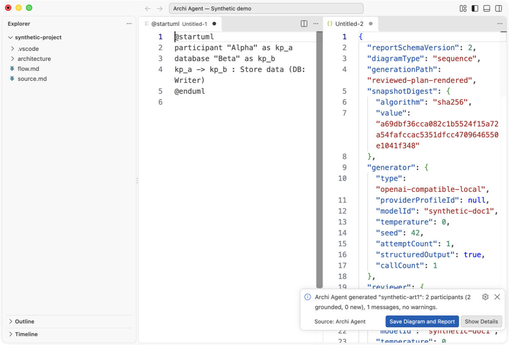
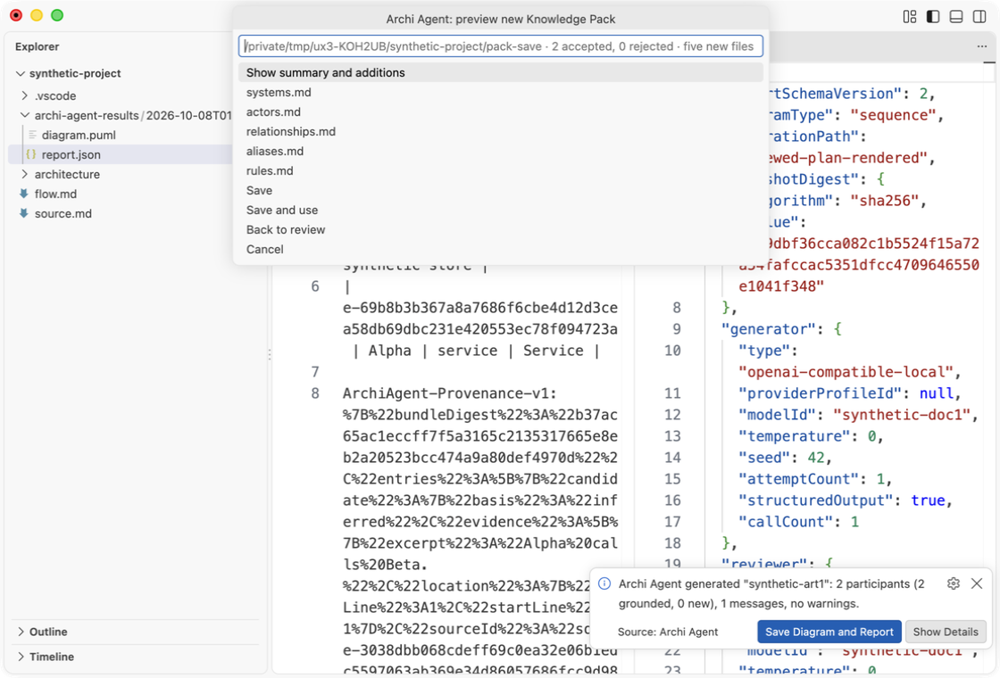
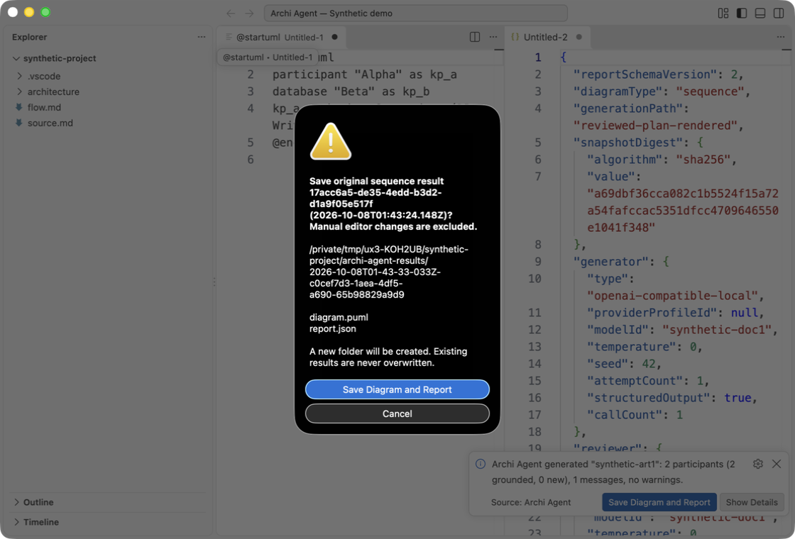

# Historical DOC1 UI demonstrations / Historyczne demonstracje UI DOC1

**These preserved recordings show DOC1 picker screens, not the new UX4 Configuration/Review screens. Follow the updated user guides. / Zachowane nagrania pokazują pickery DOC1, nie nowe ekrany Configuration/Review UX4. Używaj aktualnych instrukcji.**

[English user guide](../en/user-guide.md) · [Polska instrukcja](../pl/user-guide.md)

Three short recordings show real desktop VS Code controls, including native file pickers and ART1 confirmation, on a synthetic Alpha/Beta project in an isolated profile. The UI stays in English. A controlled loopback transport returns synthetic extraction, generation and reviewer responses. These are agent UI demonstrations, not evidence of live LLM quality, performance or owner smoke. No personal profile, keys or client documents are used. / Trzy krótkie nagrania pokazują prawdziwe kontrolki desktopowego VS Code, natywne pickery i potwierdzenie ART1 na syntetycznym projekcie Alpha/Beta w izolowanym profilu. UI pozostaje angielskie. Kontrolowany loopback zwraca syntetyczne odpowiedzi ekstrakcji, generatora i reviewera. To demonstracje agenta, nie dowód jakości/wydajności żywego LLM ani owner smoke. Bez osobistego profilu, kluczy i dokumentów klienta.

## Choose a pack and generate / Wybierz pack i wygeneruj

[GIF](choose-pack-generate.gif) · [Static preview / statyczny podgląd](choose-pack-generate.png)

Run Configure Knowledge Pack, choose Choose Existing and Alpha/Beta's folder. Run Generate Diagram, choose Sequence and Choose a flow file, select `flow.md`, then inspect the two result editors. / Uruchom Configure Knowledge Pack, wybierz Choose Existing i folder Alpha/Beta. Uruchom Generate Diagram, wybierz Sequence i Choose a flow file, wskaż `flow.md`, sprawdź dwa edytory wynikowe. One generator and one reviewer request / jedno żądanie generatora i jedno reviewera.

## Documents, review, save / Dokumenty, review, zapis

[GIF](documents-review-save.gif) · [Static preview / statyczny podgląd](documents-review-save.png)

Run Build Knowledge Pack from Documents; select `source.md` with `Alpha calls Beta.` Read details, edit Beta's description to `Edited synthetic store`, accept pending rows, Validate and preview, select the parent and new `pack-save` folder, inspect `systems.md`, then Save. The original active pack remains unchanged. / Uruchom Build Knowledge Pack from Documents; wybierz `source.md` z tekstem `Alpha calls Beta.` Sprawdź szczegóły, zmień opis Beta na `Edited synthetic store`, zaakceptuj pending, wybierz Validate and preview, folder nadrzędny i nowy `pack-save`, sprawdź `systems.md`, następnie Save. Aktywny pack się nie zmienia. One extraction request; zero extra review/edit/save requests / jedno żądanie ekstrakcji; zero dodatkowych żądań review/edycji/zapisu.

## Save the original pair / Zapisz oryginalną parę

[GIF](save-original-pair.gif) · [Static preview / statyczny podgląd](save-original-pair.png)

Run Save Diagram and Report, select the completed Sequence result, read the native confirmation of the new folder and two filenames, confirm Save Diagram and Report, then Open Report. The saved `diagram.sha256` was checked against actual UTF-8 bytes. / Uruchom Save Diagram and Report, wybierz ukończony wynik Sequence, przeczytaj natywne potwierdzenie nowego folderu i dwóch nazw plików, potwierdź Save Diagram and Report, następnie Open Report. `diagram.sha256` sprawdzono względem rzeczywistych bajtów UTF-8. Zero additional provider requests / zero dodatkowych żądań providera.

## Provenance and reproduction / Pochodzenie i odtworzenie

[Machine-readable provenance and SHA-256 / metadane i SHA-256](provenance.json) record the product source commit, exact recorded VSIX checksum/size, scenario, synthetic transport, capture method, timing, frame counts, encoding parameters, harness hash and final GIF/preview hashes. The product base is FU-01 `a76b15ca822364810edb0298852db70437f73e9d`; DOC1 changes only docs/license/package tooling. Final ignored evidence binds the local checkpoint separately. / Metadane zapisują commit bazy produktu, dokładny VSIX, scenariusz, transport, capture, czas, klatki, parametry, hash harnessu i finalnych mediów. DOC1 zmienia dokumentację/licencję/narzędzia pakowania; finalne lokalne dowody osobno wiążą checkpoint.

Use [local tooling instructions](../../scripts/docs/README.md). Raw recordings, failed attempts and isolated profiles stay outside tracked product files. Final evidence is in `build/docs-pl-en/run-2026-10-07T19-28-51Z/`; earlier candidates and historical audits are retained. GIF timing follows measured frames sampled to 1 fps (up to one second of rounding); there is no speed-up or reordered action. Captures sample the owned VS Code window, not the desktop; frame sampling does not show every keystroke. / Użyj instrukcji narzędzi. Surowe nagrania, nieudane próby i profile nie trafiają do śledzonych plików produktu. Czas GIF-ów odpowiada klatkom, bez przyspieszania i zmiany kolejności. Capture dotyczy własnego okna VS Code, nie pulpitu; próbkowanie nie pokazuje każdego naciśnięcia klawisza.

Read the complete [EN](../en/user-guide.md) / [PL](../pl/user-guide.md) text instructions for limitations, errors, Cancel, dependencies and frozen originals. GIFs are supplements. / Pełne instrukcje tekstowe opisują ograniczenia, błędy, Cancel, zależności i zamrożone oryginały. GIF-y są dodatkiem.

OWNER_SMOKE: DEFERRED

Native picker frames are cropped to their actual content and action buttons, excluding the system sidebar with personal home/network labels. The crop uses local macOS Vision only to identify picker frames; no UI is redrawn and no OCR text is saved. Full owned-window capture is used for other frames. / Klatki natywnych pickerów są kadrowane do rzeczywistej zawartości i przycisków, bez systemowego paska z osobistymi etykietami katalogu domowego/sieci. Lokalny Vision tylko rozpoznaje klatki pickera; UI nie jest odrysowywane i tekst OCR nie jest zapisywany. Pozostałe klatki pokazują własne okno.

Cropping also covers two adjacent raw samples around detected pickers, so translucent presentation/dismissal frames exclude the personal sidebar too. / Kadrowanie obejmuje też po dwie sąsiednie surowe klatki wokół rozpoznanych pickerów, aby wyłączyć osobisty sidebar podczas półprzezroczystego otwierania/zamykania okna.
