# Aktualne ekrany / Current screens

[README EN](../../../README.md) · [README PL](../../../README.pl.md) · [Help EN](../../en/user-guide.md) · [Help PL](../../pl/user-guide.md)

Rzeczywisty VS Code 1.141.0 na macOS 26.6.2 ARM64, izolowany profil i syntetyczny projekt Alpha/Beta. ScreenCaptureKit przechwytuje okno przypisane do PID. Transport modeli/listingu jest syntetyczny i lokalny; OCR wykonano rzeczywiście z zasobów VSIX. / Actual VS Code 1.141.0 on macOS 26.6.2 ARM64, isolated profile and synthetic Alpha/Beta project. ScreenCaptureKit captures the owned PID window. Model/list responses are synthetic and local; OCR actually uses VSIX resources.

14 PNG. Bez generowania lub odrysowania UI, danych klienta i osobistego profilu. / 14 PNG files, without generated/redrawn UI, customer data or a personal profile.

[Provenance i SHA256 każdego obrazu / per-image provenance and SHA256](provenance.json). Komplet zawiera obrazy z kilku przebiegów. Niektóre próby zatrzymał harness po wykonaniu poprawnych zdjęć; ich statusy pozostają w metadanych. / Images come from several runs. Some acquisition attempts failed after valid captures; their run statuses remain in metadata.

Te demonstracje nie dowodzą jakości żywego LLM ani owner smoke. Help pochodzi z nieopublikowanego alpha6-preview1 (hash paczki i obu instrukcji w provenance); sprawdzono rzeczywiste EN→PL→EN i wszystkie lokalne obrazy. / Help is captured from unpublished alpha6-preview1 (package and both instruction hashes in provenance); actual EN→PL→EN switching and all local images were checked.

UI poza Help pochodzi z alpha.5; byte parity z finalnym prerelease jest sprawdzana osobno. Historyczne animacje DOC1 w katalogu nadrzędnym pozostają historią. / These demonstrations establish neither live-model quality nor owner smoke. Non-Help UI is from alpha.5; byte parity with the final prerelease is checked separately. Parent-directory DOC1 animations remain historical.

## 01-open

Wybierz czynność z Archi: Open. / Choose a task in Archi: Open.

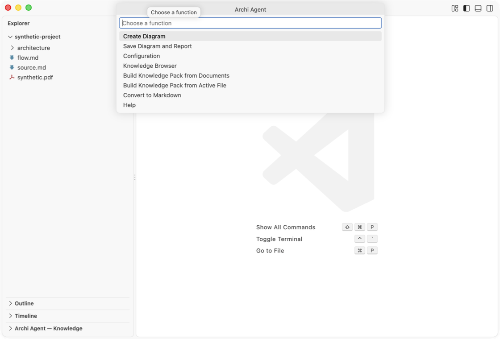

## 02-provider

Odczytaj modele, wybierz ID i zastosuj profil. / Refresh models, choose an ID and apply the profile.

## 03-knowledge

Wybierz i zwaliduj aktywny pack. / Choose and validate the active pack.

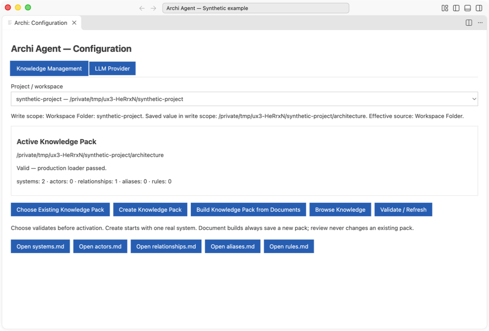

## 04-browser

Przeglądaj systemy i ich relacje. / Browse systems and their relationships.

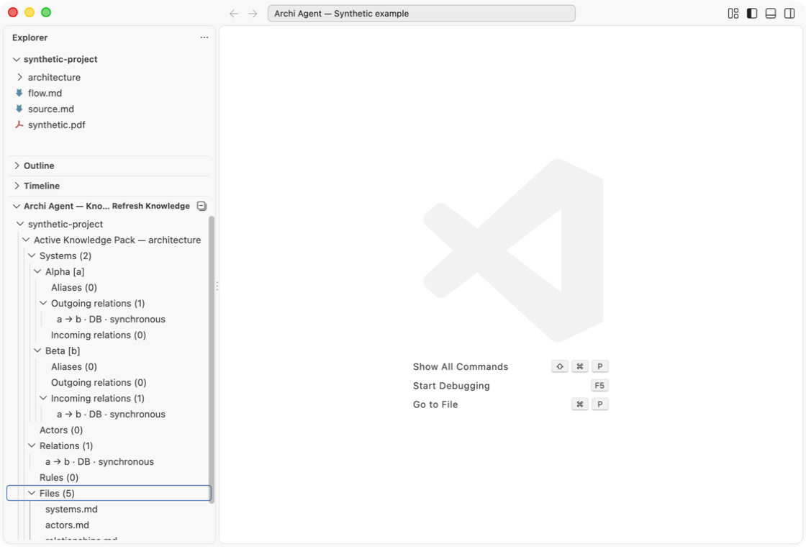

## 05-review

Podejmij decyzje dla propozycji wiedzy. / Decide proposed knowledge rows.

## 06-edit

Edytuj proponowany opis przed akceptacją. / Edit a proposed description before acceptance.

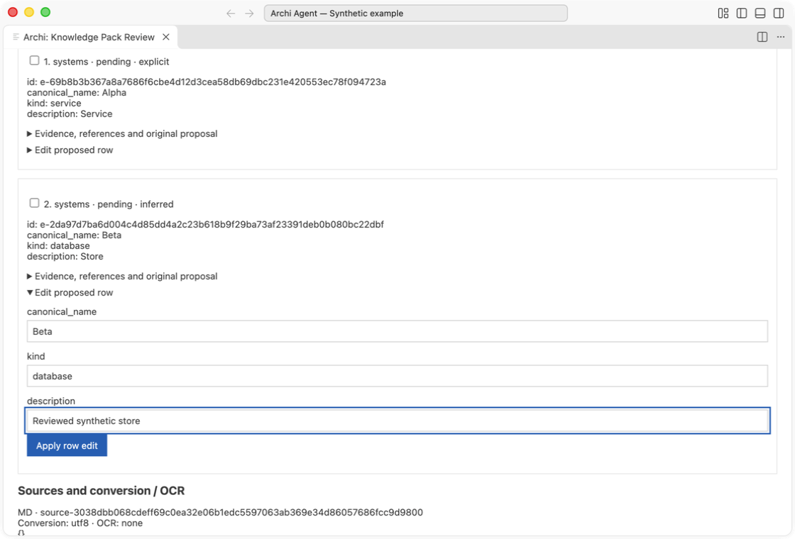

## 07-pack-preview

Sprawdź pięć podglądów i nową lokalizację; capture anuluje zapis packa. / Inspect five previews and a new destination; capture cancels the pack save.

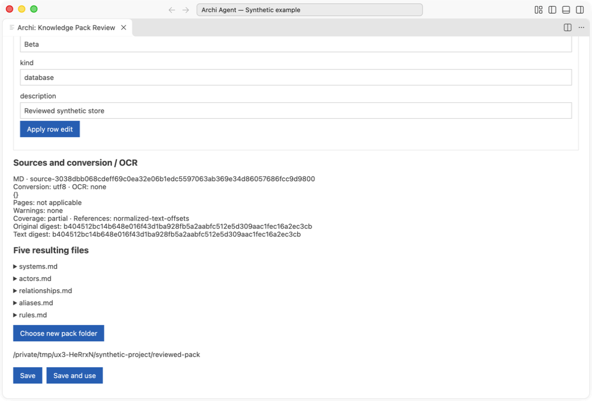

## 08-sequence

Obejrzyj Sequence i raport grounding. / Inspect Sequence and its grounding report.

## 09-component

Obejrzyj Component i powiązany raport. / Inspect Component and its linked report.

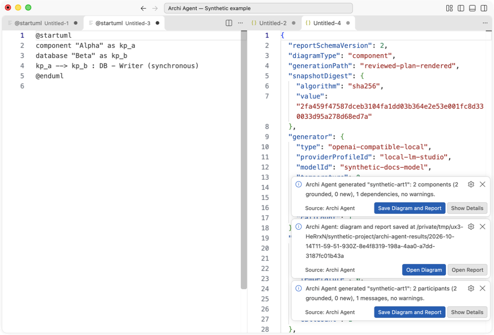

## 10-save

Potwierdź zapis oryginalnej pary diagram/raport; zapis i hash zweryfikowano. / Confirm saving the original diagram/report pair; actual files and hash were verified.

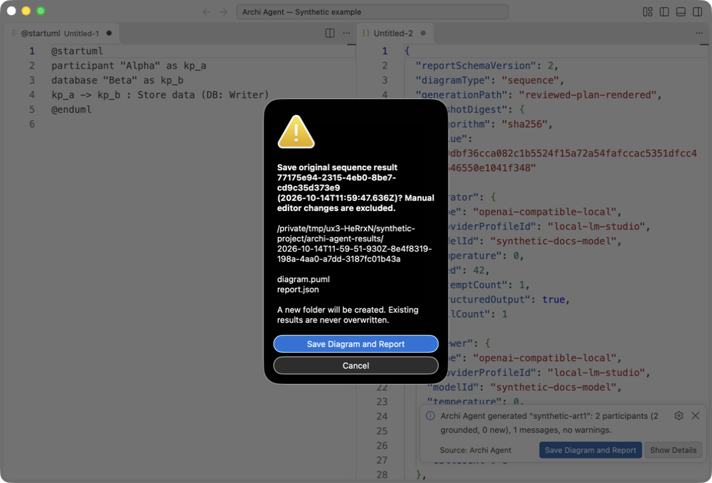

## 11-conversion

Odczytaj wynik lokalnego OCR PDF. / Read the result of local PDF OCR.

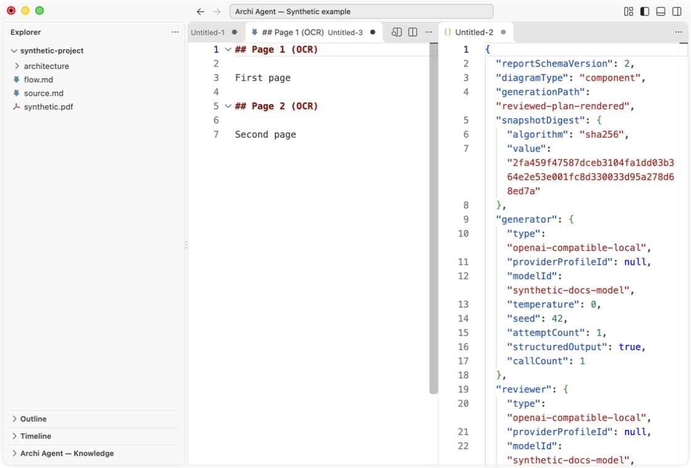

## 12-help

Otwórz help z zainstalowanego VSIX. / Open Help from the installed VSIX.

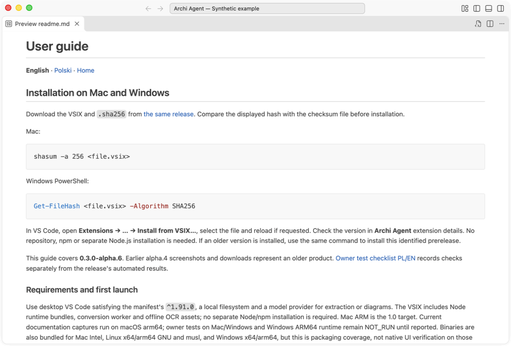

## 13-ocr

Wybierz tryb lokalnego OCR PDF. / Choose a local PDF OCR mode.

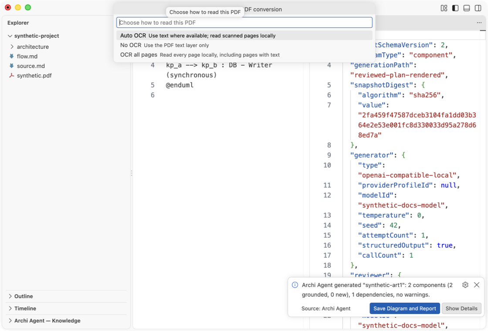

## 14-help-pl

Przełącz na polski help lokalnym odnośnikiem. / Switch to Polish Help using the local link.

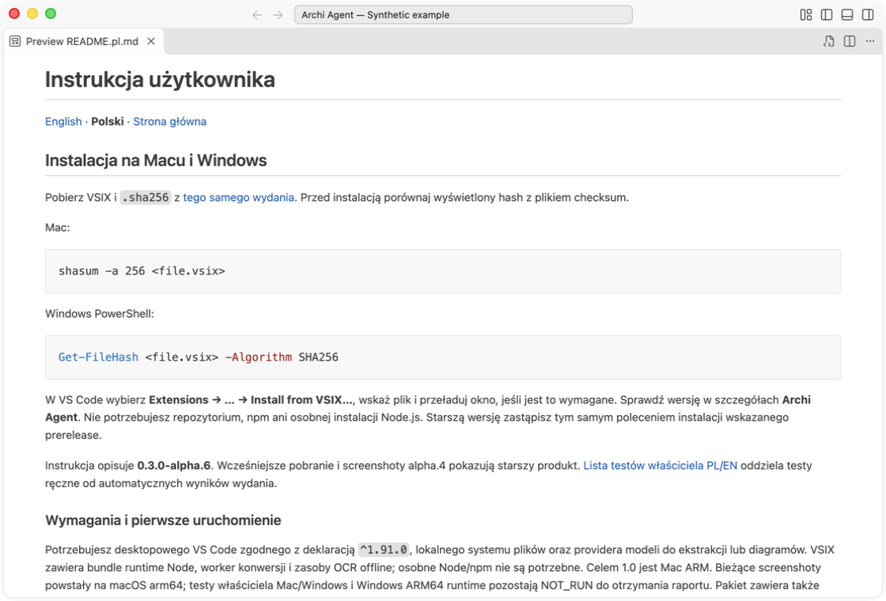
