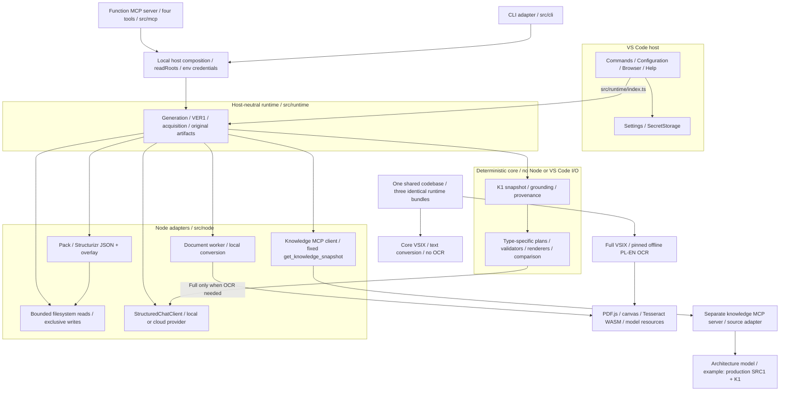
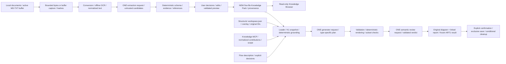
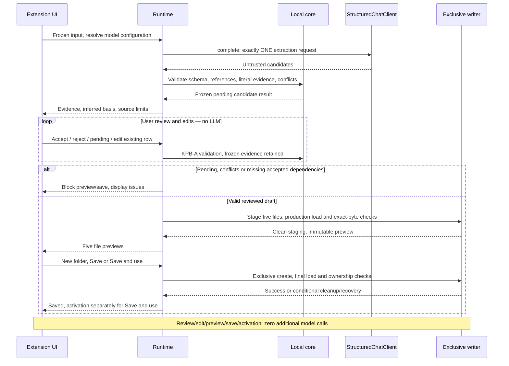
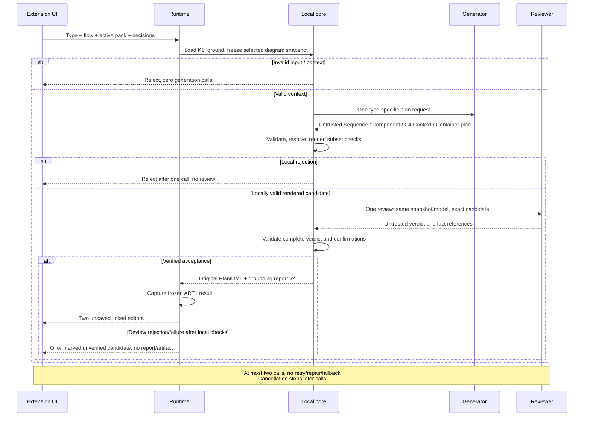
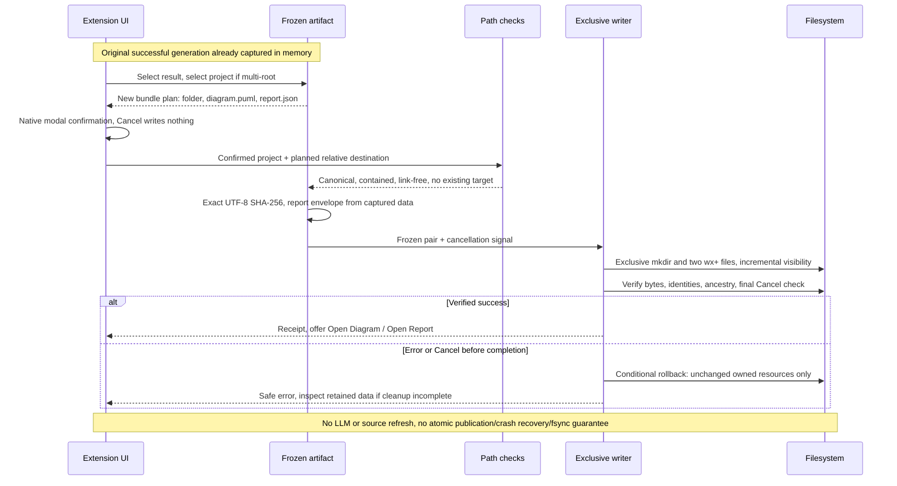
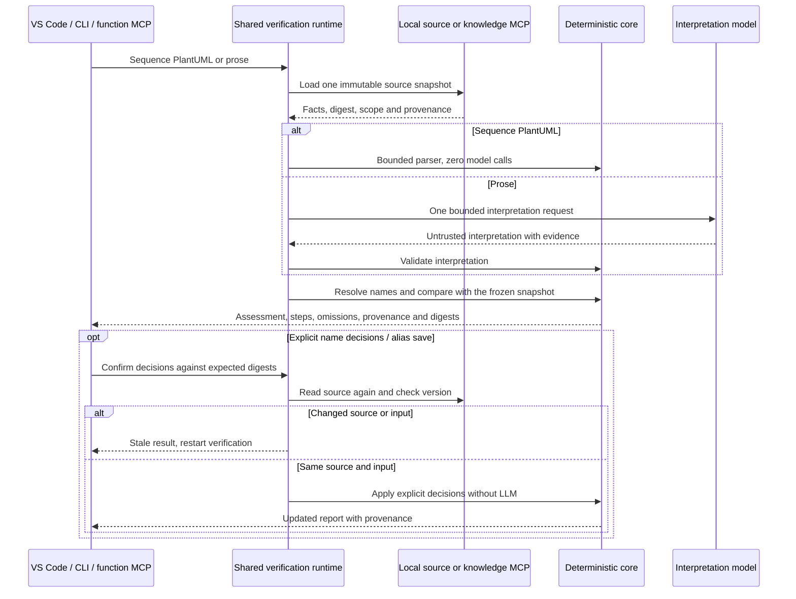

# Architecture overview

**English** · [Polski](../pl/architecture.md) · [User guide](user-guide.md)

Archi Agent keeps the editor host thin. Core owns deterministic knowledge, grounding, validation and rendering; Node adapters provide bounded file access, conversion and model transports. The shared runtime composes these operations for VS Code, CLI and MCP. Only the selected evidence reaches a model. Imported content and model answers remain untrusted.

The diagrams below explain the implemented flows. Detailed interfaces, limits and failure contracts live in the [technical architecture](../architecture.md). [Diagram profiles](../diagram-profiles.md) explain which view to choose.

The local EA1 candidate adds a separate deterministic enterprise catalog projection for Capability Map. It needs no provider, software pack or model, and uses its own provenance report with ART1. [Enterprise contract](../enterprise-catalog.md). The six software flow diagrams below keep their existing meaning.

## A. Components and boundaries

## B. Documents and frozen input

## C. Extraction, review and new-pack save

## D. Diagram generation and report

## E. ART1 original-pair save

## F. VER1 — snapshot and provenance

## Technical references

[Host and packaging](../vscode-extension.md) · [Sources](../src1-structurizr-source.md) · [Flow verification](../ver1-flow-verification.md) · [C4](../c4-diagrams.md) · [Document extraction](../document-candidates.md) · [Review and new-pack saving](../knowledge-pack-review.md) · [Original-pair saving](../diagram-artifact-save.md) · [CLI/MCP](cli-mcp.md) · [Architecture decisions](../adr/0002-deterministic-diagram-plan-renderers.md).

Rendered copies (SVG / PNG): [A SVG](../assets/diagrams/en-A.svg) / [PNG](../assets/diagrams/en-A.png) · [B SVG](../assets/diagrams/en-B.svg) / [PNG](../assets/diagrams/en-B.png) · [C SVG](../assets/diagrams/en-C.svg) / [PNG](../assets/diagrams/en-C.png) · [D SVG](../assets/diagrams/en-D.svg) / [PNG](../assets/diagrams/en-D.png) · [E SVG](../assets/diagrams/en-E.svg) / [PNG](../assets/diagrams/en-E.png) · [F SVG](../assets/diagrams/en-F.svg) / [PNG](../assets/diagrams/en-F.png)

## Enterprise catalog across hosts — local EA1b

Capability Map uses the same EA1 validation, frozen snapshot, view projection and renderer in
VS Code, CLI and function MCP. It has no flow/provider/model fields and makes zero LLM calls.
Config v2 adds enterpriseSources separately from software sources. The optional knowledge tool
get_enterprise_snapshot v1 transports enterprise/1 catalogs; get_knowledge_snapshot v1 is unchanged.
The source client validates identity, source version and semantic digest, with bounded discovery,
response, deadline and confirmed child cleanup. VS Code enterpriseSource may select a catalog;
only User knowledgeServer can configure its executable. Local report v1 retains actual file lines,
remote report v2 retains response pointers and declared references. ART1 keeps its original-pair
writer/envelope; CLI/function MCP never gain automatic write permission. This candidate is local,
not an update of published DEMO1 downloads.
