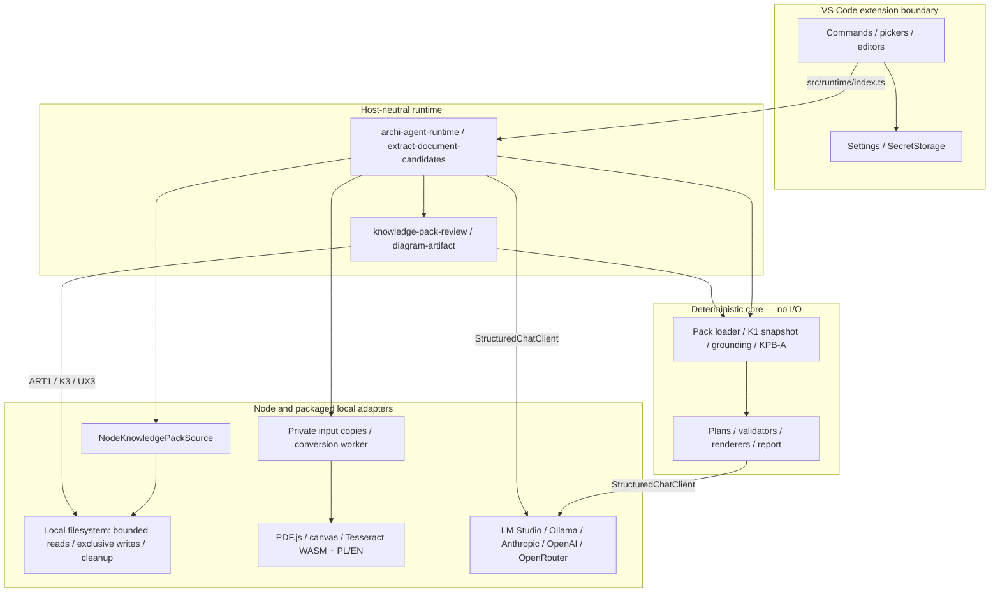
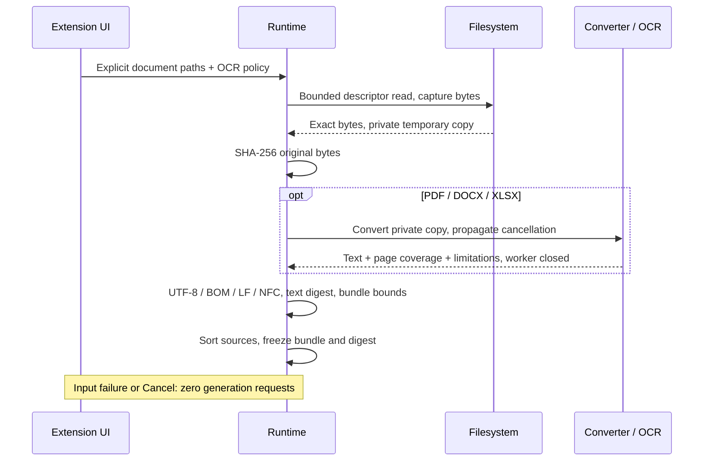
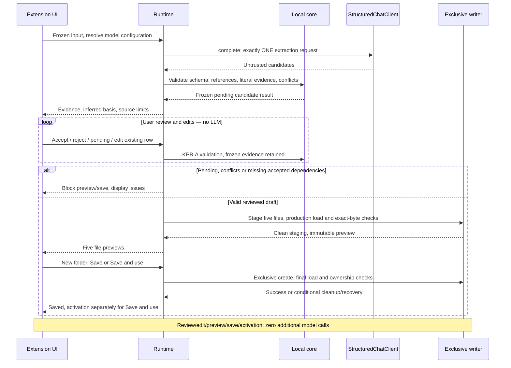
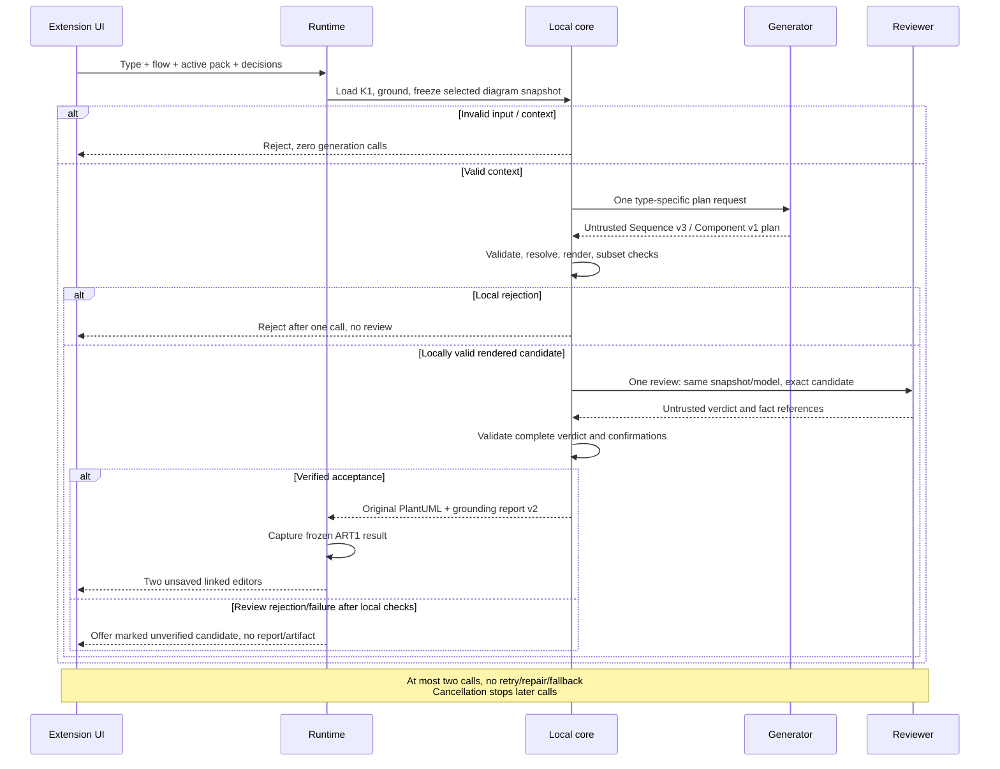
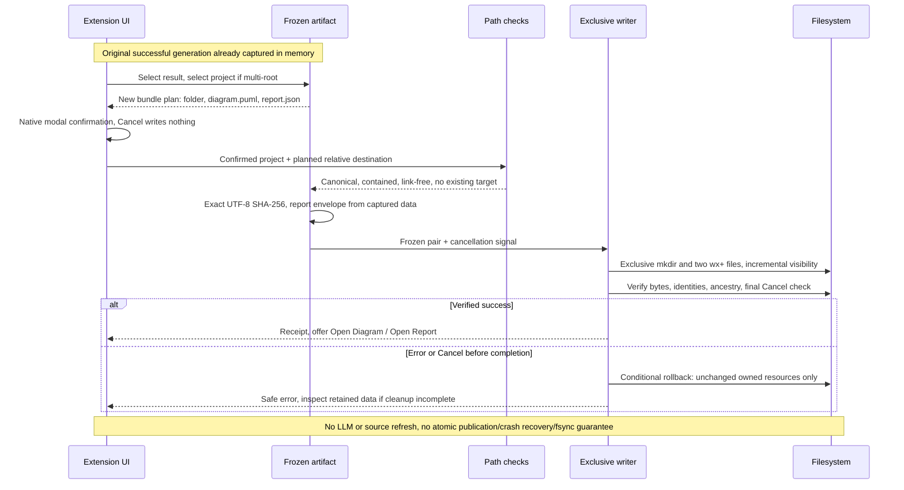

# Architecture

**English** · [Polski](../pl/architecture.md) · [Home](../../README.md)

This is the implemented architecture at the local FU-01/DOC1 baseline, not the published UX2 package. [Detailed stable architecture](../architecture.md) retains historical explanations; [roadmap](../product-roadmap.md) owns plans. Current acquisition uses local Markdown packs and explicitly selected documents to build a new pack; no EA/MCP acquisition adapter exists. Sequence and Component use separate plans/validators/renderers. Context/Container/ArchiMate remain planned. The compatibility sequence renderer is a separate older path.

Core is deterministic and has no Node/VS Code I/O; orchestration calls injected ports and Node adapters. Runtime is host-neutral; the editor imports only `src/runtime/index.ts`. Providers are interchangeable adapters for StructuredChatClient. Documents/model responses are untrusted data. Only bounded relevant diagram snapshots or bounded selected extraction text reach a model. Settings and SecretStorage stay at the VS Code boundary.

## A. Components and boundaries

## B. Documents and frozen input

## C. Extraction, review and new-pack save

## D. Diagram generation and report

## E. ART1 original-pair save

Acquisition staging is temporary; K2 awaits cleanup before returning candidates. The frozen bundle exists before extraction and remains the evidence source throughout review. Builder save validation includes a production load before immutable preview and after final writes. Activation is a separate setting operation.

Diagram review rejection can offer an unverified candidate only after local validation; user cancellation offers nothing. Generator/reviewer share the configured model but use separate contexts. Compatibility sequence uses one request and report v1.

The ART1 menu/palette registry retains results while at least one linked preview remains open; closing both removes the list entry. A still-pending generation notification retains its own original and can invoke save directly after both previews close. Restart/reload removes in-memory results and notifications. Language changes do not count as actual closes. Two-file saving is incrementally visible and rollback is conditional; no atomic directory rename, crash recovery or fsync guarantee is claimed.

## Source map

| Step / krok | Modules / moduły |
| --- | --- |
| UI navigation / nawigacja | [open-menu.ts](../../vscode-extension/src/commands/open-menu.ts), [build-knowledge-pack.ts](../../vscode-extension/src/commands/build-knowledge-pack.ts), [generate-sequence-diagram.ts](../../vscode-extension/src/commands/generate-sequence-diagram.ts), [save-diagram-and-report.ts](../../vscode-extension/src/commands/save-diagram-and-report.ts) |
| Boundary / granica | [index.ts](../../src/runtime/index.ts), [archi-agent-runtime.ts](../../src/runtime/archi-agent-runtime.ts) |
| Acquisition / przechwycenie | [extract-document-candidates.ts](../../src/runtime/extract-document-candidates.ts), [convert-document.ts](../../src/runtime/convert-document.ts), [convert.mjs](../../experiments/ux2-ocr/convert.mjs), [ocr-parent.mjs](../../experiments/ux2-ocr/ocr-parent.mjs), [ocr-child.mjs](../../experiments/ux2-ocr/ocr-child.mjs) |
| K1 / source / źródło | [knowledge-snapshot.ts](../../src/core/knowledge-pack/knowledge-snapshot.ts), [node-knowledge-pack-source.ts](../../src/node/node-knowledge-pack-source.ts) |
| Extraction evidence / dowody | [document-candidates.ts](../../src/core/knowledge-pack/builder/document-candidates.ts), [knowledge-pack-builder.ts](../../src/core/knowledge-pack/builder/knowledge-pack-builder.ts) |
| Review/save | [knowledge-pack-review.ts](../../src/runtime/knowledge-pack-review.ts), [knowledge-pack-onboarding.ts](../../src/runtime/knowledge-pack-onboarding.ts), [document-provenance.ts](../../src/core/knowledge-pack/document-provenance.ts) |
| ART1 | [diagram-artifact.ts](../../src/runtime/diagram-artifact.ts), [local-file-path.ts](../../src/node/local-file-path.ts) |
| Provider transports / transporty | [local](../../src/node/llm/openai-compatible-local-chat-client.ts), [remote OpenAI-compatible](../../src/node/llm/openai-compatible-remote-chat-client.ts), [Anthropic](../../src/node/llm/anthropic-remote-chat-client.ts) |

Sequence: [reviewed-sequence.ts](../../src/core/pipeline/reviewed-sequence.ts), [sequence-diagram-plan.ts](../../src/core/pipeline/sequence-diagram-plan.ts). Component: [generate-component-diagram.ts](../../src/core/pipeline/generate-component-diagram.ts), [component-diagram-plan.ts](../../src/core/pipeline/component-diagram-plan.ts).
