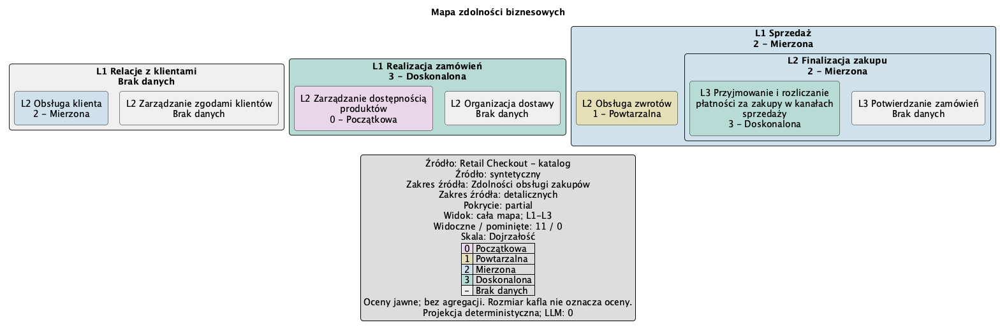

# Capability Map — local EA1b candidate

[Polski](../pl/capability-map.md) · [User guide](user-guide.md)

Use the **new local EA1b Core or Full VSIX**, identified in the local verification report.
The published DEMO1 VSIX/ZIP does not include this feature. Use the current checkout's
[Retail folder](../../examples/retail-checkout/START-HERE.en.md) and
[enterprise.json](../../examples/retail-checkout/architecture/enterprise.json).
Do not replace the published archives. Enable exactly one Core/Full profile and reload VS Code.

1. Open the current `examples/retail-checkout` folder in VS Code. You can leave all provider,
   model, API key and software architecture settings empty. No setup script is needed for this map.
2. Run **Archi: Create Diagram → Enterprise Architecture → Capability Map**.
   In a multi-root workspace choose the project, then select `architecture/enterprise.json`.
3. Choose **Whole map**, **L1–L3**, then **Dojrzałość**. The example has three L1 areas,
   eleven capabilities and explicit partial coverage. Names stay Polish; the UI language controls the legend.
4. Read the PlantUML and JSON report opened side by side. Expect `modelCalls: 0`,
   `generationPath: deterministic-catalog-projection` and semantic review `not-applicable`.
   A graphical preview needs a separate local PlantUML renderer; the reference image below is already rendered.
5. Run **Archi: Save Diagram and Report**, select the original capability result, choose the save
   project if asked and confirm. A new `archi-agent-results/<time-and-UUID>/` contains
   `diagram.puml` and `report.json`. This saves the original pair, including after preview edits.
   Cancel at any selection or confirmation creates no partial result on disk.

[Reference PlantUML](../../examples/retail-checkout/assets/capability-map.puml) ·
[Render provenance](../../examples/retail-checkout/assets/capability-map-provenance.json).

Nesting expresses business decomposition: L1 area, L2 capability, L3 detail. Colors correspond
only to the explicit scale and the labels printed in the legend. Gray **No data** is an absent
assessment, not zero. Explicit zero is valid in this example. Parents do not inherit child ratings;
tile size carries no assessment. **No rating colors** deliberately hides ratings in the view.

Repeat with **Sprzedaż** and **L1–L2**: the report marks other branches outside selected scope
and L3 records below detail level. Source coverage stays partial. These are deliberate omissions,
not missing source records. Limit errors ask you to choose a branch or lower detail; no data is silently cut.
If the catalog changes during selection, repeat Create Diagram. Invalid input gives a field/code/line;
fix the catalog, never ask a model to guess a missing parent or name.

[Exact file contract, bounds and digests](../enterprise-catalog.md).
CLI/MCP and the MCP enterprise source are available in the local EA1b candidate. Follow the complete configurations and commands in the [CLI/MCP tutorial](cli-mcp.md#capability-map-with-no-model--local-ea1b-candidate). With enterpriseSource configured, choose Configured MCP source instead of a file; scope/detail/colors and ART1 stay the same. Remote errors show a code and JSON Pointer without invented file lines. Application support maps, value streams and application landscapes remain future work.
