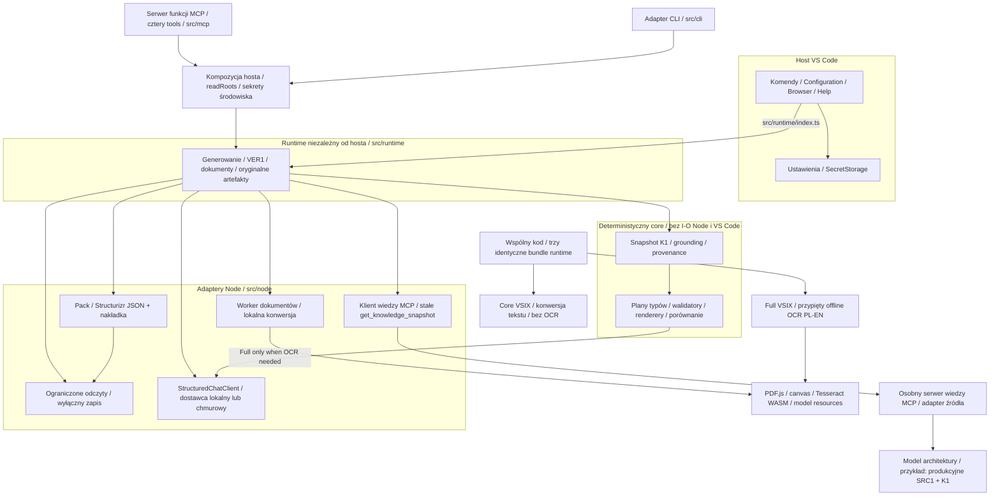
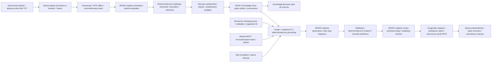
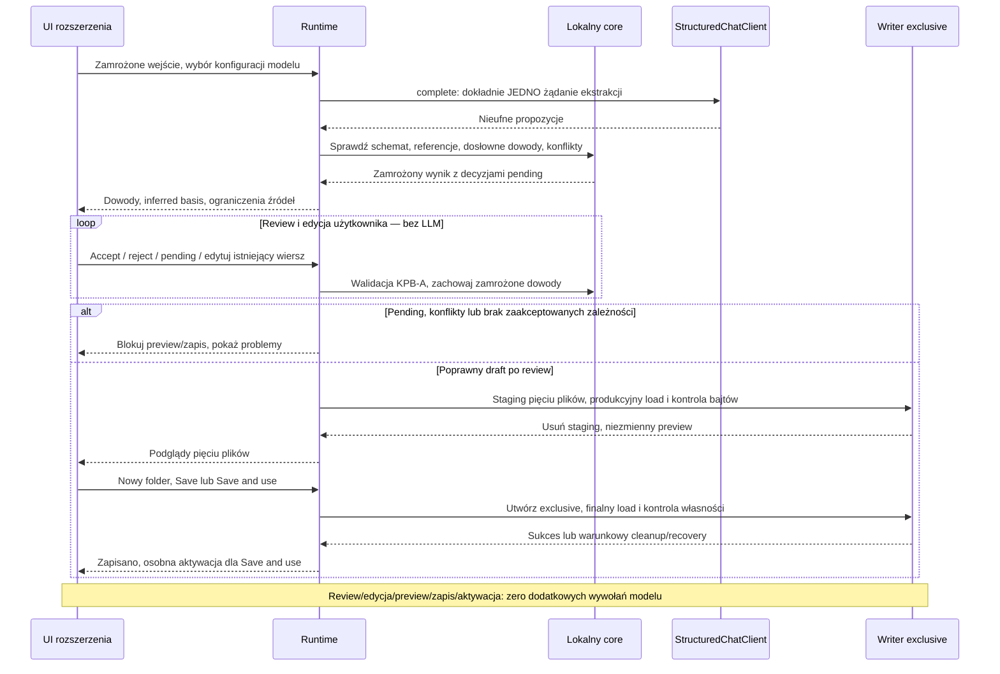
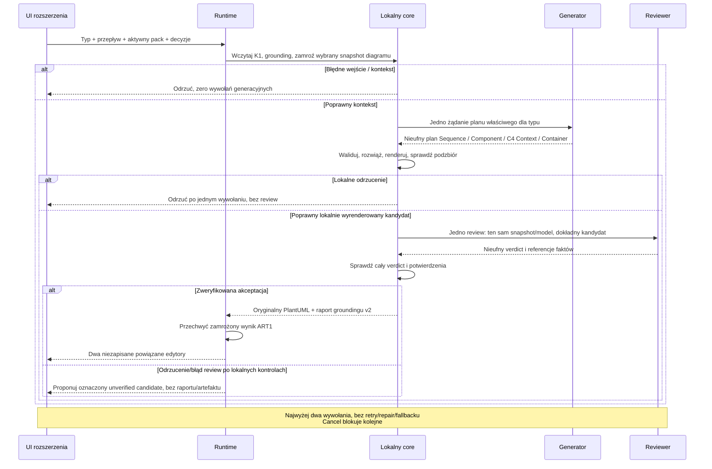
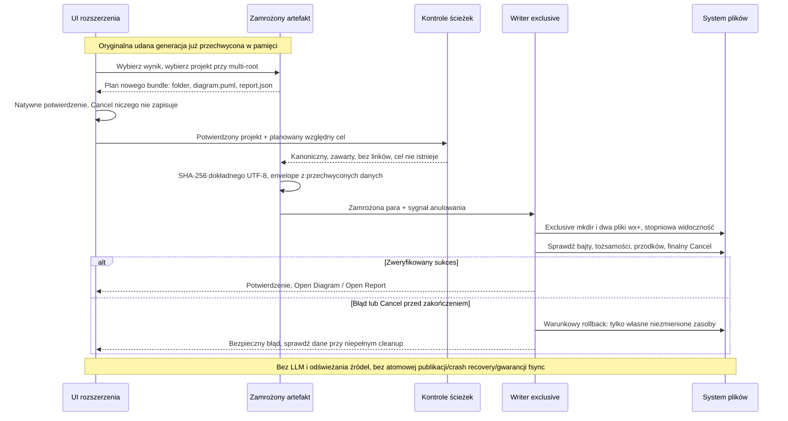
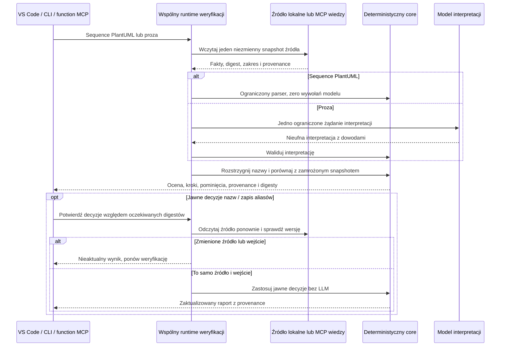

# Architektura — przegląd

[English](../en/architecture.md) · **Polski** · [Instrukcja użytkownika](user-guide.md)

Archi Agent zachowuje cienką warstwę edytora. Core odpowiada za deterministyczną wiedzę, grounding, walidację i renderowanie; adaptery Node zapewniają ograniczony odczyt plików, konwersję i transport do modeli. Wspólny runtime składa te operacje dla VS Code, CLI i MCP. Do modelu trafiają tylko wybrane dowody. Importowane dane i odpowiedzi modelu pozostają nieufne.

Diagramy poniżej objaśniają zaimplementowane przepływy. Szczegółowe interfejsy, limity i kontrakty błędów opisuje [architektura techniczna](../architecture.md). [Profile diagramów](../diagram-profiles.md) pomagają wybrać właściwy widok.

Lokalny kandydat EA1 dodaje osobną deterministyczną projekcję katalogu enterprise dla mapy zdolności. Nie wymaga providera, packa oprogramowania ani modelu; ma własny raport provenance i zapis ART1. [Kontrakt enterprise](../enterprise-catalog.md). Sześć poniższych diagramów przepływów oprogramowania zachowuje dotychczasowe znaczenie.

## A. Komponenty i granice

## B. Dokumenty i zamrożone wejście

## C. Ekstrakcja, review i zapis nowego packa

## D. Generowanie diagramu i raportu

## E. ART1 — zapis oryginalnej pary

## F. VER1 — snapshot i provenance

## Kontrakty techniczne

[Host i pakowanie](../vscode-extension.md) · [Źródła](../src1-structurizr-source.md) · [Weryfikacja przepływu](../ver1-flow-verification.md) · [C4](../c4-diagrams.md) · [Ekstrakcja dokumentów](../document-candidates.md) · [Review i zapis nowego packa](../knowledge-pack-review.md) · [Zapis oryginalnej pary](../diagram-artifact-save.md) · [CLI/MCP](cli-mcp.md) · [Decyzje architektoniczne](../adr/0002-deterministic-diagram-plan-renderers.md).

Wyrenderowane kopie (SVG / PNG): [A SVG](../assets/diagrams/pl-A.svg) / [PNG](../assets/diagrams/pl-A.png) · [B SVG](../assets/diagrams/pl-B.svg) / [PNG](../assets/diagrams/pl-B.png) · [C SVG](../assets/diagrams/pl-C.svg) / [PNG](../assets/diagrams/pl-C.png) · [D SVG](../assets/diagrams/pl-D.svg) / [PNG](../assets/diagrams/pl-D.png) · [E SVG](../assets/diagrams/pl-E.svg) / [PNG](../assets/diagrams/pl-E.png) · [F SVG](../assets/diagrams/pl-F.svg) / [PNG](../assets/diagrams/pl-F.png)
