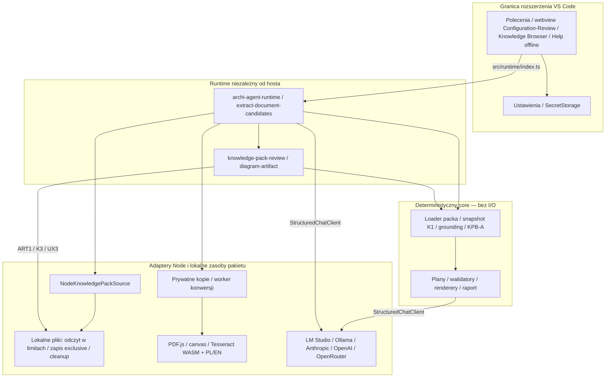
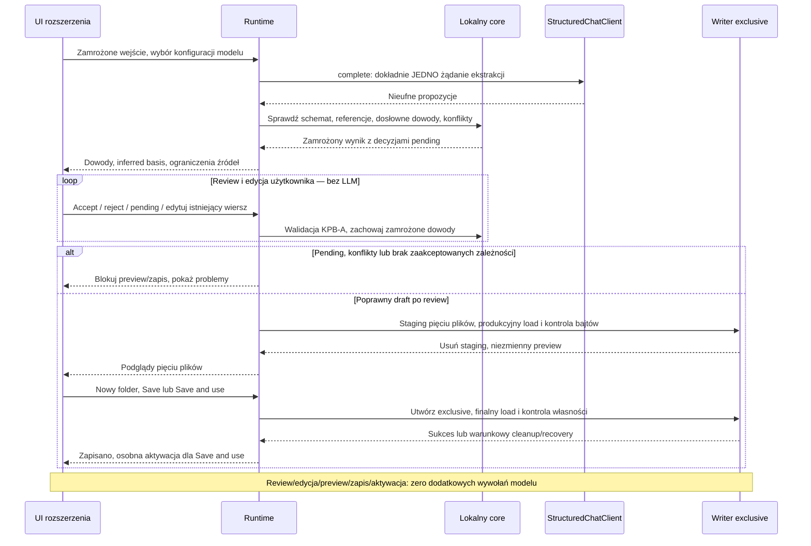
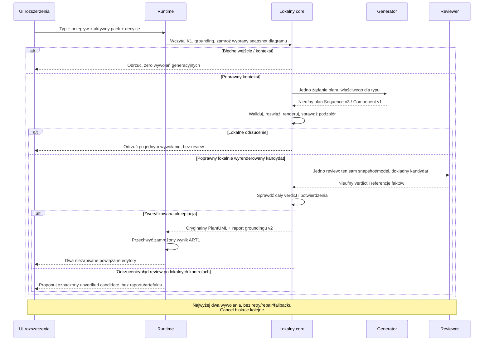
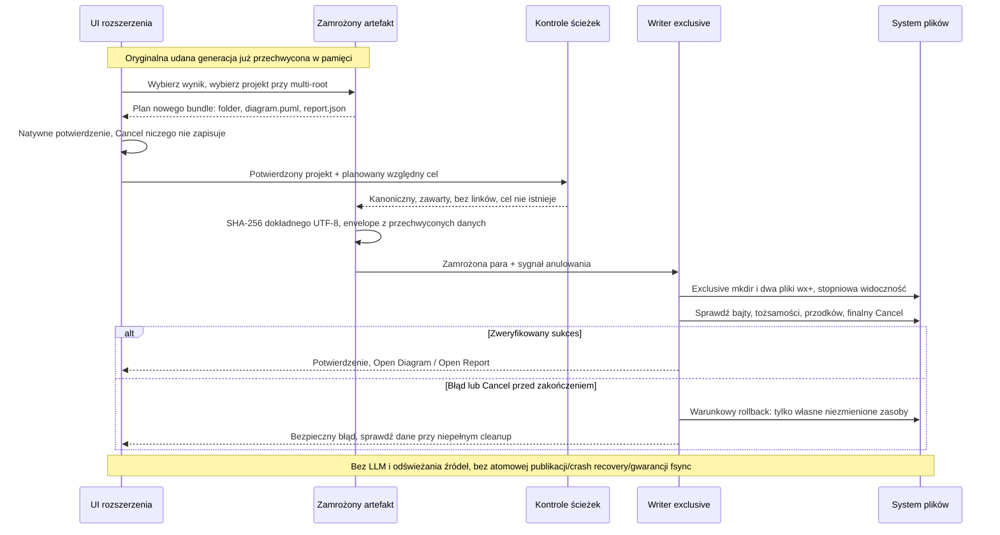

# Architektura

[English](../en/architecture.md) · **Polski** · [Strona główna](../../README.pl.md)

To architektura zaimplementowana w bieżącym buildzie gałęzi UX4-FU2, nie w publicznym pakiecie UX2. [Szczegółowa stabilna architektura](../architecture.md) opisuje bieżące granice; osobna historia zachowuje wcześniejsze wyjaśnienia; [roadmapa](../product-roadmap.md) określa plany. Obecne pozyskiwanie używa lokalnych packów Markdown oraz jawnie wskazanych dokumentów do budowy nowego packa; nie ma adaptera pobierania EA/MCP. Sequence i Component mają osobne plany/walidatory/renderery. Context/Container/ArchiMate są planowane. Renderer zgodności sequence jest osobną starszą ścieżką.

Core jest deterministyczny, bez Node/VS Code I/O; orkiestracja wywołuje wstrzyknięte porty i adaptery Node. Runtime jest niezależny od hosta; edytor importuje tylko `src/runtime/index.ts`. Providerzy są wymiennymi adapterami StructuredChatClient. Dokumenty/odpowiedzi modeli są nieufnymi danymi. Do modelu trafiają ograniczone właściwe snapshoty diagramów lub ograniczony wybrany tekst ekstrakcji. Ustawienia i SecretStorage pozostają na granicy VS Code.

UX4 dodaje jeden edytor Configuration z Knowledge Management / LLM Provider i powiązany webview review K3. Oba delegują do istniejących usług runtime; zamknięty protokół hosta, nonce CSP i renderowanie tekstu chronią granicę danych. Klucze pozostają w SecretStorage; ekran otrzymuje tylko obecność. [Kontrakt UX4](../configuration-workbench.md).

## A. Komponenty i granice

## B. Dokumenty i zamrożone wejście

```mermaid
flowchart LR
  Source["Dokumenty lokalne / aktywny bufor MD-TXT"] --> Capture["Odczyt bajtów lub bufora w limitach / hashe"]
  Capture --> Convert["Konwersja / OCR offline / znormalizowany tekst"]
  Convert --> Extract["JEDNO żądanie ekstrakcji / nieufni kandydaci"]
  Extract --> Evidence["Deterministyczna walidacja schematu / dowodów / referencji"]
  Evidence --> Review["Decyzje użytkownika / edycje / zwalidowany podgląd"]
  Review --> Pack["NOWY Knowledge Pack pięciu plików / provenance"]
  Pack --> Snapshot["Loader / snapshot K1 / deterministyczny grounding"]
  Flow["Opis przepływu / jawne decyzje"] --> Snapshot
  Snapshot --> Plan["JEDNO żądanie generatora / plan typu diagramu"]
  Plan --> Local["Walidacja / deterministyczny renderer / kontrola podzbioru"]
  Local --> Semantic["JEDNO żądanie review semantycznego / walidacja verdictu"]
  Semantic --> Result["Oryginalny diagram i powiązany raport / zamrożony wynik ART1"]
  Result --> Save["Jawne potwierdzenie / zapis exclusive / warunkowy cleanup"]
  Pack --> Browser["Knowledge Browser tylko do odczytu"]
```

## C. Ekstrakcja, review i zapis nowego packa

## D. Generowanie diagramu i raportu

## E. ART1 — zapis oryginalnej pary

Staging przechwycenia jest tymczasowy; K2 czeka na cleanup przed zwrotem kandydatów. Zamrożony bundle powstaje przed ekstrakcją i jest źródłem dowodów całego review. Walidacja zapisu Buildera obejmuje produkcyjny load przed niezmiennym preview i po finalnym zapisie. Aktywacja jest osobną operacją ustawienia.

Odrzucenie review diagramu może zaproponować unverified candidate dopiero po lokalnej walidacji; Cancel użytkownika niczego nie proponuje. Generator/reviewer współdzielą wybrany model, ale używają osobnych kontekstów. Sequence zgodności ma jedno żądanie i raport v1.

Rejestr menu/palety ART1 przechowuje wyniki, gdy co najmniej jeden powiązany podgląd pozostaje otwarty; zamknięcie obu usuwa wpis z listy. Nadal oczekujące powiadomienie generacji zachowuje własny oryginał i może wywołać zapis bezpośrednio po zamknięciu obu podglądów. Restart/reload usuwa wyniki i powiadomienia z pamięci. Zmiana języka nie jest zamknięciem. Zapis dwóch plików jest stopniowo widoczny, a rollback warunkowy; bez atomowego rename katalogu, crash recovery i gwarancji fsync.

## Mapa źródeł

| Step / krok | Modules / moduły |
| --- | --- |
| UI navigation / nawigacja | [open-menu.ts](../../vscode-extension/src/commands/open-menu.ts), [build-knowledge-pack.ts](../../vscode-extension/src/commands/build-knowledge-pack.ts), [generate-sequence-diagram.ts](../../vscode-extension/src/commands/generate-sequence-diagram.ts), [save-diagram-and-report.ts](../../vscode-extension/src/commands/save-diagram-and-report.ts) |
| Boundary / granica | [index.ts](../../src/runtime/index.ts), [archi-agent-runtime.ts](../../src/runtime/archi-agent-runtime.ts) |
| Acquisition / przechwycenie | [extract-document-candidates.ts](../../src/runtime/extract-document-candidates.ts), [convert-document.ts](../../src/runtime/convert-document.ts), [convert.mjs](../../experiments/ux2-ocr/convert.mjs), [ocr-parent.mjs](../../experiments/ux2-ocr/ocr-parent.mjs), [ocr-child.mjs](../../experiments/ux2-ocr/ocr-child.mjs) |
| K1 / source / źródło | [knowledge-snapshot.ts](../../src/core/knowledge-pack/knowledge-snapshot.ts), [node-knowledge-pack-source.ts](../../src/node/node-knowledge-pack-source.ts) |
| Extraction evidence / dowody | [document-candidates.ts](../../src/core/knowledge-pack/builder/document-candidates.ts), [knowledge-pack-builder.ts](../../src/core/knowledge-pack/builder/knowledge-pack-builder.ts) |
| Review/save | [knowledge-pack-review.ts](../../src/runtime/knowledge-pack-review.ts), [knowledge-pack-onboarding.ts](../../src/runtime/knowledge-pack-onboarding.ts), [document-provenance.ts](../../src/core/knowledge-pack/document-provenance.ts) |
| ART1 | [diagram-artifact.ts](../../src/runtime/diagram-artifact.ts), [local-file-path.ts](../../src/node/local-file-path.ts) |
| Provider transports / transporty | [local](../../src/node/llm/openai-compatible-local-chat-client.ts), [remote OpenAI-compatible](../../src/node/llm/openai-compatible-remote-chat-client.ts), [Anthropic](../../src/node/llm/anthropic-remote-chat-client.ts) |

Sequence: [reviewed-sequence.ts](../../src/core/pipeline/reviewed-sequence.ts), [sequence-diagram-plan.ts](../../src/core/pipeline/sequence-diagram-plan.ts). Component: [generate-component-diagram.ts](../../src/core/pipeline/generate-component-diagram.ts), [component-diagram-plan.ts](../../src/core/pipeline/component-diagram-plan.ts).

## Konfiguracja, limity i błędy

Configuration oddziela widoczny draft od zastosowanych ustawień User. Refresh Models używa profilu/endpointu/timeoutu draftu, waliduje ograniczoną odpowiedź i nie zapisuje modelu. Available models zmienia Selected model; Apply zapisuje profil i binding modelu sekwencyjnie. Discard odtwarza zastosowane ustawienia i unieważnia katalog draftu. Zmiana zewnętrzna blokuje nieaktualny Apply; częściowy błąd zapisu powoduje odczyt rzeczywistego stanu. Check Provider Configuration używa zastosowanych ustawień. Profil/model/binding mają zakres machine, wybór packa — resource. Endpoint LM Studio i timeout mogą mieć efektywne nadpisania workspace, z ograniczeniami Workspace Trust. Lokalne URL wymagają dosłownego loopback; adaptery chmurowe używają stałych allowlist HTTPS.

Klucze są oddzielnymi wpisami VS Code SecretStorage dla providerów. Wprowadza się je przez maskowane pola natywne; webview dostaje tylko obecność, nigdy sekret. Help korzysta z języka wyświetlania VS Code i bundlowanego Markdown; nie wysyła żądań do providera ani nie wprowadza przełącznika języka aplikacji. Browser czyta aktywny pack produkcyjnym loaderem; nawigacja używa linii packa i zamrożonego provenance dokumentów, sprawdzając digest przed otwarciem evidence w żywym edytorze.

Konwersja przyjmuje jeden plik do 50 MiB i wynik do 8 MiB Markdown; deadline bez OCR to 120 sekund, OCR — 300 sekund i najwyżej 20 stron OCR. Builder przyjmuje osiem źródeł, po 10 MiB/20 MiB łącznie, 64 KiB tekstu na źródło/160 KiB serializowanego bundle, 256 KiB gotowego żądania i 128 kandydatów. Łączny deadline Buildera to 360 sekund; ekstrakcja ma limit 120 sekund albo krótszy timeout providera. AbortSignals docierają do żądań/workerów/zapisów; zamknięcie procesów i warunkowy cleanup mogą zakończyć się po deadline pracy. Progress pokazuje odczyt, konwersję/OCR, wybór providera, generację i walidację dowodów. Błędy zwracają ograniczone kody/etapy; bez częściowej konwersji/kandydatów ani automatycznego retry/repair/fallbacku. Pełne limity: [kontrakt dokumentów](../document-candidates.md).

## Samowystarczalny build i pakiet

`npm run extension:build` tworzy przez esbuild trzy sąsiednie bundle CommonJS: rozszerzenie, runtime niezależny od hosta i worker konwersji. Rozszerzenie externalizuje `vscode` i sąsiedni runtime; runtime — tylko moduły wbudowane Node. `npm run extension:package` przebudowuje bundle, używa jawnej allowlisty VSIX i dodaje przypięte zasoby OCR offline z manifestem licencji/hashów. Obie instrukcje trafiają jako `readme.md` i `README.pl.md`. Użytkownik korzysta z Node wbudowanego w VS Code; nie potrzebuje ścieżek repo, npm ani osobnej instalacji Node.

`npm run extension:verify` sprawdza wpisy archiwum, importy/limity bundle, ujawnienie ścieżki repo, hashe OCR i zasoby platform. Dane produktu, fixture'y, testy i skrypty developerskie są wykluczone. Dowody Mac ARM nie potwierdzają równoważnego wykonania na wszystkich pakowanych platformach. Historyczne wyniki i pakiety są w [historii stanu projektu](https://github.com/Setech-pl/archi-agent/blob/6856ab260a6755c6b975c85abe3ab9cddd7d63f9/docs/project-state-history.md); bieżące kontrole i przekazanie audytorowi — w [stanie projektu](../project-state.md).

## Spójność konfiguracji dostawcy

Credential jest rozwiązywany dla ostatecznie wybranego profilu/modelu tuż przed operacją.
Generowanie i review używają tej samej niezmiennej konfiguracji mimo późniejszych zmian ustawień.
Host obserwuje zdarzenia konfiguracji we właściwym scope przed pierwszym await; monotoniczna rewizja
unieważnia stary wybór także po zewnętrznym A→B→A. Tylko jeden writer rozszerzenia publikuje naraz.
Każdy zapis sprawdza oczekiwany scope przed i po await; konsumuje wyłącznie własną oczekiwaną
notyfikację. Inne zdarzenie, zmiana zaufania/workspace lub nowsza publikacja anulują stary wybór.
Obserwacje są zwalniane w finally, również po błędzie i anulowaniu.

Kolejność bindingu pozostaje fail-closed, jawny profil jest aktywowany na końcu, a wynik odczytywany
ponownie. Częściowy zapis może pozostawić model bez bindingu. Wiele aktualizacji VS Code nie jest
atomowe; nie ma rollbacku nad nowszymi wartościami, crash recovery ani CAS wobec obcych writerów.
Sekrety pozostają w SecretStorage, poza webview, diagnostyką i raportami.

## Niezmienniki snapshotu wiedzy

Contribution deklaruje tożsamość źródła i zakres partial/complete dla każdej tabeli; pominięcie
oznacza brak dostarczonych danych. Complete dotyczy deklarowanego zakresu, nie zamkniętego świata
architektury. Brak file/line pozostaje jawną luką. Równoważne twierdzenia zachowują całe provenance.
Sprzeczne fakty/reguły, kolizje actor/system ID i forbidden relationships są jawnymi konfliktami
z referencjami wszystkich stron; nie ma pierwszeństwa źródła ani domyślnego zwycięzcy.
Wieloznaczne aliasy nadal wymagają decyzji. Digest SHA-256 obejmuje fakty semantyczne, zakresy,
provenance, luki, niejednoznaczności i konflikty; ID zawiera pełny digest. Zmiana kolejności źródeł
lub rekordów nie zmienia zserializowanych bajtów. Szczegóły rekordów określa kontrakt packa.
