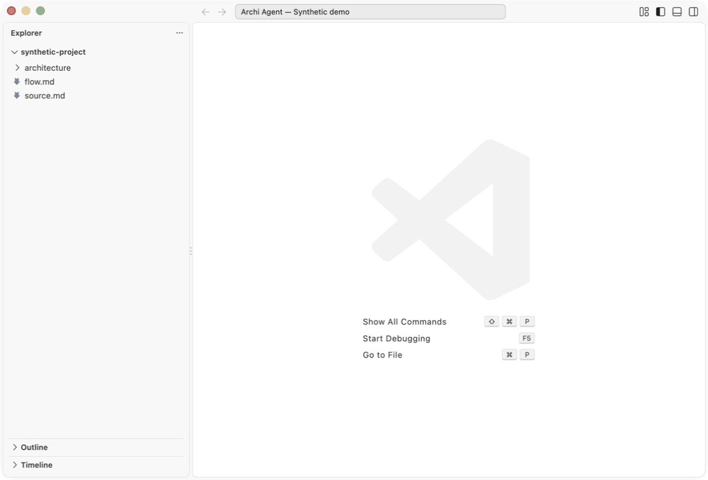
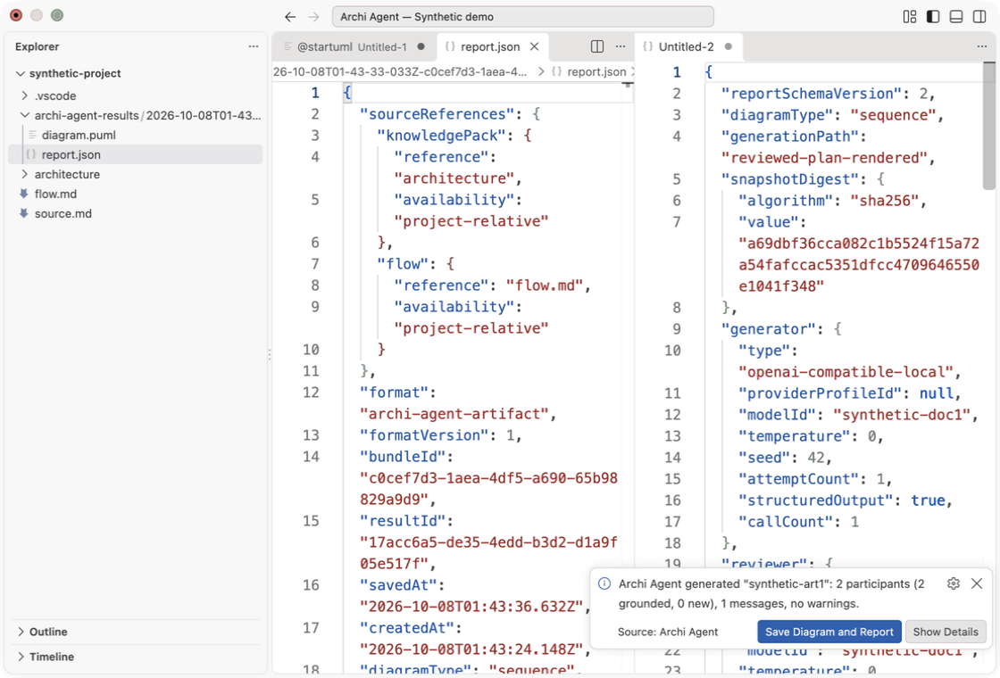
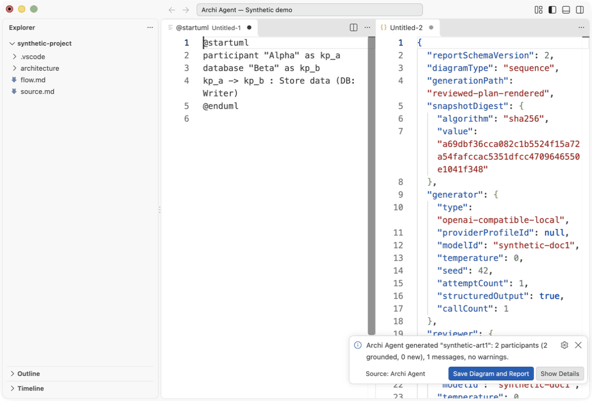

# Instrukcja użytkownika

[English](../en/user-guide.md) · **Polski** · [Strona główna](../../README.pl.md)

## Wersja i wymagania

Instrukcja opisuje lokalnego kandydata UX4-FU2 z bazy UX4-FU1 `d5fb95a`. Publiczne pobranie `v0.3.0-alpha.4` zawiera UX2; późniejsze funkcje OBS1/UX3/K1–K3/ART1/UX4/UX4-FU1 wymagają wskazanego lokalnego kandydata. Zobacz [wybór pakietu i sumy kontrolne](../../README.pl.md#wybierz-właściwy-pakiet).

Potrzebujesz desktopowego VS Code zgodnego z deklaracją `^1.91.0`, lokalnego systemu plików oraz providera modeli do ekstrakcji lub diagramów. VSIX zawiera bundle runtime Node, worker konwersji i zasoby OCR offline; osobne Node/npm nie są potrzebne. Celem 1.0 jest Mac ARM. Dotychczasowa weryfikacja natywnego UI odbyła się na macOS arm64 (VS Code 1.140.0); owner smoke UX4 jest nieukończony. Pakiet zawiera także bindingi Mac Intel, Linux x64/arm64 GNU i musl oraz Windows x64/arm64 — to pokrycie pakowania, nie weryfikacja natywnego UI tych systemów. Workspace zdalny lub wirtualny nie potwierdza obsługi zdalnych ścieżek dokumentów; używaj lokalnych folderów. W niezaufanym workspace ustawienia objęte ograniczeniami są odczytywane z ustawień użytkownika.

Zainstaluj właściwy VSIX przez **Extensions → … → Install from VSIX…**, następnie uruchom **Archi: Open**. Menu zawiera **Create Diagram**, **Save Diagram and Report**, **Configuration**, **Knowledge Browser**, **Build Knowledge Pack from Documents**, **Build Knowledge Pack from Active File**, **Convert to Markdown** oraz **Help**. **Archi: Configuration** otwiera jeden panel edytora z zakładkami **Knowledge Management** i **LLM Provider**; ponowne polecenie pokazuje ten panel. **Archi: Create Diagram** pyta o **Sequence** lub **Component** przed generacją. Osobne polecenie Sequence jest ukryte i deleguje do tego wyboru. **Check Provider Configuration** jest dostępne w zakładce providera; identyfikator zgodności jest ukryty w palecie. Budowanie opisuje [instrukcja deweloperska](development.md).

## Provider, profil i model

Provider to usługa uruchamiająca model. Profil wybiera adapter i zasady endpointu; identyfikator modelu wskazuje jeden model u tego providera.

| Profil UI | ID | Endpoint | Klucz |
| --- | --- | --- | --- |
| LM Studio | `local-lm-studio` | domyślnie `http://127.0.0.1:1234/v1` | brak |
| Ollama | `local-ollama` | `http://127.0.0.1:11434/v1` | brak |
| Anthropic | `cloud-anthropic` | stały `https://api.anthropic.com` | SecretStorage |
| OpenAI | `cloud-openai` | stały `https://api.openai.com` | SecretStorage |
| OpenRouter | `cloud-openrouter` | stały `https://openrouter.ai` | SecretStorage |

Przygotuj lokalny serwer/model samodzielnie; rozszerzenie nie pobiera modeli. Otwórz **Archi: Configuration → LLM Provider**. Wybierz profil, uzupełnij właściwe pola endpointu/timeoutu/modelu i użyj **Apply**. **Discard Changes** przywraca zastosowane wartości. Niezapisane zmiany przetrwają przełączanie zakładek. Refresh Models czyta widoczny profil/adres bez zapisu ustawień; diagnostyka zastosowanej konfiguracji wymaga Apply lub Discard. Operacje klucza dotyczą widocznego profilu formularza i są dostępne także przed Apply. Zewnętrzna zmiana ustawień jest pokazywana bez utraty wpisanych wartości; przy konflikcie użyj Discard i wpisz zamierzone zmiany ponownie. Zmiana konfiguracji unieważnia diagnostykę. **Refresh Models** pobiera listę jednym ograniczonym żądaniem. Wybierz dokładne ID z **Available models** albo wpisz je w Selected model, następnie Apply. Pusta, niepoprawna i błędna odpowiedź mają odrębne komunikaty EN/PL oraz następne działanie. Identyczne powtórzone bezpieczne ID lokalnego dostawcy tworzą jeden wybór; niebezpieczne ID nadal odrzuca listę. Model nie jest wybierany automatycznie. Chmura wymaga **Set / Replace Key** (natywne zamaskowane pole); **Remove Key** prosi o potwierdzenie. Klucze pozostają w SecretStorage; ekran otrzymuje tylko informację o obecności. **Check Provider Configuration** testuje zastosowane ustawienia najwyżej jednym żądaniem listy, bez generacji. Pokazuje połączenie, listing, model i gotowość generacji oraz następne działanie. Listing nie dowodzi gotowości generacji, dostępu, rozliczeń ani quota. Jawne **Create Diagram** testuje generację przy zachowanej polityce żądań. Nie każdy provider ma owner smoke na żywo.

| Ustawienie | Znaczenie |
| --- | --- |
| `archiAgent.knowledgePackPath` | bezwzględny folder pięciu plików packa; scope resource |
| `archiAgent.localModel.profile` | ID profilu na tym komputerze |
| `archiAgent.localModel.selectedModel` | ID modelu na tym komputerze |
| `archiAgent.localModel.selectedModelProfile` | binding zarządzany przez rozszerzenie; nie edytuj |
| `archiAgent.localModel.baseUrl` | loopback LM Studio; Ollama go ignoruje |
| `archiAgent.localModel.model` | starsze ustawienie modelu LM Studio do jawnego wyboru profilu |
| `archiAgent.localModel.timeoutSeconds` | jedno żądanie modelu, domyślnie 120; zakres 1–600 |
| `archiAgent.defaultAuthor` | autor wpisanego opisu, domyślnie `Archi Agent` |
| `archiAgent.diagnostics.verbose` | bezpieczna diagnostyka JSON w Output; domyślnie false |

Wybór profilu/modelu ma scope machine: Settings Sync go nie synchronizuje, a workspace nie nadpisuje. Po zmianie profilu wybierz model ponownie; stary binding jest nieaktywny. Preferuj UI zamiast ręcznych zmian ustawień modelu. Lokalne URL dopuszczają dosłowne `127.0.0.1` lub `[::1]` z `/v1`; `localhost`, zdalne hosty, przekierowania i URL z credentialami są odrzucane. Szczegóły: [adaptery lokalne](../local-model.md), [adaptery chmurowe](../cloud-models.md).

## Wybór lub utworzenie aktywnego Knowledge Pack

Knowledge Pack to lokalny katalog architektury: systemy, aktorzy, relacje, aliasy i reguły. Grounding dopasowuje nazwy kanoniczne i aliasy do tego katalogu przed generowaniem przez model.

Otwórz **Configuration → Knowledge Management** (ukryty identyfikator zgodności **Configure Knowledge Pack** otwiera tę samą zakładkę). Sprawdź projekt, aktywną ścieżkę, zapisany zakres, źródło efektywnej konfiguracji, walidację loadera i rzeczywiste liczby wierszy. W multi-root najpierw jawnie wybierz projekt. **Choose Existing Knowledge Pack** otwiera natywny picker folderu i waliduje pięć tabel przed aktywacją przez UX3. **Validate / Refresh** ponownie czyta pack; **Open systems.md** i cztery pozostałe przyciski otwierają pliki. Jeden projekt zapisuje WorkspaceFolder; bez workspace używany jest User/Global. Cancel zachowuje ustawienie. Aktywny jest jeden pack dla wybranego zakresu.

**Create Knowledge Pack** wybiera istniejący folder nadrzędny natywnym pickerem, pyta o jedną nazwę folderu i rzeczywisty system (ID, nazwa, kind, opis), następnie tworzy pięć tabel bez wymyślonych relacji. UX3 nadal obsługuje nowy lub istniejący pusty cel i odrzuca niepuste foldery. Builder dokumentów wymaga nowego folderu. Onboarding pierwszego **Create Diagram** zachowuje natywne Create/Choose/Cancel i edytowalny bezwzględny domyślny cel; nie używa modelu.

Dla małego katalogu demonstracyjnego utwórz Alpha jako `service`, następnie dodaj Beta jako `database` i relację zgodnie z [formatem pięciu tabel](../knowledge-pack-format.md). Wymaga to świadomej edycji plików i ponownej walidacji; Builder dokumentów nie aktualizuje tego packa. Relacja może mieć `interface_type` `DB`, `interface_name` `Writer` i `mode` `synchronous`.


### Kompletny syntetyczny pack z pięciu plików

Utwórz te pięć plików UTF-8 w jednym folderze i wybierz go przez Configure Knowledge Pack. To ręczny przykład, nie wynik Buildera z provenance.

`systems.md`:

```markdown
| id | canonical_name | kind | description |
| --- | --- | --- | --- |
| a | Alpha | service | Synthetic service |
| b | Beta | database | Synthetic store |
```

`actors.md`:

```markdown
| id | canonical_name | kind | description |
| --- | --- | --- | --- |
```

`relationships.md`:

```markdown
| from_id | to_id | interface_type | interface_name | mode | purpose |
| --- | --- | --- | --- | --- | --- |
| a | b | DB | Writer | synchronous | Store |
```

`aliases.md`:

```markdown
| alias | target_id |
| --- | --- |
```

`rules.md`:

```markdown
| rule | from_id | to_id | reason |
| --- | --- | --- | --- |
```

## Dokumenty → nowy pack

1. Uruchom **Build Knowledge Pack from Documents** z palety lub przyciskiem **Build Knowledge Pack from Documents** w **Configuration → Knowledge Management**. Wybierz jawnie lokalne pliki `.md`, `.txt`, `.pdf`, `.docx`, `.xlsx`. Nie ma skanowania katalogu ani pobierania URL. Istniejący pack nie jest wymagany.
2. Dla PDF picker Buildera **PDF OCR mode** używa **none**, **auto**, **all**. `auto` zachowuje strony tekstowe i rozpoznaje strony bez tekstu; `all` rozpoznaje wszystkie; `none` wymaga użytecznego tekstu. Osobne **Convert to Markdown** nazywa te opcje **No OCR**, **Auto OCR**, **OCR all pages** i otwiera jeden niezapisany edytor Markdown. Nie potrzebuje providera ani packa i nie wysyła żądania sieciowego.
3. Lokalne przetwarzanie przechwytuje dokładne bajty w limitach, oblicza hashe, konwertuje prywatne kopie i zamraża znormalizowany tekst. Review nie czyta ponownie oryginałów. Przechwycenie nie jest atomowym snapshotem pliku zmienianego równocześnie. Przygotuj stabilne dokumenty. Wybór brakującego modelu następuje po walidacji wejścia; progress obsługuje Cancel. Poprawna ekstrakcja wysyła jedno żądanie generacyjne StructuredChatClient z ograniczonym tekstem dokumentów, a następnie lokalnie sprawdza propozycje/dowody.
4. Powiązany panel **Knowledge Pack Review** pokazuje propozycje, problemy walidacji, ograniczenia źródeł i OCR. Rozwiń **Evidence, references and original proposal** przy wierszu. `pending` oznacza brak decyzji; `accepted` — Twoją decyzję włączenia; `rejected` — wykluczenie. `explicit` i `inferred` opisują oryginalną propozycję; inferred wymaga uzasadnienia. Evidence to dosłowny cytat z tożsamością źródła, hashami oryginału/tekstu oraz offsetami/liniami w znormalizowanym tekście. Poprawne pozycje i prawdziwy cytat nie dowodzą interpretacji architektury. Pewność OCR jest niedostępna; pokrycie pozostaje częściowe.
5. **Accept selected**, **Reject selected**, **Return selected to pending** obsługują grupy; dostępne są też **Accept all pending** / **Reject remaining pending**. Sprawdź dowody przed akceptacją. Rozwiń **Edit proposed row**, zmień pola i wybierz **Apply row edit**; referencje wybierasz z encji. Nie dodaje propozycji ani nie zmienia ID, dowodów, basis i reasoning. Edytowany wiersz zachowuje oryginalny dowód i znacznik `editedByUser`; cytat nie jest przedstawiany jako dosłowne źródło Twojej zmiany. Niezastosowana edycja wiersza nie zmienia sesji.
6. **Validate and preview** blokuje zapis, gdy wiersz jest pending, zaakceptowana relacja/alias/reguła nie ma zaakceptowanych końców, pozostają konflikty, aliasy kolidują lub zbiór nie ma systemu. Zależności nie są akceptowane automatycznie. Zmień decyzje/pola i waliduj ponownie. Każda zmiana unieważnia poprzedni niezmienny preview.
7. Wybierz istniejący folder nadrzędny i jedną **nową nazwę folderu packa**. Rozwiń pięć podglądów tylko do odczytu na tym samym ekranie: `systems.md`, `actors.md`, `relationships.md`, `aliases.md`, `rules.md`. Zamrożony podgląd to dokładna treść zapisu.
8. **Save** tworzy nowy pack i zachowuje aktywne ustawienie. **Save and use** najpierw zapisuje/wczytuje, potem aktywuje w wybranym scope UX3 (Global bez projektu). **saved, not activated** oznacza zachowane poprawne pliki przy błędzie konfiguracji; wybierz je później przez Configure Knowledge Pack. Decyzje pozostają nad podglądami; **Cancel** lub zamknięcie panelu kończy przed zapisem. Po kolizji **Choose new pack folder** wybiera inny nowy cel bez ekstrakcji.

W jednym Extension Host działa jeden build. Cancel lub zamknięcie panelu review kończy build; ukończony zapis zwalnia blokadę builda. Nie ma trwałych draftów, autosave, aktualizacji/scalania packów ani historii akceptacji. Nowe polecenie to nowa ekstrakcja. Review/edycja/walidacja/preview/zapis/aktywacja używają **zera dodatkowych żądań LLM**, również po kolizji zapisu i powrocie do review.

Limity Buildera są mniejsze niż samodzielnej konwersji:

| Granica | Builder | Samodzielna konwersja |
| --- | --- | --- |
| Pliki/wejście | 8; po 10 MiB, łącznie 20 MiB | jeden; 50 MiB |
| Tekst/wyjście | 64 KiB UTF-8 na źródło; serializowany bundle 160 KiB | 8 MiB Markdown |
| Żądanie/kandydaci | 256 KiB gotowego żądania; 128 kandydatów, 32 aliasy, 64 relacje | bez LLM |
| Deadline pracy | 360 sekund; generowanie 120 sekund ograniczone pozostałym czasem | 120 sekund bez OCR; deadline OCR 300 sekund |

Obie ścieżki zachowują limity: 300 stron PDF, 20 stron OCR, 10 MP renderowanego canvas, 16 MP osadzonego obrazu; ZIP Office 1000 wpisów, 100 MiB po rozpakowaniu łącznie, 25 MiB na wpis, proporcja 100:1; XLSX 40 arkuszy, 20000 wierszy, 150 kolumn, 250000 komórek. PDF traci układ/strukturę tabel; DOCX pomija obrazy/zasoby zewnętrzne, złożony układ może stracić wierność; XLSX bierze zapisane wyniki formuł, bez przeliczania. DOC/XLS są nieobsługiwane. Modele OCR PL/EN są lokalne. Cancel/błąd nie zwraca częściowej konwersji ani kandydatów. Zamykanie workerów/cleanup może wykroczyć poza deadline pracy. Zobacz [pełne limity ekstrakcji](../document-candidates.md#limits-and-cancellation).

## Generowanie i odczyt diagramu

Wybierz **Create Diagram → Sequence** (kolejność interakcji) albo **Component** (komponenty i zależności). Wybierz aktywny dokument, **Choose a flow file** albo wpisz opis. Plik wymaga ograniczonego front matter; dla opisu metadane zbiera UI. W obu językach użyj tego samego syntetycznego pliku:

```markdown
---
diagram_name: synthetic-art1
flow_name: Synthetic ART1
author: Test
language: en
---
Alpha stores data in Beta.
```

Rozstrzygnij niejednoznaczności, wskazując właściwy element. Nieznany zwykły tekst nie tworzy nowego elementu; wpisz jawnie `[NEW: Name]` i potwierdź. Alias nie ustanawia relacji. Relacje źródłowe i podane w przepływie pozostają rozróżnialne; brak relacji w źródle nie dowodzi jej nieistnienia. Lokalne zakazy nadal blokują generowanie.

Błąd wejścia/groundingu daje zero żądań generacyjnych; odrzucenie generatora/lokalnej walidacji — jedno; poprawny lokalnie kandydat uruchamia osobne żądanie reviewera, łącznie dwa. Generator i reviewer używają tego samego profilu/modelu, osobnych żądań i tego samego zamrożonego snapshotu. Bez retry, repair, fallbacku i trzeciego wywołania. Zweryfikowany sukces otwiera obok siebie niezapisany PlantUML i powiązany raport groundingu JSON. Sprawdź fakty, klasy dowodów, linie źródeł, ostrzeżenia, walidację deterministyczną, verdict semantyczny i digest snapshotu. Edytor zawiera tekst PlantUML; graficzny podgląd wymaga osobnej obsługi PlantUML. Lokalna walidacja podzbioru nie jest gwarancją renderowania oficjalnym silnikiem PlantUML.

Gdy review odrzuci wynik/nie powiedzie się po lokalnych kontrolach, **Show unverified candidate** może otworzyć oznaczony kandydat bez raportu; Cancel niczego nie otwiera. Nie jest to ukończony wynik ART1. Anulowanie przez użytkownika nie proponuje kandydata. Stary identyfikator `archiAgent.generateSequenceDiagram` jest niewidocznym delegatem **Create Diagram**. Starsze API runtime z jednym wywołaniem pozostaje wewnętrzną ścieżką zgodności, bez osobnego wejścia użytkownika ani fallbacku.

## Zapis oryginalnego diagramu i raportu

Użyj **Save Diagram and Report** w powiadomieniu generacji, **Archi: Save Diagram and Report** w palecie albo menu Open. Menu/paleta wybiera oryginalny wynik według typu, czasu utworzenia UTC i UUID wyniku. Jeden lokalny projekt jest celem; multi-root wymaga jawnego wyboru projektu docelowego. Bez projektu otwórz najpierw lokalny folder. W modalu potwierdź oryginalny wynik, pełny nowy folder, `diagram.puml` i `report.json`. Cancel przed zapisem niczego nie tworzy.

```text
<project>/archi-agent-results/<UTC-time>-<bundle-UUID>/
  diagram.puml
  report.json
```

ART1 przechwytuje zamrożony wynik udanej generacji: oryginalny PlantUML (z końcowym LF), powiązany raport, metadane źródeł/snapshotu i bezpiecznej konfiguracji. Edycja bufora, późniejsze ustawienia/zmiana packa czy inna generacja nie zastępują tej pary. Edytowany bufor zapisz osobno zwykłym Save edytora; to nie jest oryginalna para ART1. ART1 nie wysyła **nowego żądania LLM, listy, diagnostyki, konwersji, credentiali ani odświeżania źródeł** i nie zmienia ustawień.

`report.json` to envelope v1 `archi-agent-artifact`. `generationReport` zachowuje kontrakt raportu generacji. `diagram.sha256` i `byteLength` opisują dokładne bajty UTF-8 diagramu, z białymi znakami i newline. Digesty wiedzy/snapshotu identyfikują kanoniczne wejścia semantyczne; digesty oryginału/tekstu — przechwycone bajty dokumentu/tekst po normalizacji; digest konfiguracji dotyczy deterministycznej bezpiecznej projekcji, bez credentiali i możliwości pełnego odtworzenia konfiguracji. Hashe identyfikują treść, nie jej autentyczność ani jakość modelu. Brakujące hashe bajtów źródła/wersja runtime mają `null`, nie są odtwarzane później.

Źródła wewnątrz projektu docelowego mają referencje względne, gdzie to możliwe; zewnętrzne — logiczne nazwy plików oznaczone `logical-name-only`. Przepływ z pamięci ma `in-memory-input`. Dokumenty i pełne snapshoty nie są kopiowane. Fakty raportu zachowują dostępne dowody i ostrzeżenia. **Open Diagram** / **Open Report** otwierają zapisane pliki po sukcesie. Błąd otwarcia nie usuwa zapisanej pary; otwórz ją ręcznie.

Lista menu/palety przechowuje wyniki w bieżącym Extension Host, gdy co najmniej jeden powiązany podgląd pozostaje otwarty. Zamknięcie diagramu i raportu usuwa wpis z tej listy; zamknięcie jednego go zachowuje. Nadal oczekujące powiadomienie generacji może zachować własny oryginalny wynik i wywołać Save Diagram and Report bezpośrednio, nawet po zamknięciu obu podglądów. Zmiana języka edytora nie jest rzeczywistym zamknięciem. Restart/reload usuwa wyniki z pamięci i oczekujące powiadomienia; zapisane pliki ich nie importują. Ponowny jawny zapis tworzy nowy UUID bundle dla tego samego oryginalnego wyniku. Nie ma trwałej historii.

## Błędy zapisu i rozwiązywanie problemów

| Sytuacja | Działanie |
| --- | --- |
| Cel Buildera istnieje, nawet pusty | zachowaj go; wróć przez review/wybór miejsca i wybierz nowy folder; bez ponownej ekstrakcji |
| Cel ART1 istnieje | ponów Save, aby uzyskać nowy bundle; bez nadpisywania/scalania |
| Symlink, brak folderu nadrzędnego, rodzic nie jest katalogiem lub błąd containment | najpierw popraw wskazany lokalny projekt/ścieżkę; nowy bundle nie naprawi ścieżki |
| Cancel podczas zapisu lub błąd zapisu/weryfikacji | poczekaj na cleanup; obejrzyj wskazaną lokalizację, jeśli cleanup jest niepełny |
| Zachowana cudza edycja/podmiana/nieudowodniony częściowy zapis | zachowaj edycje, sprawdź dane, przenieś zachowane pliki lub wybierz inne miejsce przed ponowieniem |
| Pack zapisany, aktywacja nieudana | zachowaj pliki, sprawdź ustawienia i aktywuj przez Configure Knowledge Pack |
| Brak modelu/klucza/połączenia lub błąd strukturalnej odpowiedzi | użyj Configuration i Check Provider Configuration; popraw konfigurację i jawnie uruchom nową operację |
| Pending/brak zależności/konflikt | sprawdź problemy, rozstrzygnij wiersze, zaakceptuj wymagane encje lub odrzuć zależne wiersze; waliduj ponownie |
| Brak ukończonego wyniku | pozostaw otwarte podglądy albo uruchom nową udaną generację; edytowane niezapisane pliki same nie są wynikami ART1 |

Sukces następuje po sprawdzeniu dokładnych bajtów/wczytania/własności i finalnej kontroli anulowania. Pliki mogą być widoczne stopniowo. To kontrolowane operacje z warunkowym rollbackiem, **nie atomowa publikacja katalogu ani dwóch plików**. Cleanup usuwa tylko zasoby o potwierdzonej własności i niezmienionej treści; niepewne dane zachowuje. Nie ma crash recovery ani gwarancji trwałości fsync; przenośne sprawdzanie ścieżek nie eliminuje wrogich wyścigów między syscallami. Cancel po sukcesie nie cofa danych. Pliki packa i ustawienia VS Code są osobnymi operacjami.

## Demonstracje i licencja

Powyższy tekst jest kompletny bez animacji. [Media i pochodzenie](../assets/README.md) opisują kontrolowany syntetyczny transport; nagrania pokazują wcześniejsze UI DOC1, a nie nowe ekrany UX4, jakość żywego LLM ani owner smoke. Dla UX4 stosuj aktualne instrukcje tekstowe.

[Wybór packa i generowanie](../assets/choose-pack-generate.gif) — skonfiguruj istniejący pack Alpha/Beta, wybierz Sequence i przepływ, sprawdź wynik/raport. [Statyczny podgląd](../assets/choose-pack-generate.png).



[Dokumenty, review, zapis](../assets/documents-review-save.gif) — wybierz `source.md`, obejrzyj propozycje, zmień opis Beta, zaakceptuj, sprawdź preview i zapisz w nowym folderze. [Statyczny podgląd](../assets/documents-review-save.png).



[Zapis oryginalnej pary](../assets/save-original-pair.gif) — wybierz ukończony wynik Sequence, potwierdź nowy folder, zapisz i otwórz raport. [Statyczny podgląd](../assets/save-original-pair.png).



Własny kod/dokumentacja używa [MIT](../../LICENSE); cudze składniki zachowują [notices](../../vscode-extension/THIRD_PARTY_NOTICES.md) i [licencje OCR](../../experiments/ux2-ocr/TRIAL_NOTICES.md). MCP, pobieranie EA, Context/Container, ArchiMate, Chat oraz retry/repair są planowane. Wpisy roadmapy nie opisują obecnego UI.

## Aktywny plik i Knowledge Browser

**Archi: Build Knowledge Pack from Active File** przechwytuje niezapisany Markdown/TXT (także untitled) przed ekstrakcją. Nie zapisuje edytora. Lokalny podgląd PDF/DOCX/XLSX musi udostępniać URI pliku; w przeciwnym razie wybierz obsługiwane źródło jawnie. Dalej dostępne są te same evidence, pięć podglądów, Save oraz Save and use.

**Archi: Knowledge Browser** otwiera **Archi Agent — Knowledge** w Explorerze. Rozwiń projekt i aktywny pack, potem Systems, Relations, Rules, Sources/Evidence (jeśli dostępne) lub Files. System pokazuje aliasy i odwołania do relacji przychodzących/wychodzących. Rekord otwiera plik packa na właściwej linii; evidence bez lokalizacji oryginału otwiera lokalne szczegóły. Refresh i zapis plików odczytują walidację produkcyjną; błędna wiedza nie pozostaje aktualnym widokiem.

W Configuration opis profilu i przyciski kluczy reagują na wybór formularza. Natywny input wskazuje profil docelowy i pozostaje z nim związany po zmianie wyboru. Effective configuration pokazuje zastosowane ustawienia do udanego Apply. Zmiana profilu czyści model formularza. Discard przywraca zapisane ustawienia. Progress ekstrakcji wskazuje odczyt/konwersję/wybór providera/generację/walidację, z Cancel. Generacja K2 ma limit 120 s albo krótszy timeout providera; po timeout wybierz szybszy model lub mniejsze wejście. Brak automatycznych retry.
