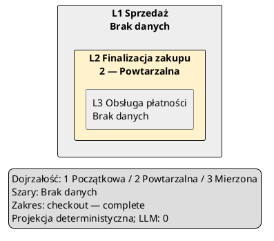

# EA1 — Capability Map

Status: **REVIEWED — EA1 authorized 2026-10-19**. Kontrakt i przyrosty zatwierdzone zakresem
IMPLEMENTACJA EA1; nie zmieniają istniejących diagramów. Grupa: **Enterprise Architecture /
Architektura korporacyjna**. Kolejność: EA1 → EA1b → EA2 → EA3 → EA4.

## Stan wyjściowy i cel

Preflight DOC3/EA1: czysty checkout `feature/mcp1-cli-mcp-core-full`, HEAD
`fa586dd6f0398f72cdab4925bf5db907e00ebb23`, staging pusty. Po fetch remote `github/main`
wskazuje `d723af09dacc71746a82c0fddcad97beb2cece8e` (merge PR #10).
Gałąź robocza `docs/doc3-ea1` powstała z tego main. Plan opiera się na jego kodzie;
przed implementacją porównać ponownie HEAD, working tree i API.

Capability Map odpowiada na pytanie: „jakie zdolności biznesowe obejmuje wskazany zakres,
jak się dzielą i jakie jawne oceny mają?”. To projekcja katalogu, **zero wywołań LLM**,
bez konfiguracji providera, modelu lub klucza. Capability jest odrębnym pojęciem biznesowym;
nie staje się systemem, aktorem, kontenerem ani nazwą API.

EA1 obejmuje lokalny katalog, walidację, wybór zakresu, renderer PlantUML, raport provenance,
Create Diagram i zapis oryginalnej pary przez ART1, demo oraz tutoriale. EA1b obejmuje dopiero
transport enterprise przez CLI/MCP i jego kontrakty. Nie dodajemy zależności, webview, edytora
katalogów, Buildera capabilities, LLM, relacji aplikacyjnych, ogólnego metamodelu ani heatmapy
wywnioskowanej z opisów. Dotychczasowe cztery diagramy, Verify Flow i ich schematy pozostają zgodne.

## Proponowany katalog wymiany `enterprise.json`

Jeden UTF-8 JSON o ścisłym schemacie `schemaVersion: 1`, format
`archi-agent-enterprise/1`. To wersja katalogu enterprise, niezależna od istniejącej wersji
wiedzy K1/MCP. Bez duplikatów kluczy, nieznanych pól, include, URL do pobrania, globów i skryptów.
Pierwszy adapter czyta tylko ten plik; nie wymaga Structurizr, pięciu plików Knowledge Pack,
metadanych interfejsów ani providera. Adapter zewnętrzny może dostarczyć ten sam zwalidowany
kontrakt bez generowania pliku Markdown lub fikcyjnego modelu Structurizr.

```typescript
type EnterpriseCoverage = "partial" | "complete" | "not-provided";
interface EnterpriseReference {
  sourceId: string;
  recordId: string;
  fields: readonly string[]; // rzeczywiste JSON Pointer: /name, /parentId, /ratings/maturity
  reference?: { uri: string; version: string; fragment?: string }; // opis, nigdy automatyczny fetch
}
interface Capability {
  id: string;
  name: string;
  description: string;
  parentId?: string;
  provenance: readonly EnterpriseReference[];
  ratings?: Readonly<Record<string, number>>; // klucz istniejącej skali
}
interface RatingScale {
  id: string;
  name: string;
  levels: readonly { value: number; label: string }[];
  provenance: readonly EnterpriseReference[]; // /name i /levels
}
interface EnterpriseCatalogV1 {
  schemaVersion: 1;
  format: "archi-agent-enterprise/1";
  source: {
    id: string;
    name: string;
    scope: { id: string; description: string; coverage: EnterpriseCoverage };
  };
  scales: readonly RatingScale[];
  capabilities: readonly Capability[];
}
```

`complete` oznacza pełność wyłącznie w opisanym zakresie, nigdy całe przedsiębiorstwo.
`partial` może mieć rekordy, ale nie potwierdza pełnego pokrycia. `not-provided` wymaga pustej
listy capabilities i daje `enterprise-data-unavailable`; nie produkuje pustego „udanego” diagramu.
Pusty partial/complete daje `empty-scope` z zachowaną deklaracją pokrycia. Odrębny wynik
`enterprise-unsupported` oznacza źródło, które nie oferuje tego kontraktu.
Brak wybranej oceny jest stanem danych także wtedy, gdy sam katalog jest complete.

ID capability: `[a-z][a-z0-9-]{0,63}`, unikalne w katalogu; tożsamość to para
`source.id + capability.id`. Zmiana nazwy zmienia digest, zachowując ID i wszystkie wiązania.
Nie wyprowadzać ID z nazwy i nie łączyć automatycznie rekordów różnych źródeł.
Rodzic należy do tego samego katalogu. Brak parent oznacza L1, dziecko L2, wnuk L3.
Nie zapisujemy redundantnego `level` i nie dopuszczamy L4. Przy źródle częściowym adapter musi
przekazać rzeczywistych przodków wybranego rekordu lub zwrócić brak danych; brakujący rodzic
nie zmienia dziecka w korzeń. Nie tworzymy placeholderów capabilities.

Ocena wskazuje jedną skalę i jej dokładną wartość. Skala ma 2–7 unikalnych, rosnących wartości
całkowitych 0–100 i niepuste etykiety. Wartość 0 jest poprawna tylko jako jawny poziom danej
skali. Brak pola/skali oceny w rekordzie oznacza brak danych, nigdy 0. Nie obliczamy średniej
rodzica z dzieci ani nie dziedziczymy oceny; bez domyślnej skali i progów. Maksymalnie 8 skal;
kolorowanie używa jednej wybranej. Definicja skali i każda ocena mają ślad provenance.
Skala deklaruje provenance pól name/levels jak rekord biznesowy. Lokalny adapter dodaje
lokator `/scales/<index>`, a dla capabilities lokatory do pól;
zewnętrzny adapter zachowuje prawdziwe reference zamiast fikcyjnych linii.

Provenance rekordu ma co najmniej jeden wpis dla każdego dostarczonego pola biznesowego
(name, description, parentId i każdej oceny); pola mogą współdzielić wpis. `sourceId` musi
odnosić się do `source.id`; `recordId` zachowuje identyfikator oryginalny, a `fields` dokładne
pokryte pola. Lokalny adapter dodaje odrębnie `enterprise.json` + JSON Pointer, file SHA-256
i pozycję z parsera, jeśli dostępna; nie nadpisuje deklaracji źródła informacją o adapterze.
Brak fizycznego lokatora pozostaje jawny, nie stosujemy line 1. URI przechodzi istniejącą
politykę source-reference (bez userinfo/query/hash; fragment osobno); samo URI jest danymi.

### Przykład poprawnego wejścia

```json
{
  "schemaVersion": 1,
  "format": "archi-agent-enterprise/1",
  "source": {
    "id": "retail",
    "name": "Retail Checkout",
    "scope": {"id": "checkout", "description": "Zdolności obsługi zakupów", "coverage": "complete"}
  },
  "scales": [
    {"id": "maturity", "name": "Dojrzałość", "levels": [
      {"value": 1, "label": "Początkowa"},
      {"value": 2, "label": "Powtarzalna"},
      {"value": 3, "label": "Mierzona"}
    ], "provenance": [{"sourceId": "retail", "recordId": "maturity", "fields": ["/name", "/levels"]}]}
  ],
  "capabilities": [
    {"id": "sales", "name": "Sprzedaż", "description": "Obsługa zakupów klienta",
     "provenance": [{"sourceId": "retail", "recordId": "sales", "fields": ["/name", "/description"]}]},
    {"id": "checkout", "name": "Finalizacja zakupu", "description": "Zakończenie koszyka", "parentId": "sales",
     "ratings": {"maturity": 2},
     "provenance": [{"sourceId": "retail", "recordId": "checkout", "fields": ["/name", "/description", "/parentId", "/ratings/maturity"]}]},
    {"id": "payment", "name": "Obsługa płatności", "description": "Przyjęcie płatności", "parentId": "checkout",
     "provenance": [{"sourceId": "retail", "recordId": "payment", "fields": ["/name", "/description", "/parentId"]}]}
  ]
}
```

Skala i jej deklaracja provenance są jawne w pliku; adapter dodaje `/scales/0` i hash pliku jako dowód odczytu.
Przykład pokazuje trzy poziomy i dwie zdolności bez oceny. Etykiety mogą pozostać polskie także
przy angielskiej legendzie; wybór języka nie tłumaczy nazw biznesowych automatycznie.

### Walidacja i granice

Proponowane początkowe limity, do sprawdzenia scenariuszem renderowania przed akceptacją:
plik 1 MiB, maksymalnie 100 000 tokenów JSON i 64 poziomy składni JSON, 1000 capabilities, głębokość 3, name 160 znaków Unicode, description 2000,
16 wpisów provenance na rekord, 32 pola na wpis; source/scale labels do 160 znaków.
Odczyt 10 s, cała operacja 30 s, anulowanie między etapami. Błędy są ograniczone do 100
z liczbą pozostałych; ograniczenie diagnostyki nigdy nie dopuszcza niepoprawnego katalogu.

Parser odrzuca powtórzone ID/klucze, brak rodzica, self-parent, cykle, głębokość >3, puste
nazwy/opisy, nieznane skale/wartości i niepełne referencje provenance. Identyczne nazwy pod
różnymi ID są dozwolone jako odrębne zdolności, z ostrzeżeniem o niejednoznacznej nazwie;
wybór odbywa się zawsze po ID. Wyświetlany opis pokazuje ID przy kolizji nazw.
Łańcuchy są NFC, bez brzegowych białych znaków, kontroli i ukrytych znaków bidi;
nie normalizujemy dowolnych danych po cichu. Tablice i strings są ograniczane przed projekcją.

Limit mapy: 120 widocznych capabilities, 12 korzeni, wynik PlantUML 256 KiB, raport 1 MiB.
Nadmiar daje `map-too-large` z faktyczną liczbą i instrukcją wyboru korzenia lub L1/L2.
Bez diagramu, bez artefaktu, bez automatycznego obcięcia, paginacji ani dzielenia na pliki.
W UI po błędzie można jawnie wrócić do wyboru; ograniczenie do L1/L2 jest świadomą projekcją,
a raport wylicza ID/count elementów poza zakresem i poniżej wybranej głębokości.
Nie utożsamiamy pominięcia przez wybór z brakiem danych źródłowych.

## Czyste API, projekcja i renderowanie

Proponowane API eksportowane przez `src/runtime/index.ts`:

```typescript
type EnterpriseSourceConfig = {kind: "enterprise-json"; path: string};
interface CapabilityMapSelection {
  rootIds: readonly string[]; // [] = wszystkie korzenie L1
  maxLevel: 1 | 2 | 3;       // bezwzględny poziom katalogu, nie rebazowany
  colorBy: {kind: "none"} | {kind: "rating"; scaleId: string};
  language: "pl" | "en";
  expectedCatalogDigest: string;
}
// Czysty core; wynik błędu zawiera code, ograniczone issues i counts.
validateEnterpriseCatalog(raw: unknown): EnterpriseValidationOutcome;
createEnterpriseSnapshot(catalog: EnterpriseCatalogV1, provenance: EnterpriseSourceEvidence): EnterpriseSnapshot;
projectCapabilityMap(snapshot: EnterpriseSnapshot, selection: CapabilityMapSelection): CapabilityMapProjectionOutcome;
renderCapabilityMap(projection: CapabilityMapProjection): CapabilityMapRenderOutcome;
// Runtime komponuje Node I/O i czysty core; request nie ma generator/flow/model.
inspectEnterpriseSource(source: EnterpriseSourceConfig, signal?: AbortSignal): Promise<EnterpriseInspectionOutcome>;
generateCapabilityMap(request: {source: EnterpriseSourceConfig; selection: CapabilityMapSelection},
  signal?: AbortSignal): Promise<CapabilityMapOutcome>;
```

Nazwy typów z tego bloku są propozycjami, nie istniejącymi eksportami. `EnterpriseSnapshot`
obejmuje zamrożony zwalidowany katalog, source evidence, wyliczoną hierarchię, catalogDigest
oraz sourceBytesSha256. Sam core otrzymuje tekst/obiekty i evidence; nie czyta ścieżek.
Node odczytuje plik przez istniejący bounded local-text-input/read-policy, bez symlinków.
Runtime ładuje raz na operację; wcześniejsza inspekcja i wybór są związane expectedCatalogDigest.
Zmiana po inspekcji daje `stale-source`; użytkownik powtarza wybór. Równoważna zmiana formatowania
nie zmienia semantyki wyboru, ale raport generacji zawsze wskazuje rzeczywisty nowy hash bajtów.
Nie ma cache między operacjami ani odświeżania źródła podczas ART1 Save.

Selekcja korzeni dotyczy wyłącznie istniejących L1. UI pokazuje nazwę, ID, coverage i liczbę
potomków. Wybranie L2 jako samodzielnego nowego L1 nie jest wspierane w EA1.
Zastosowanie filtra jest dokładne: wszystkie dzieci wybranych L1 do maxLevel; bez arbitralnej
selekcji pojedynczych liści. Chroni to widoczność rodziców i upraszcza odbiór.

Kolejność: preorder drzewa; korzenie i rodzeństwo sortowane po stabilnym ID porównaniem
kodów, bez localeCompare. Render odzwierciedla zagnieżdżenie przez `rectangle` L1/L2,
liście L3, z lokalnymi aliasami `cap_0001` itd. Alias wynika z kolejności ID, nigdy z nieufnej
nazwy jako kodu. Węzły bez dzieci także mogą wystąpić na L1/L2. Nie rysujemy strzałek parent
jako zależności biznesowych. Kontrolowane łamanie nazwy co najwyżej po 32 znakach na granicy
słów (dłuższe słowo po punktach kodowych), bez wielokropka i utraty treści. Opisy pozostają
w raporcie, by nie przeładowywać kafelków. Każdy kafelek pokazuje poziom i pełną nazwę.

Stałe kolory dla 2–7 kolejnych poziomów skali, z zamkniętej palety zależnej od liczby poziomów;
nie pobieramy CSS/kolorów z katalogu. Etykieta oceny i legenda podają wartość, etykietę oraz
nazwę skali, więc kolor nie jest jedynym nośnikiem. Brak oceny to neutralny szary i „Brak danych” /
„No data”. `none` daje neutralny diagram bez interpretacji ocen. Partial coverage jest widoczne
w legendzie i raporcie niezależnie od koloru. Brak automatycznej agregacji ani oceny przez LLM.

Renderer emituje zamknięty lokalny subset. Osobny walidator sprawdza nesting, aliasy, rozmiar,
liczbę i kolejność węzłów oraz mapowanie linii. Tekst przechodzi bezpieczne kodowanie dla quoted
PlantUML labels, a znaki składni/markup są kodowane bez utraty czytelnego tekstu; niedające się
bezpiecznie przedstawić etykiety są odrzucane z konkretnym polem. Niedozwolone kontrolki,
nowe linie w polach i próby dyrektyw nie mogą tworzyć osobnych instrukcji. Testować quotes,
backslash, nawiasy, `!include`, `@enduml`, HTML/Creole i URL; bez zdalnych include/linków,
makr, tytułu z surowego kodu i automatycznego otwierania reference.

### Przykład wyniku

Dla powyższego katalogu i `{rootIds:[], maxLevel:3, colorBy:{kind:"rating",scaleId:"maturity"}, language:"pl", expectedCatalogDigest:<digest inspekcji>}`
semantyka wyniku jest następująca (skrócony przykład notacji, finalny golden powstaje przy implementacji):



Sukces `CapabilityMapOutcome`: `status:"success"`, `diagramType:"capability-map"`, `plantUml`,
`report`, `artifact`. Raport jest ścisłym `format:"archi-agent-capability-map-report",
formatVersion:1`, zawiera `generationPath:"deterministic-catalog-projection"`, `modelCalls:0`,
`semanticReview:{status:"not-applicable",reason:"deterministic-projection"}`,
`deterministicValidation:{verdict:"passed"}`, coverage źródła, scope, wybór, wszystkie trzy
hashe opisane niżej, widoczne rekordy/provenance, skale z provenance, linię renderu każdego
rekordu i listę świadomie niewidocznych ID z powodem. Nie dopisujemy fikcyjnego modelu,
reviewera ani „LLM review passed”. Przykład: widoczne `sales, checkout, payment`, poziomy
`1,2,3`, ocena tylko `checkout:maturity=2`, brak pominięć. Digesty w tym opisie są polami
wyliczanymi z wejścia, nie przykładowymi stałymi hashami do skopiowania.

Błędy są rozłączne: `invalid-source`, `enterprise-unsupported`, `enterprise-data-unavailable`,
`empty-scope`, `invalid-selection`, `stale-source`, `map-too-large`, `render-invalid`, `cancelled`.
Każdy zwraca bezpieczny code/counts i następne działanie, nigdy częściowy PlantUML czy artifact.

## Snapshot i digest

Użyć istniejącego `canonicalSerialize` / `stableDigest` z `src/core/util/stable-digest.ts`.
Object keys sortowane po UTF-16, strings NFC już sprawdzone, JSON scalar encoding, UTF-8,
bez whitespace i końcowego LF. Listy rekordów/skali/provenance sortowane jawnie po kluczach;
`levels` rosnąco po value, korzenie/fields jako sortowane zbiory bez duplikatów.

- `catalogDigest = SHA256(canonical({domain:"archi-agent-enterprise-snapshot/1", catalog:normalizedCatalog}))`:
  wszystkie pola katalogu, w tym nazwy/opisy, parent, oceny, skale i ich deklarowane provenance,
  coverage/scope oraz źródło. Nie obejmuje lokatorów dodanych przez adapter (indeksy tablicy,
  fizyczne linie, ścieżki absolutne), czasu ani hashów surowych bajtów. Field pointers wewnątrz
  deklarowanego provenance są względne do stabilnego recordId. Rzeczywisty /capabilities/<index>
  pozostaje w raporcie obok sourceBytesSha256; permutacja rekordów nie zmienia semantyki.
- `projectionDigest = SHA256(canonical({domain:"archi-agent-capability-map/1", catalogDigest,
  selectionWithoutExpectedDigest, visibleRecords, excludedIdsWithReasons, rendererVersion:1}))`.
  Obejmuje język legendy, colorBy i pełną skalę; nie obejmuje timestamp/result UUID.
- `sourceBytesSha256` liczy Node z dokładnych odczytanych bajtów pliku, odrębnie od semantyki;
  `diagramSha256` ART1 liczy z finalnych UTF-8 bytes z LF.

Permutacja rekordów/provenance/kluczy nie zmienia catalogDigest ani wyniku. Formatowanie pliku
zmienia tylko sourceBytesSha256 i rzeczywiste lokatory fizyczne w raporcie. Zmiana nazwy,
opisu, parent, oceny, skali, coverage, logicznego provenance lub zakresu zmienia catalogDigest;
zmiana wyboru/legendy zmienia projectionDigest. Żaden digest istniejących ścieżek K1,
Sequence/Component/C4 nie jest przebudowywany według tych reguł.

## Integracja VS Code i ART1

Create Diagram zachowuje obecny picker i dodaje grupę Enterprise Architecture /
Architektura korporacyjna z Capability Map. Użyć separatorów/natywnego QuickPick i istniejących
InputBox, bez nowego webview. Obecne cztery opcje pozostają dostępne. Wybór EA następuje
**przed** onboardingiem Knowledge Pack/providera, aby żadne z nich nie stało się warunkiem.
Natywny OpenDialog wybiera `enterprise.json`; inspekcja → rooty → L1/L2/L3 → none/skala →
generacja. W EA1 nie zapisujemy kolejnego ustawienia źródła: plik jest jawny dla operacji,
a obecna konfiguracja software źródła i providera pozostaje nietknięta. Multi-root wybiera
projekt jak dzisiaj. Cancel przed końcem nie otwiera wyników i nic nie zapisuje.

Host przekazuje request, pokazuje błędy i rejestruje wynik w istniejącej parze preview/save.
`generateCapabilityMap` jest osobną operacją runtime bez pól flow i generator. Nie poszerzać
`GenerateSequenceDiagramRequest` o opcjonalne pola enterprise. Wspólny picker może routować
nowy literal `capability-map`, lecz `isSupportedDiagramType`/dispatch używane przez stary
reviewed pipeline muszą nadal odrzucać go jako nieobsługiwany w tej ścieżce.

ART1 nie jest dziś automatycznie zgodne: `DiagramArtifact.diagramType`,
`captureDiagramArtifact` i `reportProjection` w `src/runtime/diagram-artifact.ts` są związane
z czterema typami, K1 i requestem generatora. Należy dodać mały osobny capture dla zwalidowanego
wyniku capability oraz oddzielną ścisłą projekcję raportu, zachowując istniejący writer,
WeakSet completed, bundle plan, rejestr podglądów i komendę Save. To konkretna zmiana planowana,
a nie założenie, że nowe pola już przechodzą przez allowlistę.

Zachować ART1 `formatVersion:1` jako kopertę zapisu; `generationReport` ma własny format/version.
Metadata enterprise używa własnego contract ID oraz catalog/projection digest; pola provider/model
są nieobecne, nie pozorują requestu. Trzeba objąć je allowlistą capture i walidacją; stare raporty
pozostają byte-compatible. Źródło wskazać jako project-relative/logical-name-only; brak absolutnych
ścieżek w przenośnym raporcie. Zapis oryginalnej pary po edycji podglądu nadal zapisuje oryginał.
Save nie czyta ponownie katalogu i nie wywołuje modelu. Wyłączność, Cancel, ochrona obcych danych,
conditional cleanup i granice atomowości są dokładnie tym samym kontraktem ART1.

## EA1b — dokładna granica CLI/MCP

Sprawdzony kod bazowy:

| Plik | Obecny kontrakt i konsekwencja |
| --- | --- |
| `src/core/knowledge-pack/knowledge-transfer.ts` | `KnowledgeResponseV1`: schemaVersion 1, format `archi-agent-knowledge-contributions/1`, source/version, snapshot/id/digest; strict records i scope tylko systems/actors/relationships/aliases/rules. Capability nie można dopisać bez nowej wersji. |
| `src/knowledge-server/adapter.ts` | `KnowledgeAdapter.load(sourceId, signal): Promise<KnowledgeResponseV1>`; produkcyjny przykład tylko Structurizr. Nie dostarcza enterprise. |
| `src/knowledge-server/server.ts`, `src/node/mcp-knowledge-source.ts` | Stałe `get_knowledge_snapshot`; walidacja digestów i formatu; structuredContent i tekst muszą być zgodne. Brak LLM tools. |
| `src/hosts/local/config.ts` | strict config schemaVersion 1, sources local-directory/structurizr-json/mcp, jawne readRoots, providers wymagane jako mapa (może być pusta). |
| `src/hosts/local/schemas.ts`, `src/cli/main.ts` | `generateInputSchema` wymaga input i provider; diagram generate obsługuje tylko cztery typy; C4 wymaga ID i expectedKnowledgeDigest. EA nie można dopisać jako opcjonalnego type z pustym provider. |
| `src/runtime/host-results.ts` | HostResultV1 ma trzy operation, ścisłą pięciokategoriową inspection/evidence i kształt diagramu z GenerationSummary. Nie przenosi jeszcze wyniku capability. |
| `src/mcp/server.ts` | Cztery tools: inspect_knowledge, verify_flow, resolve_flow_names, generate_diagram. Jedno aktywne żądanie, 4 MiB structured result, 10 MiB frame. |

Rekomendacja EA1b: **osobny kontrakt enterprise/1 i osobne stałe tools**, bez mutacji odpowiedzi
`get_knowledge_snapshot` v1. Nie tworzyć szerokiego v2 obejmującego przyszły metamodel.
Nowy knowledge tool `get_enterprise_snapshot` z input
`{schemaVersion:1, sourceId:"retail", format:"archi-agent-enterprise/1"}` zwraca strict envelope
`{schemaVersion:1, format:"archi-agent-enterprise-snapshot/1", source:{id,version},
snapshot:{id,digest}, catalog, sourceEvidence}`. Version/digest liczone według jawnych reguł
enterprise; klient sam rekonstruuje i weryfikuje, nie ufa hashowi serwera. sourceBytesSha256
opcjonalny tylko dla rzeczywistego pliku; zewnętrzny adapter bez pliku go nie fabrykuje.
Envelope/kompletna ramka max 8 MiB, z wliczonym escaping kopii tekstowej; ograniczenia katalogu
nadal obowiązują. reference pozostaje opisem, nie uprawnieniem I/O.

Rozpoznanie obsługi deterministycznie przez MCP `tools/list` (bounded katalog, walidacja nazwy
oraz input/output schema). Tylko deklaracja narzędzia z formatem/version 1 pozwala na wywołanie.
Brak tool w serwerze v1 daje `enterprise-unsupported`; obecny tool z not-provided daje
`enterprise-data-unavailable`; inna wersja `enterprise-version-unsupported`; błędny digest
`enterprise-response-digest-mismatch`. Bez próby drugiego narzędzia i bez fallbacku z nazw systemów.
Dotychczasowy klient software i serwer v1 nadal używają niezmienionego get_knowledge_snapshot.
Nowy `EnterpriseKnowledgeAdapter.load(sourceId, signal): Promise<EnterpriseTransferResponseV1>`
pozostaje osobny od istniejącego `KnowledgeAdapter`; oba mogą współdzielić transport serwera.
Dodatkowy tool nie jest wymaganiem dla starych serwerów; nowy serwer może oferować oba.

W konfiguracji hosta EA1b dodać **schemaVersion 2** jako osobny parser/union z niezmienionym v1;
v2 zawiera stare sources/providers oraz `enterpriseSources`:
`{"retail":{"kind":"enterprise-json","file":{"root":"project","path":"enterprise.json"}}}`
lub `{"remote":{"kind":"mcp-enterprise","server":"knowledge","sourceId":"retail"}}`.
Stary v1 nie przyjmuje nieznanych pól; nowy klient nadal w pełni obsługuje v1 dla starego produktu.
VS Code EA1b może dodać osobną konfigurację enterprise MCP w User settings; nie pozwala
workspace wybrać executable i nie przerabia istniejącego software źródła na capability catalog.
To należy do EA1b, nie EA1.

Nowe CLI: `archi-agent enterprise inspect --config /srv/archi-agent.json --source retail`
oraz `archi-agent capability-map generate --config /srv/archi-agent.json --source retail
--root-id sales --level 3 --color-by maturity --language pl --expected-catalog-digest SHA256
--format json`. Bez `--input` i `--provider`; none jest jawną wartością --color-by.
Nowe function tools: `inspect_enterprise`, `generate_capability_map`; input generowania
`{source, rootIds, maxLevel, colorBy, language, expectedCatalogDigest}` plus dotychczasowy timeout.
Wyjście: osobny strict `EnterpriseHostResultV1` z version 1, operation `enterprise.inspect` lub
`capability-map.generate`, outcome i istniejącą bezpieczną meta. Dotychczasowy HostResultV1,
cztery tools i verification exit semantics pozostają niezmienione. structuredContent i kopia tekstowa
identyczne; max 4 MiB wyniku i 10 MiB ramki funkcji nadal obowiązują.

Wyjścia CLI EA: 0 sukces (coverage nadal jawne; partial success nie oznacza pełności firmy),
2 brak danych/nieobsługiwane/pusty zakres, 3 input/config/stale/limit/render/execution error;
124 deadline, 130/143 sygnały. Nie używać tych exitów do zmiany reguł `flow verify`.
Stdout pojedynczy JSON z LF, diagnostyka stderr. Bez zapisu źródeł, automatycznego zapisu wyników,
sekretów VS Code, shella ani OS sandbox obiecywanego przez readRoots.

EA1 implementuje czyste kontrakty użyteczne dla EA1b, ale **żadnych nowych tools, config v2,
CLI args, parserów transportu i API serwera**. EA1b osobno implementuje wskazane surfaces,
negocjację, transport parity, procesy poza repo oraz instrukcje PL/EN.

## Pliki i sekwencja małych przyrostów

| Przyrost | Proponowane pliki / zakres | Odbiór przed następnym krokiem |
| --- | --- | --- |
| 1. Katalog i snapshot | nowe `src/core/enterprise/enterprise-catalog.ts`, `enterprise-snapshot.ts`; `test/core/enterprise/enterprise-catalog.test.ts`, `enterprise-snapshot.test.ts` | Poprawny przykład, negatywne hierarchie/skale/provenance, stabilność i zmiany digestów; bez I/O i LLM |
| 2. Projekcja i renderer | nowe `src/core/enterprise/capability-map.ts`, `capability-map-renderer.ts`; testy projekcji/renderera w `test/core/enterprise/` | Zakres/poziomy, neutralne braki, limity, golden i rzeczywisty lokalny render |
| 3. Lokalny runtime + ART1 | nowe `src/node/enterprise-json-source.ts`, `src/runtime/capability-map.ts`; zmiany `src/runtime/index.ts`, `src/runtime/diagram-artifact.ts`; odpowiednie testy runtime/node | I/O policy, stale/cancel, gotowy oryginalny artifact i istniejący writer poza repo |
| 4. Cienki host | `vscode-extension/src/commands/generate-sequence-diagram.ts` (picker/router); mały nowy `commands/generate-capability-map.ts`; istniejący registry/save i `src/core/model/diagram-type.ts` tylko jeśli routing potrzebuje literal | Nowa grupa w Create Diagram, brak model/onboarding, niezmienione cztery ścieżki i prawdziwe Host/UI |
| 5. Demo i instrukcje | nowe `examples/retail-checkout/architecture/enterprise.json`, referencyjne `.puml` i render z provenance w assets; tutoriale START-HERE PL/EN, `docs/{pl,en}/tutorials.md`, user-guide; sync-help i celowany checker demo | Z gotowego checkoutu pierwszy diagram biznesowy offline, PL/EN i paczki Core/Full; nie zmieniać istniejących release assets |

Dokładne ścieżki nowych plików są propozycją; przed kodowaniem potwierdzić rzeczywisty routing
registry. Retail software model/overlay pozostaje źródłem czterech obecnych diagramów; katalog
biznesowy jest osobny i nie wywodzi capabilities z jego systemów. ZIP-y DEMO1 pozostają niezmienione.
Późniejsze wydanie nowych ZIP-ów wymaga osobnego zadania publikacji i nowej tożsamości.

EA1b pliki: `src/hosts/local/config.ts`, `schemas.ts`, `operations.ts`, `src/cli/main.ts`,
`src/mcp/server.ts`, nowe enterprise-transfer/client w core/Node, `src/knowledge-server/adapter.ts`
i `server.ts`, własny strict portable-result schema oraz `src/runtime/index.ts`; testy transportów,
konfiguracji i CLI w odpowiednich istniejących katalogach. Nie dopisywać tych zmian w EA1.

## Kontrole i scenariusze odbioru implementacji

1. Hierarchia: L1/L2/L3, wiele korzeni, liść na L1/L2, self-parent/cykl, brak rodzica,
   L4, duplikaty ID, zmiana nazwy bez zerwania ID, nazwy powtórzone pod różnymi ID.
2. Pokrycie i provenance: partial/complete/not-provided, pusty zakres, brak ocen i ocena 0,
   nieznana skala, każda deklarowana właściwość i lokator, brak fikcyjnych referencji/wierszy;
   zakres wyświetlony w legendzie i raporcie; żadne pominięcie nie jest ciche.
3. Digest: permutacja/formatowanie kontra rename/parent/opis/scale/provenance/scope;
   granica inspekcja→generacja daje stale; ART1 po zmianie źródła zachowuje zamrożoną parę.
4. Limity: każdy próg dokładnie i +1, szerokie L1, 120 i 121 kafelków, bytes Unicode,
   brak automatycznej redukcji; Cancel na odczycie/projekcji i przed zapisem.
5. Bezpieczeństwo: literalne nieufne etykiety/provenance, wstrzyknięcie PlantUML i markup,
   symlink/traversal/nieprawidłowe UTF-8/JSON duplicate keys; brak sieci, odczytu sekretów i LLM.
6. Wyrenderować lokalnym PlantUML bez remote includes. Obejrzeć referencyjną mapę i stresowy
   układ: długie nazwy, polskie znaki, trzy poziomy, wiele rodzeństw, wszystkie oceny/brak ocen,
   legendę i wydruk/skalę 100%. Golden tekstu nie zastępuje oględzin. Jeśli 120 kafelków jest
   nieczytelne, obniżyć jawny limit przed odbiorem, bez auto-truncation i nowego layout frameworka.
7. Dokładny świeży Core/Full VSIX poza repo, pusty PATH/NODE_PATH: inspect→generate→ART1,
   bez generator configuration i bez root node_modules. Runtime obu profili identyczny.
8. Rzeczywisty Extension Host sprawdza komendy, multi-root, oryginalne artifact identity,
   scope i lifetime. Osobny widoczny UI: Create Diagram → grupa EA → plik → korzenie/poziom/
   kolor → dwa podglądy → natywne Save/Cancel. Brak providera i packa nie uruchamia onboarding.
   Po ręcznej edycji podglądu Save nadal zapisuje oryginał. Testowany hash VSIX w każdym dowodzie.
9. Regresje: cztery diagramy i ich call budgets/snapshoty, Verify Flow bez zmian, SRC1 nazwy,
   aliasy/hierarchia/provenance, ART1 wyłączność/rollback/Cancel i registry lifetime; Help PL/EN.
   Nie deklarować naprawy otwartych AUD-003/004 w ramach EA1.
10. Komendy z manifestu: celowane testy nowych modułów, `npm test`, `npm run typecheck`,
    `npm run extension:typecheck`, `npm run extension:test`, `npm run extension:build`;
    `npm run extension:package -- --profile core --out <nowy-katalog>`, dokładne extension:verify,
    następnie analogicznie Full. `prepare-ci-ocr.mjs` przed Full zgodnie z instrukcją developerską.
    Nie nakładać pakowania/gauntletów. Właściwy pełny profil funkcjonalny, osobny niezależny
    review i późniejszy owner smoke zgodnie z workflow; wyniki przypisane dokładnym źródłom/paczkom.

EA1b dodatkowo: serwer v1 z obecnymi funkcjami; nowy serwer software+enterprise; brak enterprise,
nieobsługiwana wersja, malformed/oversize/digest mismatch, tools/list, EOF/timeout/cancel/busy,
zmiana danych, identyczne wyniki CLI/function MCP/lokalny VSIX i źródło enterprise MCP; zero
fallbacków na systemy. Testy rzeczywistych stdio procesów poza repo i brak zanieczyszczenia stdout.

## Dalsze widoki

| Etap | Cel | Wymagane dane | Zależności |
| --- | --- | --- | --- |
| EA2 Capability–Application Map | Pokazać aplikacje wspierające konkretne capabilities i jawne luki pokrycia | Stabilne capability i application IDs, jawne mapowania supports z provenance i deklaracją coverage; brak mapowania pozostaje unknown w partial source | EA1/EA1b, osobny minimalny application contract i referencje do istniejących systemów bez zmiany capability w system |
| EA3 Value Stream | Kolejność etapów dostarczania wartości i wspierające je capabilities | Stabilne stream/stage IDs, jawny porządek, wartość/odbiorca, stage→capability mapping i provenance | Zweryfikowane capability IDs; osobny plan etapów, bez wywnioskowania kolejności z systemów |
| EA4 Application Landscape | Krajobraz portfela aplikacji według jawnego grupowania biznesowego/organizacyjnego | Application IDs, nazwa/opis, właściciel lub domena, jawne grupowania i opcjonalne oceny z provenance | Uzgodniony kontrakt aplikacji EA2; mapowania capabilities opcjonalne, bez automatycznej klasyfikacji |

## Rekomendacje i decyzje do przeglądu

Rekomenduję odrębny mały katalog enterprise/1 oraz osobną operację deterministyczną.
Najprostsza alternatywa — zakodowanie capabilities jako K1 systems — łamie semantykę i wymaga
technicznych metadanych biznesowej mapy. Ogólny metamodel wszystkich widoków zwiększyłby dziś
liczbę typów i migracji bez poprawy EA1. Proponowany kontrakt dotyka tylko nowego katalogu,
projekcji, host routingu i ścisłego capture ART1; nie zwiększa kosztu LLM (zawsze 0).

Do akceptacji planu należą: niezależna wersja enterprise/1; brak LLM jako jawna ścieżka obok
ADR 0002 dla istniejących diagramów; osobny raport i capture ART1 bez fikcyjnego review;
limity/wybór L1 i poziomu; brak konfiguracji trwałego źródła w EA1; osobne tools i config v2
wyłącznie w EA1b. To propozycje do późniejszego zatwierdzenia implementacji, nie dokonane zmiany
architektury. Brak nierozstrzygniętej rutynowej decyzji blokującej przygotowanie tego planu.

Definition of Done EA1: poprawny katalog biznesowy daje czytelną, odtwarzalną mapę i pełny
raport provenance bez modelu, z istniejącego Create Diagram i ART1, z jawnym zachowaniem
braków/limitów, działającym demo PL/EN, świeżymi paczkami i dowodami runtime/Host/UI;
obecne funkcje pozostają zgodne. EA1b nie jest warunkiem użycia lokalnej Capability Map.

Plan reviewed independently: 0 HIGH; 2 MEDIUM resolved by adopting the existing 1 MiB /
100 000 token JSON limit and SourceReference with required version. Runtime/ART1 and
zero-provider routing verified against base d723af0. EA1b remains outside implementation.
