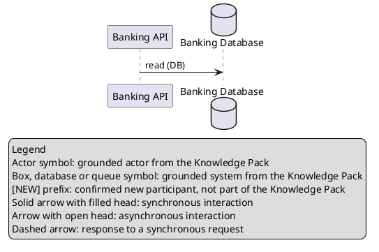

# MCP1 — plan CLI, lokalnego MCP i profili Core/Full

Status: **REVIEWED — IMPLEMENTATION AUTHORIZED**. Niezależny review 2026-10-18: trzy ustalenia zamknięte korektami planu; testy zachowania są bramkami implementacji.
Data: 2026-10-18. Zlecenie właściciela obejmuje review, implementację, weryfikację i lokalny checkpoint.

MCP1 udostępnia istniejący runtime przez dwa cienkie adaptery: nieinteraktywne CLI
i lokalny MCP stdio. Pierwszy użyteczny przepływ to sprawdzenie Sequence w PR bez modelu.
Ten sam przyrost rozdziela VSIX na domyślny Core i opcjonalny Full z lokalnym OCR PL/EN.
Ocena relacji, parser, resolver, snapshoty, walidatory i renderery pozostają wspólne.

## Preflight wykonania i status historycznych zapisów

Zlecenie implementacji: branch początkowy `feature/ver1-c4-diagrams`, pełny HEAD
`ea3df0a73067f66a7e5fe8d2b8053c6059a8861d`, zmienione project-state i nowy plan, staging pusty.
Prace planistyczne zachowano na `feature/mcp1-cli-mcp-core-full`. Q1 została jawnie zatwierdzona.
Poniższe zapisy o stanie samego planowania i dawnym owner smoke są historyczne; aktualny odbiór
MCP1 należy do raportu weryfikacji i project-state. Nowy zakres KNOW przeszedł osobny review
opisany na końcu. Lokalny checkpoint po bramkach jest autoryzowany; bez push/merge/tag/publikacji.

## Preflight i stan wyjściowy

- Branch: `feature/ver1-c4-diagrams`.
- Pełny HEAD: `ea3df0a73067f66a7e5fe8d2b8053c6059a8861d`.
- Zastany working tree czysty; staging pusty. Brak rozbieżności z przekazanym stanem.
- Odczytano [AGENTS.md](../../AGENTS.md), [ADR 0002](../adr/0002-deterministic-diagram-plan-renderers.md),
  [workflow](../development-workflow.md), [roadmapę](../product-roadmap.md),
  [architekturę](../architecture.md), kontrakty i raporty
  [SRC1](../src1-structurizr-source.md), [SRC1 verification](../src1-verification.md),
  [VER1](../ver1-flow-verification.md), [C4](../c4-diagrams.md),
  [VER1/C4 verification](../ver1-c4-verification.md) oraz oba niezależne review.
- Historyczny lokalny odbiór VER1/D3/D4: root 1893/1893, extension 696/696,
  typecheck/build/package/verify, packaged runtime, Host, UI i niezależny review PASS.
  Transport był syntetyczny. Wyników nie sumować; nie uruchamiano ich ponownie do planowania.
- Owner smoke DEFERRED, remote CI SRC1/VER1/D3/D4 NOT_RUN, Windows ARM64 runtime NOT_RUN;
  AUD-003–006 OPEN. Przygotowanie planu nie zależy od wykonania owner smoke.

Podstawą API jest [src/runtime/index.ts](../../src/runtime/index.ts). Dwa komentarze są
nieaktualne: `KnowledgePackSourceConfig` opisuje tylko Markdown, choć unia obejmuje SRC1;
`ArchiAgentRuntime` mówi o przyszłym `generateDiagram`, choć metoda już istnieje.
To korekty komentarzy w ramach implementacji, bez zmiany zachowania.

## Zakres i granice

Minimalne operacje to:

| Operacja | Zachowanie | Wywołania LLM |
| --- | --- | --- |
| `knowledge.inspect` | Wczytanie i walidacja zadeklarowanego źródła; liczby, zakres, digest, braki; ograniczona inspekcja elementów i ich provenance | 0 |
| `flow.verify` | Istniejący VER1 dla `plantuml-sequence` lub `prose` | 0 dla PlantUML; najwyżej 1 dla prozy |
| `flow.resolve` | Jawne rozstrzygnięcia nazw na zachowanej sesji VER1 | 0 |
| `diagram.generate` | Istniejące `sequence`, `component`, `c4-context`, `c4-container`; wynik tekstowy PlantUML i raport | 0/1/2 według ADR 0002 |

„Przygotowanie wiedzy” oznacza tu produkcyjne wczytanie, walidację i przygotowanie snapshotu
istniejącego źródła. Nie oznacza nowego kreatora packów. K2/K3 pozostają w VSIX; MCP1
nie tworzy ich drugiego interfejsu ani automatycznej akceptacji kandydatów.

Nie dodawać narzędzi do renderowania dowolnego PlantUML w silniku graficznym. Generowanie
już obejmuje deterministyczny rendering zatwierdzonego planu do tekstu. Nie wystawiać
legacy `generateSequenceDiagram` jako domyślnej ścieżki ani fallbacku.

CLI/MCP czytają źródła; nie zapisują aliasów, nie modyfikują modelu ani packów i nie
publikują plików ART1. Zwracają oryginalny PlantUML i raport. Użytkownik może przekierować
stdout do pliku; zapis ART1 w VSIX nadal korzysta z istniejącego runtime.

Poza zakresem: weryfikacja Component/C4, nowe diagramy, EA, DSL, Chat, HTTP, OAuth,
hosting, MCP sampling/prompts/resources/tasks, trwałe sesje, retry/repair/fallback,
naprawy AUD-003–006, Marketplace oraz publikacja CLI lub VSIX.

## Wspólny runtime i zmiany publicznego API

| Istniejące API | Ponowne użycie |
| --- | --- |
| `createArchiAgentRuntime()` | Jedna kompozycja tych samych adapterów źródeł i providerów |
| `inspectArchitectureSource(config, signal)` | Jeden produkcyjny loader Markdown/SRC1; snapshot, fingerprint, counts, błędy |
| `inspectC4Source(config, signal)` | Istniejący wybór systemu po ID i digest; bez zgadywania hierarchii |
| `runtime.startFlowVerification(request)` | Parser lub interpretacja, lokalny resolver i porównanie |
| `FlowVerificationSession.current()` / `.resolveNames()` | Frozen input, interpretacja, K1 i decyzje; kontrola świeżości |
| `runtime.generateDiagram(request)` | Cztery zatwierdzone profile, walidacja planu, rendering i review |
| `GeneratorConfig`, `KnowledgePackSourceConfig`, `CancellationSignal` | Kontrakty przekazywane przez adaptery, bez zależności od VS Code |
| `convertDocument`, `conversionLimits`, K2 extraction | Wspólny guard OCR i konwersja obu profili VSIX |
| `planDiagramBundle` / `saveDiagramBundle` | Niezmieniony zapis oryginalnego ART1 w VSIX; regresje |

Adaptery importują produkt wyłącznie z `src/runtime/index.ts`. Nie importują parserów,
`compareFlow`, rendererów ani klas transportu providera. `src/core` i `src/runtime`
nie importują MCP SDK, CLI ani `vscode`.

Potrzebne, wąskie uzupełnienia publicznego runtime:

1. `inspectKnowledgeForHost(source, options)` — projekcja **jednego** wyniku istniejącego
   loadera: digest, fingerprint, counts, źródła/omissions oraz strona elementów.
   Typ i ID systemów C4 pochodzą z tego samego snapshotu. Nie wywoływać drugiego loadera,
   żeby dokleić do odpowiedzi listę C4 z innej wersji źródła.
2. `readLocalTextInput(...)` — ograniczony odczyt UTF-8 przez istniejący
   `readBoundedTextFile`; wynik obejmuje tekst i logiczną nazwę, bez repo-relative lookup.
3. `serializeFlowVerificationForHost(...)` i ścisły schemat `PortableVerificationV1`
   — wspólna reprezentacja oceny dla VSIX/CLI/MCP opisana poniżej.
4. `getDocumentConversionCapabilities()` — jawny profil i stan OCR; import runtime
   nie odczytuje ani nie ładuje zasobów OCR.

Kontrola readRoots ma konkretny punkt egzekwowania: opcjonalny
`ArchiAgentRuntimeOptions.localReadPolicy`: niezmienna polityka Node obejmująca kanoniczne readRoots oraz przypięte tożsamości dev/ino od startu procesu.
CLI/MCP zawsze ustawiają ją z kanonicznej konfiguracji startowej; żądanie toola nie może
jej podmienić. `inspectArchitectureSource` i `inspectC4Source` dostają równoważną opcję
zaufanego wywołującego, a sesja VER1 zachowuje tę politykę dla wszystkich ponownych
odczytów świeżości. Publiczny bounded read też wymaga tej polityki w CLI/MCP.
Node sprawdza containment względem dozwolonego root w miejscu rzeczywistego otwarcia
pliku, także dla modelu i nakładki. Brak opcji w obecnym VSIX zachowuje dotychczasowy
kontrakt lokalnych źródeł. To ograniczenie istniejących odczytów w warstwie Node,
bez nowego portu filesystem ani przenoszenia I/O do core.

Nie są to nowe porty ani silniki domenowe. Problem dostępu do plików rozwiązujemy
istniejącymi funkcjami Node; problem nadmiarowego wyniku — projekcją w runtime.
Gdy implementacja ujawni konieczność nowej warstwy lub zmiany granic, wrócić z problemem
i alternatywami do właściciela przed implementacją takiej zmiany.

### Wspólny wynik weryfikacji

Dzisiejszy `VerifyFlowReport` v1 zawiera pełny `sourceProvenance: KnowledgeSnapshot`.
Zwrócenie go wprost z MCP przekazałoby klientowi modelowemu cały katalog architektury.
Nie wolno użyć `JSON.stringify(session)` ani pełnego wyniku inspekcji źródła.

`PortableVerificationV1` jest jawnym, wersjonowanym DTO. Zachowuje bez zmiany wartości
wszystkie pola `VerifyFlowReport` poza pełnym `sourceProvenance`, a zamiast niego zawiera:

```typescript
type PortableVerificationV1 = {
  schemaVersion: 1;
  report: Omit<VerifyFlowReport, "sourceProvenance">;
  evidence: {
    scope: "selected-verification-evidence";
    snapshotId: string;
    snapshotDigest: string;
    sources: SourceSummary[];
    elements: SelectedElementEvidence[];
    facts: SelectedFactEvidence[];
    gaps: KnowledgeGap[];
    conflicts: KnowledgeConflict[];
    ambiguities: SelectedAmbiguity[];
    documentProvenance: SelectedDocumentEvidence[];
  };
};

type SourceSummary = KnowledgeSource;
type SelectedElementEvidence = Extract<KnowledgeFact, { table: "systems" | "actors" }>;
type SelectedFactEvidence = Exclude<KnowledgeFact, SelectedElementEvidence>;
type SelectedAmbiguity = KnowledgeSnapshot["ambiguities"][number];
// SelectedDocumentEvidence: istniejący wpis documentProvenance po filtrze użytych
// kandydatów/evidence, bez editorUri, tak jak w selectKnowledgeContext.
```

Każdy obiekt jest zamknięty; tablice i teksty mają limity istniejących kontraktów.
Typy evidence są projekcjami istniejących typów K1, nie swobodnym `Record<string, unknown>`.
Jawny schemat obejmuje również `findings.details`: dopuszczone pola zależą od kodu ustalenia.

Dobór evidence obejmuje rozwiązane elementy, wszystkie cele niejednoznaczności, jawne
decyzje oraz **każdy** `factId` z kroków i findings. Zachowuje wszystkie pochodzenia
złożonego faktu, model/overlay, rzeczywiste linie, oryginalne ID, typ/rodzica/technologię,
gdy dotyczą wybranego elementu. Nie pomija reguł ani dowodów relacji odwrotnej.
Reużyć format/allowlistę istniejącej projekcji `selectKnowledgeContext`; domknąć wybór
po jawnych referencjach findings. Nie wywoływać jej bezwarunkowo jako walidatora eksportu:
ta funkcja odrzuca snapshot z conflicts, podczas gdy raport VER1 musi zachować ocenę
i odpowiednie konflikty. Serializer nie ocenia ponownie źródła. Zachować metadane zakresu,
hashe plików i wszystkie
omissions/gaps/conflicts istotne dla wyniku, także globalne ograniczenia źródła.
Wynik bez użytego faktu nadal zachowuje metadane załadowanego źródła i jego ograniczenia.

Nie usuwać findings, interpretacji, częściowego pokrycia ani decyzji w celu skrócenia
odpowiedzi. Brak referencjonowanego dowodu to `result-contract-invalid`; przekroczenie
limitu odpowiedzi to `result-too-large`, bez pozornego pełnego wyniku.

VSIX używa tego samego serializera w istniejącym edytorze raportu JSON; aktualna ocena
i sesja w pamięci pozostają `VerifyFlowReport` v1. Nie dodawać osobnej komendy ani
historii eksportów. Wersjonowany wynik zachowuje całą ocenę i użyte dowody, a pomija
nieużyty katalog. Dokumentacja rozróżnia wewnętrzny raport v1 i publiczną kopertę v1.

Wyniki CLI/MCP otrzymują wspólną kopertę, z osobnymi, ścisłymi wariantami operacji:

```typescript
type HostResultV1 = {
  schemaVersion: 1;
  operation: "knowledge.inspect" | "flow.verify" | "diagram.generate";
  outcome: KnowledgeInspectionOutcome | PortableVerificationOutcome | PortableDiagramOutcome;
  meta: { adapter: "vscode" | "cli" | "mcp"; runId: string; startedAt: string; elapsedMs: number };
};
```

Powyższy zapis jest skrótem sumy rozłącznej: schemat wiąże operację z jej właściwym
outcome, nie akceptuje dowolnej kombinacji. `PortableVerificationOutcome` zachowuje
statusy VER1: `completed`, `needs-resolution`, `unsupported`, `invalid-input`,
`stale-source`, `failed`, `cancelled`; raport występuje tylko w dwóch pierwszych.
Błędy mają stabilny `code` i bezpieczne issues, bez stack trace, promptów i sekretów.
Kontynuacja `flow.resolve` nadal zwraca operację domenową `flow.verify`, także w VSIX
i CLI z plikiem decyzji. Nazwa wywołanego toola nie zmienia kontraktu samej oceny.

`PortableDiagramOutcome` zachowuje `success`/`unverified`/`failed` i wszystkie istniejące
diagnostyki. Dla sukcesu zwraca oryginalny `plantUml`, nazwy plików, digest, summary,
warnings oraz oryginalny serializowany `groundingReport`. Nie serializuje obiektu
`DiagramArtifact` ani konfiguracji z credential. `unverified` pozostaje wyraźnie
niezweryfikowanym kandydatem bez raportu sukcesu i ART1. Generowane raporty już korzystają
z wybranego provenance; nie zastępować ich pełnym snapshotem.

Wariant sukcesu `KnowledgeInspectionOutcome` ma zamknięte pola: `status:"success"`,
`snapshot:{id,digest}`, `sourceFingerprint`, `counts:{systems,actors,relationships,aliases,rules}`,
`sources:SourceSummary[]`, `elements:SelectedElementEvidence[]`,
`page:{total,offset,limit,hasMore}` i `c4Available:boolean`.
Liczby są nieujemnymi integerami w granicach loadera, digests to 64 małe znaki hex.
`c4Available` oznacza dostępność źródłowych typów/hierarchii, nie gotowość dowolnego
systemu do Container. Pozostałe warianty to `stale-source`/`failed` z `code` i issues
oraz `cancelled`; bez połowicznej listy przedstawianej jako sukces.

## Konfiguracja lokalnego hosta i dostęp do plików

CLI i MCP wymagają jawnego `--config /absolute/path/archi-agent.json`. Brak automatycznego
odkrywania konfiguracji w CWD, importowania `.vscode/settings.json`, include, globów,
URL ani rozwijania zmiennych środowiska w ścieżkach.

Przykład proponowanego pliku v1:

```json
{
  "schemaVersion": 1,
  "readRoots": { "project": "/srv/architecture" },
  "sources": {
    "bank": {
      "kind": "structurizr-json",
      "sourceId": "big-bank",
      "model": { "root": "project", "path": "big-bank/workspace.json" },
      "overlay": { "root": "project", "path": "big-bank/overlay" }
    },
    "pack": {
      "kind": "local-directory",
      "directory": { "root": "project", "path": "knowledge-pack" }
    }
  },
  "providers": {
    "local": {
      "profileId": "local-lm-studio",
      "modelId": "chosen-model",
      "baseUrl": "http://127.0.0.1:1234/v1",
      "timeoutMs": 120000
    },
    "cloud": {
      "profileId": "cloud-openai",
      "modelId": "explicit-model-id",
      "credentialEnv": "ARCHI_AGENT_OPENAI_API_KEY",
      "timeoutMs": 120000
    }
  }
}
```

Wartości modelId są przykładami składni, nie rekomendacją ani gwarancją dostępności modelu.
`providers` może być puste. PlantUML nie wymaga modelu, uruchomienia serwera LLM,
odczytu credentialEnv, listowania modeli ani testu połączenia.

Schemat konfiguracji jest ścisły na każdym poziomie; nazwy wpisów
`^[a-z][a-z0-9-]{0,55}$`, maksymalnie 16 readRoots, 16 sources i 5 providerów.
Plik konfiguracji: maksymalnie 64 KiB, ścisły JSON bez duplikatów kluczy i bez sekretów.
Ścieżki bez znaków sterujących. Każda ścieżka względna przechodzi istniejące reguły
`validateRelativePath` i `relativeSegments`, w tym limit 256 znaków.

`readRoots` są uprawnieniami zadanymi przy uruchomieniu przez operatora. Narzędzie MCP
wybiera tylko istniejącą nazwę źródła i root; nie dodaje katalogów ani providerów.
Nie używać uprawnień zgłaszanych przez klienta MCP jako rozszerzenia tej listy.
Całą zawartość dopuszczonego katalogu należy traktować jako dostępną do odczytu;
operator powinien wskazać katalog architektury, nie katalog domowy.

Przy starcie kanonizować readRoots, odrzucić symlinki/junctions i zapamiętać ich
kanoniczne ścieżki oraz tożsamość. Przed każdą operacją i kontynuacją sprawdzać ponownie
root i wszystkie ścieżki źródła. Używać `resolveContainedPath` oraz odczytu z kontrolą
regular file, dev/ino i zmian w trakcie odczytu. Bez `startsWith(root)` jako kontroli dostępu.
Obsłużyć różne dyski/UNC, wielkość liter na Windows, segmenty urządzeń i traversal.

Do runtime trafiają tylko absolutne, zatwierdzone ścieżki; loader nadal czyta wyłącznie
pięć plików packa lub JSON i trzy pliki nakładki. Odczyt wejścia/decisions korzysta z
tego samego ograniczonego mechanizmu. Kontynuacja korzysta z niezmiennej konfiguracji
źródła zapisanej wraz z sesją; zmiana config wymaga restartu hosta.

To ograniczenie dostępu aplikacji, nie sandbox systemowy chroniący przed administratorem
lub równoczesną wrogą wymianą całych katalogów przez inny proces tego samego użytkownika.
Nie deklarować atomowej transakcji plików. Jeżeli istniejący reader nie pozwala zachować
kontroli root podczas konkretnego ponownego odczytu, dodać wąskie sprawdzenie w warstwie
Node tego odczytu; nie obchodzić polityki samym wcześniejszym sprawdzeniem w CLI.

Input jest danymi: bez wykonywania powłoki, kodu, makr, include, zasobów z dokumentów
lub instrukcji znalezionych w źródle. Nie uruchamiać silnika PlantUML. Żądanie nie może
podmienić workerFile, ocrParentFile, URL providera ani ścieżki modułu.

### Provider i sekrety

Reużyć profile `local-lm-studio`, `local-ollama`, `cloud-anthropic`, `cloud-openai`,
`cloud-openrouter` i istniejący `ProviderRegistry`. Model jest zawsze wskazany jawnie.
Local baseUrl nadal wymaga literalnego loopback; cloud korzysta z istniejących stałych
endpointów HTTPS. Brak dowolnego URL, automatycznego modelu i fallbacku.

Poza VS Code jedynym mechanizmem MCP1 jest sekret w odziedziczonej zmiennej środowiska,
wskazanej przez `credentialEnv`. Nazwa musi pasować do `^ARCHI_AGENT_[A-Z0-9_]{1,80}$`.
Wartość wstrzykuje CI, klient uruchamiający MCP lub lokalny menedżer sekretów przed
startem procesu. Nie podawać wartości w przykładach argv ani w pliku konfiguracyjnym.
Nie wczytywać `.env`, nie tworzyć własnego keychaina i nie kopiować SecretStorage.

Sekret odczytywać dopiero do operacji z odpowiednim providerem; walidować przez
istniejące `validateApiKey` i przekazywać jako `ProviderCredential` w pamięci.
Brak/niepoprawny sekret daje błąd przed żądaniem. Nigdy nie serializować GeneratorConfig,
process.env, nagłówków HTTP ani surowych wyjątków transportu. Test z markerem sekretu
musi objąć stdout, stderr, raporty i paczki. VSIX nadal używa wyłącznie SecretStorage.

## CLI

Proponowany program: `archi-agent`. Wszystkie poniższe polecenia są **projektowane**;
nie są dzisiejszymi komendami npm ani obietnicą opublikowanego pakietu.

```bash
archi-agent knowledge inspect --config /srv/archi-agent.json --source bank --format json
archi-agent knowledge inspect --config /srv/archi-agent.json --source bank --query Database --format text
archi-agent flow verify --config /srv/archi-agent.json --source bank --input project:flows/good.puml --input-format plantuml-sequence --format json > verification.json
archi-agent flow verify --config /srv/archi-agent.json --source bank --input project:flows/bad.puml --input-format plantuml-sequence --format text
archi-agent flow verify --config /srv/archi-agent.json --source bank --input project:flows/polski.txt --input-format prose --provider local --language pl --format json
archi-agent diagram generate --config /srv/archi-agent.json --source bank --input project:flows/flow.md --type sequence --provider local --format json
archi-agent diagram generate --config /srv/archi-agent.json --source bank --input project:flows/flow.md --type c4-container --system-id sz-EXACT-ID-FROM-INSPECTION --expected-knowledge-digest EXACT-64-HEX-DIGEST --provider local --format json
archi-agent mcp serve --config /srv/archi-agent.json
```

`root:path` jest składnią referencji CLI, nie ścieżką Windows z dwukropkiem. CLI parsuje
nazwę root i przekazuje osobno względną ścieżkę. W MCP są to oddzielne pola JSON.
W przykładzie C4 oba placeholdery trzeba zastąpić dokładnymi wartościami z inspekcji.
Dla C4 oba argumenty są obowiązkowe; dla Sequence/Component są niedozwolone.

`knowledge inspect` obsługuje `--query`, `--offset`, `--limit` i opcjonalny
`--expected-knowledge-digest` przy kolejnej stronie. Query jest zwykłym filtrem nazw/ID,
jak w Browser; bez fuzzy resolution. Zwraca total/offset/hasMore i najwyżej 64 elementy
(domyślnie 20), uporządkowane po ID. Nowy digest podczas stronicowania daje stale-source.

`diagram generate` czyta istniejący dokument flow z front matter; nie tworzy nowego
formatu opisu diagramu. Przy generowaniu opcjonalny `--decisions` zawiera istniejące
`selections` i `confirmedNewParticipants`, jawnie zatwierdzone przez operatora oraz
powiązane z hash wejścia i digest źródła. Nie jest to plik decyzji VER1.

Domyślny `--format text`: status, assessment, pokrycie, kody ustaleń, pozycje i scope.
`--format json`: dokładnie jeden `HostResultV1` w UTF-8 i końcowy LF; żadnych bannerów,
ANSI ani komunikatów postępu. Dla generowania tekst zawiera także oryginalny PlantUML
i informację o raporcie; JSON zawiera obie oryginalne treści.
Diagnostyka procesu i postęp idą tylko na stderr, z bezpiecznymi kodami i bez treści źródeł.
Pełny wynik domenowy idzie na stdout także przy niezgodności i niepełnej ocenie.
Wyjątki procesu przed rozpoznaniem operacji (np. nieznane polecenie) dają stderr i kod 3,
bez udawania wyniku domenowego; `--help` i `--version` mają własny jawny wynik tekstowy.

### Kody wyjścia weryfikacji

| Kod | Znaczenie |
| --- | --- |
| `0` | `completed` i `conformant-within-scope`; co najmniej jeden oceniony krok, wszystkie kroki rozstrzygnięte i zgodne, bez pominiętej składni/uciętych findings |
| `1` | Raport ma `discrepancies`, również gdy część pozostałych kroków jest nierozstrzygnięta; pokrycie pozostaje widoczne |
| `2` | `needs-resolution`, `inconclusive`, `unsupported` lub brak ocenionych kroków bez wykazanej rozbieżności |
| `3` | Błąd konfiguracji/wejścia/źródła/wykonania, niebezpieczna składnia, błędna odpowiedź modelu albo naruszony kontrakt wyniku |
| `124` | Deadline całej operacji |
| `130` / `143` | Anulowanie SIGINT / SIGTERM |

Mapowanie jest klasyfikacją istniejącego wyniku, nie drugim porównaniem relacji.
Pierwszeństwo: błąd wykonania/anulowanie, następnie wykazana rozbieżność, następnie
niepełna ocena; dopiero kompletny wynik w obsługiwanym zakresie daje 0.
`source-not-covered` o pominiętych komponentach/deployment w SRC1 pozostaje jawnym
ograniczeniem zakresu; samo nie zmienia zgodności poprawnie ocenionych kroków w projekcji.
Kod 0 nie oznacza pełnej zgodności całej architektury ani poprawności pominiętych obszarów.

PR wywołuje dokładne polecenie z `--input-format plantuml-sequence --format json`,
zachowuje stdout jako artifact i sprawdza kod procesu bez `|| true`.
Nie dodawać opcji typu `--allow-unknown` zmieniającej kod 2 na 0.

Pozostałe polecenia: inspekcja daje 0 przy poprawnym źródle, 3 przy błędzie.
Generowanie daje 0 tylko dla zweryfikowanego `success`, 1 dla jawnego odrzucenia
reviewera (`unverified/rejected`), 2 dla zablokowanego groundingu lub kontrolowanego
braku danych C4, 3 dla pozostałych błędów, w tym `unverified/failed` reviewera.
Deadline i sygnały zachowują 124/130/143 we wszystkich poleceniach jednorazowych.

### Rozstrzygnięcia nazw w CLI

CLI nie pyta przez stdin i nie zapisuje trwałej sesji. Opcjonalny
`flow verify --decisions project:decisions/verify.json` wczytuje ścisły plik:

```typescript
type VerificationDecisionsFileV1 = {
  schemaVersion: 1;
  expectedInputSha256: string;
  expectedInterpretationDigest: string;
  expectedSnapshotDigest: string;
  decisions: NameDecision[]; // max 64; confirmed musi być literalnym true
};
```

W obrębie tego wywołania CLI robi jeden start VER1 i następnie `session.resolveNames`.
Przed decyzjami sprawdza wszystkie trzy hashe; rozbieżność daje `stale-source`/błąd
powiązania wejścia bez użycia decyzji. Nie wybiera najbliższej nazwy.
Powtórzenie polecenia jest nową jawną operacją. Dla prozy może kosztować jedno nowe
wywołanie; inna interpretacja nie przejmie starych decyzji. Kontynuacja bez ponownej
interpretacji jest dostępna przez MCP, a w VSIX przez istniejącą sesję.

### Timeout, anulowanie i błędy

`--timeout-ms`: dodatnia liczba całkowita, najwyżej 600000; domyślnie 120000 dla inspekcji
i weryfikacji, 240000 dla generowania. To łączny deadline hosta. Każde wywołanie providera
zachowuje swój dotychczasowy timeout; obowiązuje krótszy z timeoutu providera i pozostałego
czasu operacji. Nie wydłużać limitów runtime przez adapter.

SIGINT/SIGTERM i deadline uruchamiają jeden AbortController przekazany do runtime.
Kończą I/O/model, blokują następne etapy i publikację sukcesu; domknąć cleanup przed
wyjściem. Kontrole czasu przed/po ograniczonych etapach synchronicznych, bez obietnicy
twardego przerwania JavaScript w połowie parsera. Zero częściowego raportu jako sukces.

Brak/konflikt modelu lub nakładki daje kod 3 i wynik z kodem źródła, przed LLM.
Nie wracać do poprzedniego packa ani ostatniego poprawnego snapshotu. Każda nowa operacja
wczytuje źródło na nowo; kontynuacja tylko sprawdza fingerprint zachowanej wersji.
Awaria stdout/EPIPE jest błędem transportu procesu, nie ukończoną oceną.

## MCP stdio

Użyć oficjalnego TypeScript SDK `@modelcontextprotocol/sdk`, proponowany pin **1.32.1**
potwierdzony w rejestrze npm podczas planowania. SDK jest zależnością adaptera MCP;
nie trafia do bundli VSIX. Zod już jest w repo. Nie implementować własnego JSON-RPC.
Kontrakt odbioru: negocjacja i test klienta protokołu `2025-11-25`; starsze wersje
tylko w zakresie oficjalnie obsługiwanym i sprawdzonym przez przypięty SDK.
[SDK v1](https://ts.sdk.modelcontextprotocol.io/),
[metadata pakietu](https://registry.npmjs.org/@modelcontextprotocol/sdk/1.32.1).

Serwer obsługuje initialize, ping, tools/list i tools/call, bez dynamicznej listy tools.
Stdout zawiera wyłącznie ramki MCP; stderr wyłącznie bezpieczną diagnostykę.
Klient uruchamia proces i łączy go przez stdin/stdout.
[Specyfikacja stdio](https://modelcontextprotocol.io/specification/2025-11-25/basic/transports).

### Narzędzia i schematy wejścia

Cztery narzędzia: `inspect_knowledge`, `verify_flow`, `resolve_flow_names`, `generate_diagram`.
Każde ma `inputSchema` i `outputSchema`; obiekty są zamknięte na każdym poziomie.
Definicje wspólne, używane w każdym schemacie jako lokalne `$defs`:

```json
{
  "name": { "type": "string", "pattern": "^[a-z][a-z0-9-]{0,55}$" },
  "digest": { "type": "string", "pattern": "^[a-f0-9]{64}$" },
  "elementId": { "type": "string", "minLength": 1, "maxLength": 64 },
  "file": {
    "type": "object", "additionalProperties": false,
    "properties": {
      "root": { "$ref": "#/$defs/name" },
      "path": { "type": "string", "minLength": 1, "maxLength": 256 }
    },
    "required": ["root", "path"]
  },
  "timeout": { "type": "integer", "minimum": 1, "maximum": 600000 },
  "decision": {
    "type": "object", "additionalProperties": false,
    "properties": {
      "mentionId": { "type": "string", "pattern": "^[a-z][a-z0-9-]{0,63}$" },
      "expectedSnapshotDigest": { "$ref": "#/$defs/digest" },
      "targetElementId": { "$ref": "#/$defs/elementId" },
      "confirmed": { "const": true }
    },
    "required": ["mentionId", "expectedSnapshotDigest", "targetElementId", "confirmed"]
  }
}
```

`file.path` dodatkowo przechodzi walidację względnej ścieżki i containment; sam limit
JSON Schema nie jest kontrolą dostępu. Limity schematów nie zastępują walidacji runtime.

`inspect_knowledge.inputSchema` (po dołączeniu powyższych `$defs`):

```json
{
  "type": "object", "additionalProperties": false,
  "properties": {
    "source": { "$ref": "#/$defs/name" },
    "query": { "type": "string", "minLength": 1, "maxLength": 160 },
    "offset": { "type": "integer", "minimum": 0, "maximum": 10000 },
    "limit": { "type": "integer", "minimum": 1, "maximum": 64 },
    "expectedKnowledgeDigest": { "$ref": "#/$defs/digest" },
    "timeoutMs": { "$ref": "#/$defs/timeout" }
  },
  "required": ["source"]
}
```

Wynik: counts, snapshot digest/fingerprint, metadane zakresu i omissions, ograniczona
strona elementów z provenance oraz jawne `c4Available`. Brak hierarchii packa nie
uniemożliwia zwykłej inspekcji. Nie zwraca surowego JSON/Markdown ani całego grafu.

`verify_flow.inputSchema`:

```json
{
  "type": "object", "additionalProperties": false,
  "properties": {
    "source": { "$ref": "#/$defs/name" },
    "input": { "$ref": "#/$defs/file" },
    "format": { "enum": ["plantuml-sequence", "prose"] },
    "provider": { "$ref": "#/$defs/name" },
    "language": { "enum": ["pl", "en"] },
    "timeoutMs": { "$ref": "#/$defs/timeout" }
  },
  "required": ["source", "input", "format"],
  "allOf": [{
    "if": { "properties": { "format": { "const": "prose" } }, "required": ["format"] },
    "then": { "required": ["provider"] },
    "else": { "not": { "required": ["provider"] } }
  }]
}
```

Wynik: `HostResultV1` z portable report. Dla `needs-resolution` dodatkowo
`continuation: {sessionId, expiresAt}` w kopercie transportu MCP. Nie zmienia raportu.
Tylko jedna oczekująca sesja na proces stdio, TTL 10 minut. Następne skuteczne rozpoczęcie
weryfikacji zastępuje poprzednią; błąd przed rozpoczęciem jej nie zastępuje.
SessionId jest losowym UUID, związanym z tym połączeniem i konfiguracją, nigdy ścieżką.
Po restarcie/EOF/wygaśnięciu nie ma kontynuacji ani automatycznego odtwarzania.
TTL liczy się od utworzenia sesji, bez przedłużania kolejnymi decyzjami. `completed`
lub `stale-source` zwalnia slot; błąd walidacji decyzji nie niszczy poprzedniego raportu.

`resolve_flow_names.inputSchema`:

```json
{
  "type": "object", "additionalProperties": false,
  "properties": {
    "sessionId": { "type": "string", "format": "uuid" },
    "expectedInputSha256": { "$ref": "#/$defs/digest" },
    "expectedInterpretationDigest": { "$ref": "#/$defs/digest" },
    "expectedSnapshotDigest": { "$ref": "#/$defs/digest" },
    "decisions": { "type": "array", "minItems": 1, "maxItems": 64, "items": { "$ref": "#/$defs/decision" } },
    "timeoutMs": { "$ref": "#/$defs/timeout" }
  },
  "required": ["sessionId", "expectedInputSha256", "expectedInterpretationDigest", "expectedSnapshotDigest", "decisions"]
}
```

Wynik: portable report tej samej sesji; najwyżej istniejące `needs-resolution` lub
`completed`, albo błąd/stale/cancelled. Sprawdzenie hashy i ograniczeń dostępu poprzedza
`session.resolveNames`. Powtórzone mentionId, niedopuszczalny target albo brak
`confirmed:true` są błędem, nie sugestią do automatycznego poprawienia.
Zmiana źródła unieważnia sesję; bez rebase i bez ponownej interpretacji.
Rozstrzygnięcia MCP są sesyjne. Klient ma przedstawiać użytkownikowi literalną nazwę,
kanoniczny cel/ID i provenance przed przekazaniem świadomej decyzji; serwer nie
twierdzi, że flaga od klienta dowodzi kliknięcia człowieka. To pochodzenie decyzji klienta,
nie fakt modelu ani trwały alias w architekturze.

`generate_diagram.inputSchema`:

```json
{
  "type": "object", "additionalProperties": false,
  "properties": {
    "source": { "$ref": "#/$defs/name" },
    "input": { "$ref": "#/$defs/file" },
    "diagramType": { "enum": ["sequence", "component", "c4-context", "c4-container"] },
    "provider": { "$ref": "#/$defs/name" },
    "c4Selection": {
      "type": "object", "additionalProperties": false,
      "properties": {
        "systemId": { "$ref": "#/$defs/elementId" },
        "expectedKnowledgeDigest": { "$ref": "#/$defs/digest" }
      },
      "required": ["systemId", "expectedKnowledgeDigest"]
    },
    "decisionsFile": { "$ref": "#/$defs/file" },
    "timeoutMs": { "$ref": "#/$defs/timeout" }
  },
  "required": ["source", "input", "diagramType", "provider"],
  "allOf": [{
    "if": { "properties": { "diagramType": { "enum": ["c4-context", "c4-container"] } }, "required": ["diagramType"] },
    "then": { "required": ["c4Selection"], "not": { "required": ["decisionsFile"] } },
    "else": { "not": { "required": ["c4Selection"] } }
  }]
}
```

Wynik: portable success/unverified/failed, bez zapisu. `decisionsFile` dla Sequence/Component
ma zamknięty format v1: input hash, snapshot digest, bounded mapa `selections`
(max 64, klucze są literalnymi wzmiankami max 256, wartości ID max 64) i
`confirmedNewParticipants` (max 64 nazw max 256); oba pola obowiązkowe, mogą być puste.
Nie przekazywać dowolnych dodatkowych obiektów konfiguracji.

### Schematy wyjścia i błędy

`outputSchema` każdego toola jest właściwym wariantem `HostResultV1`, z opcjonalnym
`continuation:{sessionId,expiresAt}` wyłącznie dla `flow.verify/needs-resolution`.
To jedyny dodatek transportowy; ten sam pełny obiekt trafia do structuredContent
i tekstowej kopii. Domenowy report pozostaje identyczny. Z zamkniętymi
schematami całej interpretacji, pokrycia, findings i evidence. Implementacja generuje
JSON Schema z tych samych ścisłych schematów Zod, które walidują odpowiedź; nie utrzymuje
drugiej ręcznej kopii reguł VER1. `resolve_flow_names` zwraca ten sam wariant
`operation:"flow.verify"`, co rozpoczęcie weryfikacji.

Odpowiedź MCP:

```typescript
{
  structuredContent: hostResult,
  content: [{ type: "text", text: JSON.stringify(hostResult) }],
  isError: executionFailed
}
```

Takie structured output i jego tekstowy odpowiednik odpowiadają
[kontraktowi tools](https://modelcontextprotocol.io/specification/2025-11-25/server/tools).
Przekroczenie limitu nie prowadzi do niejawnego ucinania jednej z reprezentacji.

Rozbieżność, niepełne pokrycie, niejednoznaczność lub nieobsługiwana bezpieczna składnia
to **wynik domenowy**, `isError:false`; ocena i status pozostają jawne. Brak pliku,
konflikt źródła, odmowa dostępu, niepoprawne argumenty toola i błąd providera to wynik
wykonania z bezpiecznym `code`, `isError:true`. Nie traktować `isError:false` jako zgodności.
Niepoprawny JSON/envelope/metoda lub nieznane narzędzie są błędem protokołu JSON-RPC;
sprawdzenie argumentów znanego toola może dać błąd wykonania zgodny z SDK.
Niespodziewany wyjątek: ogólny internal error bez surowej treści wyjątku.

Anulowanie `notifications/cancelled` jest mapowane na signal bieżącego requestu.
Po anulowaniu zwolnić zasoby i nie wysyłać spóźnionego sukcesu; zgodnie ze specyfikacją
nie wymagać odpowiedzi na anulowane żądanie. Deadline serwera bez anulowania klienta
zwraca błąd wykonania `timeout`. EOF/SIGTERM anuluje aktywną pracę i usuwa sesję.
[Cancellation](https://modelcontextprotocol.io/specification/2025-11-25/basic/utilities/cancellation).

Jeden aktywny tool call na proces, kolejne dostają `busy`; ping/anulowanie nadal obsługiwane.
Limit wejściowej ramki UTF-8 1 MiB przed parsowaniem SDK (ograniczony stream stdin),
structured result 4 MiB i całej ramki odpowiedzi 10 MiB z uwzględnieniem tekstowej kopii
i escapingu. Gdy kopia przekracza limit, `result-too-large`, nie obcięty raport.
Istniejące limity źródeł i przepływu obowiązują niezależnie:

- źródło: 1 MiB/plik, do 10000 rekordów; SRC1 depth 64 / 100000 tokenów;
- Sequence: 256 Ki znaków, 2000 linii, 1000 znaków/linię, 64 uczestników,
  256 komunikatów, depth 4, 100 issues;
- proza: 50000 znaków, 64 uczestników, 256 kroków, 16384 tokenów wyjścia;
- wejściowy plik UTF-8: maks. 1 MiB dla Sequence, 200000 B dla prozy i istniejącego
  dokumentu generowania; następnie właściwy limit znaków runtime;
- plik decyzji: 64 KiB. Bez cichego pomijania danych.

## Instalacja CLI/MCP

Jedna niezależna dystrybucja `archi-agent-cli-<version>.tgz` zawiera bin `archi-agent`,
CLI bundle, osobny leniwie ładowany MCP bundle, wspólny runtime, manifest wersji/profilu,
licencje i instrukcję. Nie zawiera VS Code, OCR, fixture'ów, dev scripts ani zależności
runtime do root node_modules. SDK jest bundlowany tylko do adaptera MCP. Nie pakować
nieużywanych adapterów HTTP/OAuth; sprawdzić graf importów i notices.

Wymagany Node.js **>=22.12.0**, zgodnie z root package; MCP klient musi umieć uruchomić
proces stdio. Dwie ścieżki instalacji, po sprawdzeniu checksum dostarczonej paczki:

```bash
npm install --global ./archi-agent-cli-VERSION.tgz
archi-agent --version
archi-agent mcp serve --config /srv/archi-agent.json
```

To instalacja gotowej paczki u odbiorcy, nie instalowanie zależności repo. Dla pracy nad
repo nadal `npm ci`. Alternatywa bez npm: rozpakować gotową paczkę i uruchomić
`node /opt/archi-agent-cli/bin/archi-agent.cjs ...`. Node nadal jest wymagany.
Nie obiecywać gotowego natywnego executable ani instalatora z wbudowanym Node.

Przykład konfiguracji klienta stdio, z kluczem dostarczonym przez środowisko procesu,
nie literalnie zapisanym w tym pliku:

```json
{
  "mcpServers": {
    "archi-agent": {
      "command": "node",
      "args": ["/opt/archi-agent-cli/bin/archi-agent.cjs", "mcp", "serve", "--config", "/srv/archi-agent.json"]
    }
  }
}
```

Format opakowania `mcpServers` zależy od klienta; właściwy kontrakt Archi Agent to command
i args bez sekretów. Nie instalować ani nie konfigurować automatycznie klienta Chat.
W CI pinować wersję i checksum; bez `npx ...@latest` podczas uruchamiania serwera.
Ten etap przygotowuje i testuje lokalny tarball; publikacja registry/release wymaga zlecenia.

## Core i Full

### Zawartość i tożsamość

| Cecha | Core, domyślny | Full, opcjonalny |
| --- | --- | --- |
| Architektura, Browser, SRC1, VER1, cztery diagramy, ART1, K2/K3 i Help PL/EN | Tak | Tak |
| DOCX/XLSX, PDF tekstowy | Tak | Tak |
| Tesseract, traineddata PL/EN, OCR WASM, canvas/bindingi i zasoby renderowania OCR | Nie | Tak, lokalnie/offline |
| Node/npm/repo użytkownika VSIX | Niewymagane | Niewymagane |
| Automatyczne pobieranie brakujących zasobów | Nie | Nie |

**Decyzja Q1 zatwierdzona przez właściciela 2026-10-18:** osobne ID obu rozszerzeń; zachowujemy istniejące
`setech-pl.archi-agent` dla **Full**, a nowy domyślny Core dostaje
`setech-pl.archi-agent-core`. Przeciwna polityka — obecne ID dla Core — wymaga jawnego
planu migracji istniejących instalacji OCR. Sama zmiana nazwy pliku VSIX nie izoluje
aktualizacji: ID to publisher + name.
[Tożsamość rozszerzenia](https://code.visualstudio.com/api/references/extension-manifest).

Rekomendowane pliki: `archi-agent-core-<version>.vsix` i `archi-agent-full-<version>.vsix`;
wewnętrzna nazwa Full pozostaje `archi-agent`. DisplayName jednoznacznie pokazuje Core/Full.
Wersja produktu wspólna i nowa dla MCP1; nie używać ponownie numeru opublikowanej alpha.6
do dystrybucji innej zawartości. Aktualizacja odbywa się wyłącznie w ramach tego samego ID.
Żaden kanał nie może automatycznie podmienić Full na Core. Nowe instrukcje i domyślny
profil packagera wskazują Core, a Full jest świadomym wyborem.

Profile są alternatywami. Współinstalacja jest wspierana z dokładnie jednym włączonym
rozszerzeniem. Jednoczesne włączenie obu jest jawnym stanem konfliktu, nie trybem pracy.
Statyczne contributions są przetwarzane przed activate: VS Code może zgłosić duplikaty
komend, odrzuca drugi widok i późniejszą definicję ustawienia. Guard nie usuwa tych
diagnostyk. Przetestować ich konkretne zachowanie w rzeczywistym Host, również przed
aktywacją produktu. Blokować operacje obu profili przy konflikcie; pokazać oba ID i
instrukcję świadomego wyłączenia jednego oraz reload. Kontrola obejmuje aktywację,
wejście operacji i zmianę registry rozszerzeń podczas pracy; konflikt anuluje aktywną
pracę i blokuje publikację sukcesu/zapisy. Bez automatycznego wyłączania, deinstalacji
ani reload. Test ma potwierdzić, że wyłączone ID nie jest widoczne w enabled registry. Instrukcja zmiany profilu zaczyna się
od wyłączenia poprzedniego i reload. Ustawienia `archiAgent.*` pozostają wspólne;
SecretStorage jest prywatny dla ID, więc przy zmianie ID klucze wprowadza się ponownie.
Istniejący Full zachowuje swoje klucze. Bez automatycznego kopiowania.

### Jeden kod i jawna deklaracja możliwości

Oba VSIX powstają z tych samych entrypoints. Wspólne bundle runtime i konwertera tekstowego
mają identyczne bajty; profil nie wybiera innego parsera ani walidatora.
Packager generuje wymagany `distribution-profile.json` v1, np.:

```json
{ "schemaVersion": 1, "profile": "core", "ocr": { "required": false } }
```

Full ma `profile:"full"`, `ocr.required:true` i oczekiwany digest manifestu zasobów OCR.
Manifest znajduje się przy zainstalowanym runtime. Brak/nieznany profil to
`installation-invalid`, **nigdy** domniemany Core. Profilu nie zmienia ustawienie użytkownika.
Verifier wiąże manifest profilu z ID, nazwą instalatora, wersją i faktyczną zawartością.

`getDocumentConversionCapabilities()` zwraca zamknięty wynik:

```typescript
type DocumentConversionCapabilities =
  | { profile: "core"; ocr: "not-installed"; languages: [] }
  | { profile: "full"; ocr: "not-validated"; languages: ["pl", "en"] }
  | { profile: "full"; ocr: "available"; languages: ["pl", "en"] }
  | { profile: "full"; ocr: "installation-error"; code: string }
  | { profile: "unknown"; ocr: "installation-error"; code: "installation-invalid" };
```

Import runtime niczego nie uruchamia ani nie importuje z opcjonalnego katalogu OCR.
Asynchroniczne `getDocumentConversionCapabilities()` przy aktywacji czyta mały profil
i manifest/inwentarz zasobów; nie ładuje canvas, Tesseract, WASM ani modeli.
Kompletny inwentarz Full daje początkowo `not-validated`. Przed pierwszym użyciem OCR
sprawdzić SHA256, dopiero wtedy `available`; verifier paczki sprawdza wszystkie bajty
i osiem obecnych platform. Nie cache'ować poprawności po zmianie tożsamości/rozmiaru/
wersji plików. Brak lub zły hash daje `installation-error`. Wynik „instalacja poprawna”
nie może opierać się wyłącznie na istnieniu katalogu.

W `experiments/ux2-ocr/convert.mjs` istnieje top-level `require('tesseract.js')`.
Przenieść go do istniejącej gałęzi inicjalizacji OCR. Canvas pozostaje ładowany dopiero
przy renderowaniu. Runtime importuje opcjonalny parent wyłącznie po sprawdzeniu profilu.
Źródła ścieżek worker/parent są zaufaną kompozycją instalacji, nie argumentem MCP.

### Zachowanie Core i uszkodzonego Full

| Sytuacja | Wynik |
| --- | --- |
| Core: aktywacja/import, diagramy, VER1, DOCX/XLSX | Działają bez katalogu OCR, npm OCR i bindingów |
| Core: PDF `none` | Tekstowy worker; coverage wszystkich stron i jawne ostrzeżenia o stronach bez tekstu |
| Core: PDF `auto`, wszystkie strony mają tekst | Ten sam tekstowy worker, sukces bez ładowania OCR |
| Core: PDF `auto`, co najmniej jedna strona bez wydobywalnego tekstu | `ocr-unavailable`, reason `not-installed`, jawna lista `pagesRequiringOcr`; bez częściowego sukcesu i bez ekstrakcji LLM w K2 |
| Core: jawny OCR `all` | Przewidywalny `ocr-unavailable` przed inicjalizacją silnika |
| Full poprawny: `none` / `auto` / `all` | Istniejące działanie i limity; zasoby PL/EN offline |
| Full: brak modelu, parent, WASM, bindingu albo zły hash | `ocr-installation-invalid` z bezpieczną przyczyną, UI „błąd instalacji Full”; nie fallback do Core |

Tekstowy konwerter dziś nazywa wszystkie puste tekstowo strony `blank`. To nie dowodzi,
że strona nie zawiera skanu. Dla Core użyć jawnego stanu `requires-ocr` z przyczyną
`no-extractable-text`, bez twierdzenia, że na stronie na pewno jest tekst lub obraz.
Także rzeczywiście pusta strona może wymagać dalszej oceny; Core nie renderuje jej,
aby to odróżnić. Użytkownik może świadomie wybrać `none` i zobaczyć to ograniczenie.
Nie wprowadzać heurystyki „brak tekstu = bezpiecznie pusto”.

Rozszerzyć zamknięte `ConvertOutcome` o powyższe kody i metadane pokrycia również na
ścieżce niedostępności. K2 nie konsumuje Markdown z nieudanego `auto`. Wszystkie
dotychczasowe limity konwersji/OCR, deadlines i cleanup pozostają: 50 MiB wejścia,
8 MiB wyjścia, 300 stron, 20 stron OCR, 120 s tekst / 300 s OCR; K2 ma własne niższe limity.

W UI obu wejść (Convert to Markdown i Build Knowledge Pack) stan OCR jest widoczny.
Core oferuje text-only i auto z opisem ograniczenia; „OCR all pages” jest oznaczone
jako niedostępne w Core. Sprawdzenie w runtime obowiązuje także bez menu, przez command
ID, bezpośrednie `convertDocument` i extraction. Nie wystarcza ukrycie opcji.

Uszkodzony Full zachowuje profil Full i zgłasza błąd instalacji; sprawne operacje
architektury mogą nadal działać. Jawne `none` może użyć konwertera tekstowego, lecz
nie kasuje komunikatu o błędzie Full. Brak zasobów nie uruchamia pobierania ani npm.

### Pakowanie i weryfikacja profili

Rozszerzyć istniejący packager o `--profile core|full`, domyślnie core. `extension:verify`
odczytuje deklarację profilu i sprawdza odpowiadającą jej dokładną allowlistę:

- Core: brak całego katalogu OCR, canvas/native bindingów, Tesseract, modeli i OCR WASM;
  brak wywołania `build-trial --product-assets`, instalacji npm w eksperymencie i sieci.
- Full: obecne rygorystyczne sprawdzenie zasobów, patcha PDF.js, ICU, hashy, licencji
  i wszystkich ośmiu platform; brakujące zasoby są błędem build/verify.
- Nie używać `--legacy` ani `--ux2-trial` do zalegalizowania niekompletnego Full.
- Osobne katalogi staging/output, bez przepisywania tracked package.json i bez wspólnego
  zmiennego stagingu dwóch równoległych pakowań. Pakować sekwencyjnie.
- OCR lock i wersje OCR nie zmieniają się. Root lock może dostać SDK i jego zależności;
  zachować opcjonalne bindingi obu lockfile'ów. Instalacje repo przez `npm ci`.

Core musi dać się zbudować w czystym klonie po samym root `npm ci`, bez OCR node_modules,
cache i zasobów z wcześniejszego Full. Full wymaga dotychczasowego przygotowania OCR.
Nie obiecywać rozmiaru. Raport końcowy mierzy bytes, SHA256 i zawartość obu VSIX oraz CLI.

## Równość semantyczna i testy odbioru

Ten sam fixture kopiujemy poza repo. We wszystkich adapterach używamy identycznych bajtów
wejścia, sourceId/overlay, logicznego fileName, firstLine, języka i decyzji. Dla prozy
test równości używa tej samej syntetycznej odpowiedzi i tego samego provider/model config;
nie oczekuje identycznej interpretacji niezależnych losowych wywołań żywego modelu.

Porównujemy rzeczywisty eksport portable z VSIX, stdout CLI i structuredContent MCP.
Wymagana jest głęboka równość całego outcome i evidence. Kontrola zachowuje kolejność
tablic, input hash, snapshot/interpretation digest, spans, assessments, execution,
resolutions/candidateIds, decisions i ich pochodzenie, steps/factIds, wszystkie findings,
coverage/omissions/truncation, modelCalls, limitations, scope i field provenance.
Osobne asercje wiążą każdy portable report z pełnym raportem runtime, aby wspólny błąd
serializera nie ukrył różnicy we wszystkich adapterach.

Wyłącznie niedeterministyczne metadane są wyłączone z porównania: `meta.runId`,
`meta.startedAt`, `meta.elapsedMs` oraz MCP `continuation.sessionId/expiresAt`.
Tożsamość `meta.adapter` jest sprawdzana osobno jako oczekiwane CLI/MCP; schemaVersion
i operation muszą odpowiadać tej samej operacji. JSON object key order
i formatowanie tekstu nie są semantyką. Nie usuwać losowo pól po nazwach `id`, `time`,
`digest` ani sortować wszystkich tablic. Fizyczne rooty są różne, ale nie występują
w DTO; logiczne ścieżki i źródłowe numery linii muszą się zgadzać.

| Grupa testów | Obowiązkowe dowody |
| --- | --- |
| PlantUML | Dobry/zły Sequence i wszystkie statusy w VSIX/CLI/MCP; zero complete/listModels, zero lookup credential i zero sieci; serwer LLM niepotrzebny |
| Proza | Dokładnie jedno wywołanie po poprawnym input/source; zerowe kontynuacje; błąd schema/evidence, timeout i cancel bez retry/review |
| Fałszywe PASS | Zero kroków, brak legendy, nieobsługiwana linia/blok, nierozwiązana nazwa, brak atrybutów, required-not-shown i truncated findings nigdy nie dają kodu 0 |
| Źródła | Brak pliku, złe ID/końce/mode, nakładka innego sourceId, usunięty cel, pack/SRC1, omissions i zmiana każdego z czterech plików przed kontynuacją |
| Nazwy i pokrycie | Niejednoznaczność, polska fleksja i jawna decyzja, brak nadpisania resolved, wiele pochodzeń jednego faktu, discrepancies z częściowym pokryciem |
| Dostęp | Traversal, absolutne/UNC/dysk w polu relative, symlink/junction/root swap, plik poza root, inne source/provider, FIFO/device, zły UTF-8 i config duplicate keys |
| Anulowanie i limity | Przed I/O, podczas modelu i przed wynikiem, SIGINT/SIGTERM/EOF, MCP cancelled, timeout; każdy limit wejścia/odpowiedzi, busy i wygasła sesja |
| MCP | Prawdziwy klient SDK → proces stdio: initialize/list/call/structured output/schema/errors/cancel; stdout bez zanieczyszczeń; bez HTTP/sampling |
| Sekrety i treści | Canary credential oraz nieużyte elementy katalogu nie trafiają do wyników/logów; użyte evidence pozostaje kompletne; brak raw XML/JSON/promptów |
| Dystrybucja CLI | Instalacja lokalnego tgz i portable node poza repo, dowolny CWD, brak root node_modules/NODE_PATH; zero VS Code; pełna funkcja bez OCR |
| Core | Clean build bez OCR deps, import/aktywacja, text PDF/DOCX/XLSX, mixed/scanned/blank PDF, auto z listą stron i explicit OCR; runtime/K2 i obejście menu |
| Full | Offline PL/EN, text-only bez inicjalizacji silnika, auto/all, cancellation/cleanup i istniejące limity; osiem platform w paczce nie oznacza ośmiu zaliczonych runtime |
| Uszkodzony Full | Osobno usunąć manifest/profil/parent/WASM/model/native binding, zmienić hash; jawny błąd instalacji, bez fallbacku/download i bez blokady importu runtime |
| Instalacja/aktualizacja VSIX | Core→Core i obecny Full→Full, świadoma zmiana profilu, zachowanie ID/sekretów, konflikt obu ID, tryby single-folder/multi-root/global |
| Regresje produktu | SRC1/K1/K3, VER1/native alias, Sequence/Component/C4 Context/C4 Container i ART1; te same snapshoty generator/reviewer, oryginalna para po edycji preview |

Rzeczywisty provider: osobny owner smoke z provider/model i wynikiem; nie zastępuje
testu równości z kontrolowaną odpowiedzią, a transport syntetyczny nie potwierdza jakości LLM.

## Pliki do implementacji

Nazwy nowych plików są proponowane; istniejące wskazano po odczycie repo.

| Plik / grupa | Zmiana |
| --- | --- |
| `src/runtime/index.ts`, `runtime-types.ts` | Eksporty DTO/read/inspect/capabilities, aktualne komentarze, bez zależności od hosta |
| `src/runtime/host-results.ts` (nowy) | Ścisłe DTO, serializer portable VER1 i mapowanie oryginalnych wyników; bez ponownej oceny relacji |
| `src/runtime/architecture-source.ts` | Ograniczona inspekcja z jednego loaded snapshotu, provenance i stronicowanie |
| `src/runtime/archi-agent-runtime.ts`, `verify-flow.ts` | Polityka lokalnego odczytu przekazana do źródeł i zachowana w sesji |
| `src/runtime/local-text-input.ts` (nowy) | Publiczny bounded read przez istniejący Node reader |
| `src/node/local-file-path.ts`, `bounded-file-reader.ts`, źródła Node | Reużycie i ewentualne wąskie domknięcie kontroli readRoots podczas rzeczywistych odczytów |
| `src/hosts/local/config.ts`, `access.ts`, `results.ts` (nowe) | Wspólna konfiguracja CLI/MCP, walidacja uprawnień i sekretu, format CLI/exit; bez logiki domenowej |
| `src/cli/main.ts` (nowy) | parseArgs, dispatch, sygnały, stdout/stderr, --version/--help |
| `src/mcp/server.ts`, `stdio.ts` (nowe) | SDK, cztery tools/schemas, bounded stdin, jeden slot sesji i cancellation |
| `src/runtime/document-conversion-capabilities.ts` (nowy), `convert-document.ts` | Profil instalacji, opcjonalne OCR, runtime guard i lazy dispatch |
| `src/core/document-conversion/contract.ts` | Zamknięte statusy niedostępności/instalacji i coverage stron wymagających OCR |
| `src/node/document-conversion/pdf.ts`, `convert.ts`, `worker.ts` | Reużyty text-only PDF z jawnymi brakami tekstu i trybem auto Core |
| `src/runtime/extract-document-candidates.ts` | Dziedziczenie capabilities; brak ekstrakcji po niepełnym auto |
| `experiments/ux2-ocr/convert.mjs` | Leniwe ładowanie Tesseract; bez wymiany silnika i aktualizacji zależności OCR |
| `vscode-extension/src/extension.ts`, `commands/verify-flow.ts` | Portable report w obecnym JSON editor, wykrycie konfliktu profili i komunikat instalacji |
| `vscode-extension/src/commands/convert-to-markdown.ts`, `build-knowledge-pack.ts` | UI capabilities i przewidywalne błędy Core/Full |
| `vscode-extension/package.json`, `scripts/build.mjs`, `package-vsix.mjs`, `verify-vsix.mjs`, `.vscodeignore` | Generowane manifesty ID/profilu, allowlisty Core/Full i brak SDK/OCR w Core |
| `scripts/build-cli.mjs`, `package-cli.mjs`, `verify-cli.mjs` (nowe), `distribution/cli/package.json` (nowy) | Powtarzalny lokalny tarball, bin, licencje i brak runtime dependencies do repo |
| `package.json`, `package-lock.json` | SDK pin i nowe skrypty; root codename bez zmian; OCR lock bez zmian |
| `test/cli/`, `test/mcp/` (nowe), `test/runtime/host-results.test.ts` (nowy) | Kontrakty, parity, kody/stdio, błędy i canaries |
| `test/runtime/verify-flow.test.ts`, `structurizr-source.test.ts`, `c4-diagrams.test.ts`, `diagram-artifact.test.ts` | Regresje istniejących kontraktów |
| `test/core/document-conversion.test.ts`, `test/node/document-conversion.test.ts`, `test/vscode-extension/packaging.test.ts` i command tests | Profile OCR i oba instalatory |
| `scripts/mcp1-verify.mjs`, `mcp1-packaged-smoke.mjs`, `mcp1-real-ui-smoke.mjs` (nowe) | Sekwencyjny odbiór dokładnych dwóch VSIX i CLI, manifest hashy i parity |
| `scripts/docs/check-docs.mjs` | Jawny profil i jego notices, wejściowe ścieżki dowodów, brak wymogu OCR w Core; zachowane kontrole PL/EN/linków |
| `docs/pl/`, `docs/en/`, Help/README, architecture/roadmap/project-state | Instalacja, kody wyników, scope, profile i aktualny stan dopiero zgodnie z implementacją |

Przed edycją sprawdzić ponownie pełny Git i różnice wobec tego planu. Nowa zależność SDK
jest częścią propozycji do zatwierdzenia; w tej sesji nie zmieniano manifestów/lockfile'ów.

## Kolejność implementacji i finalny checkpoint

1. Plan i Q1 zatwierdzone zleceniem 2026-10-18; niezależny review zamknięty po rutynowych korektach. Preflight i kontrola aktualności.
2. Wspólny DTO/read/inspection z istniejącego runtime oraz fixtures parity.
3. CLI: najpierw PR Sequence bez LLM, komplet kodów i negative cases; potem proza/decyzje
   i istniejące generowanie. Sprawdzić działanie poza repo.
4. MCP stdio na tych samych funkcjach, bez przenoszenia domeny do tool handlers.
   Dodać ścisłe schematy, sesję, allowlisty i prawdziwe testy procesu/protokołu.
5. Jawne capabilities OCR, lazy loading i text-only auto z pokryciem; runtime/K2/UI.
6. Dwa profile packagera, instalatory i polityka ID; czysty Core oraz poprawny/uszkodzony Full.
7. Pełny sekwencyjny odbiór na zamrożonym kandydacie, niezależny review w osobnym
   kontekście tylko do odczytu, naprawy i odpowiednie regresje, finalna dokumentacja.

Zlecenie właściciela z 2026-10-18 autoryzuje lokalny checkpoint po zaliczonych bramkach
i niezależnym review implementacji; push/merge/tag/publikacja nadal wymagają zlecenia.

Obecne rzeczywiste bramki repo do użycia przy implementacji:

```bash
npm ci
npm ci --prefix experiments/ux2-ocr
npm audit --audit-level=low
npm audit --prefix experiments/ux2-ocr --audit-level=low
node scripts/prepare-ci-ocr.mjs
npm run typecheck
npm run extension:typecheck
npm test -- --no-file-parallelism
npm run extension:test -- --no-file-parallelism
npm run extension:build
npm run demo:dry-run
git diff --check
```

Obecny checker dokumentacji wymaga argumentów: istniejący katalog wyników, dokładny
VSIX, tryb (`--docs`, `--help` lub `--functional`) i jawny baseline VSIX. Nie uruchamiać
go bez argumentów. W planowaniu można porównać dotychczasową paczkę do niej samej:

```bash
node scripts/docs/check-docs.mjs /ABS/existing-docs-output /ABS/baseline.vsix --docs /ABS/baseline.vsix
```

Dla MCP1 zmienić checker w ramach zadania: obsłużyć oba profile i wymagane tylko dla
nich notices; nie wymagać zgodności zmienianego konwertera z wcześniejszym workerem.
Zamiast usuwać kontrolę zgodności, wiązać wspólne bundle z nowym buildem tego samego
kandydata. Baseline/dokładne ścieżki zawsze jawne; brak historycznych domyślnych paczek.

Docelowo rozszerzyć istniejące polecenia (poniższe flagi jeszcze nie istnieją):

```bash
npm run extension:package -- --profile core --out /ABS/candidate/core
npm run extension:verify -- /ABS/candidate/core/archi-agent-core-VERSION.vsix
npm run extension:package -- --profile full --out /ABS/candidate/full
npm run extension:verify -- /ABS/candidate/full/archi-agent-full-VERSION.vsix
```

Proponowane nowe skrypty po dodaniu do package.json: `cli:build`, `cli:package`,
`cli:verify`, `mcp1:verify`; runner wykonuje je dopiero po sprawdzeniu rzeczywistych
manifestów. Clean-Core build jest osobnym dowodem **przed** przygotowaniem OCR;
pełna bramka obejmująca Full ma przygotowane OCR. Nie przypisywać gotowego Full
do testu samowystarczalnego Core.

Finalny techniczny checkpoint wymaga:

- wszystkich aktualnych root/extension testów, obu typechecków i buildów PASS;
- instalacji/audytów, dokumentacji/PL-EN/offline/licencji i diff-check PASS;
- dwóch dokładnych VSIX i tarballa CLI z wersją, bajtami, SHA256 i fingerprintem źródeł;
- zgodności wspólnych bundle oraz semantycznej parity VSIX/CLI/MCP, w tym zero/one-call;
- packaged runtime i CLI/MCP poza repo, Core bez zasobów OCR, Full offline i jego uszkodzenia;
- rzeczywistego Host i widocznego UI dla zmienionych przepływów Core/Full oraz eksportu;
- regresji SRC1/VER1/K1/K3/czterech diagramów/ART1;
- niezależnego review bez otwartych HIGH/MEDIUM i bez wymaganego FAIL/NOT_RUN;
- raportu wiążącego każdy dowód z dokładną paczką, bez nadpisywania wcześniejszych FAIL.

Owner smoke może pozostać DEFERRED zgodnie z workflow. Zdalne CI nowego przyrostu
jest osobnym wynikiem po autoryzowanym udostępnieniu; nie blokuje lokalnego planu ani
nie może zostać zgłoszone jako PASS z wyników dawnej bazy. Windows ARM64 runtime
pozostaje NOT_RUN, o ile nie pojawi się rzeczywisty dowód tej platformy.
AUD-003–006 nie są zamykane przez MCP1.

## Zbiorczy owner smoke obecnego ea3df0a

Ta instrukcja dotyczy **obecnego** kandydata, przed MCP1/Core/Full:

- VSIX: `build/ver1-c4/candidate-3/archi-agent-0.3.0-alpha.6.vsix`.
- Rozmiar: **127259553 B**.
- SHA256: **95728ca525ad4f93eaa69cee3d06886b7c0ac3214ed320a500836678ad06d207**.
- Publiczna alpha.6 jest inną paczką; użyć dokładnego pliku lokalnego.

1. Zainstalować kandydat w osobnym profilu VS Code. Skopiować kompletny
   `test/fixtures/structurizr/big-bank-plc` poza repo do zwykłego lokalnego katalogu,
   bez symlinków. Ustawić `structurizr-json`, sourceId `big-bank`, absolutne modelPath
   do `workspace.json` i overlayPath do `overlay`. Zanotować OS/arch/VS Code/hash.
2. Configuration/Browser: oczekiwane 9 systems, 3 actors, 18 relationships;
   sześć components i ich 13 relacji poza projekcją. Sprawdzić kwalifikację
   `Internet Banking System / API Application`, oryginalne ID oraz osobne linie
   modelu i nakładki dla relacji 45. W kopii nakładki zmienić jej oczekiwany koniec:
   błąd źródła przed LLM; przywrócić plik.
3. Przy niedostępnym providerze wykonać Verify Flow poniższego Sequence z dokładną
   legendą. Oczekiwane `conformant-within-scope`, modelCalls 0 i source omissions.
   Następnie zamienić `A -> B` na `A ->> B`, dodać `B -> A : wrong (DB)` i sprawdzić
   discrepancies/mode/direction, nadal zero żądań. Usunięcie legendy lub dodanie
   nieobsługiwanej składni nie może dać kompletnej zgodności.



4. **Osobny test rzeczywistego providera:** uruchomić wybrany jawnie provider/model
   i podać `Banking API synchronicznie wywołuje Bazę Płatności.`. Obejrzeć interpretację;
   ewentualna niepełna lub odrzucona interpretacja jest wynikiem testu, nie powodem
   dodania retry. Potwierdzić literalne `Bazę Płatności` jako
   `Internet Banking System / Database`, obejrzeć provenance i świadomie zapisać alias
   przez native editor. Oczekiwany wiersz: `| Bazę Płatności | big-bank | 18 |`.
   Interpretacja ma jedno wywołanie; decyzja i zapis zero dodatkowych.
5. Zamknąć sesję/reload VS Code. W dobrym Sequence zmienić wyłącznie deklarację bazy
   na `database "Bazę Płatności" as B`. Nowa operacja bez providera powinna rozwiązać
   zapisany alias i ocenić przepływ bez LLM. To dowód trwałości aliasu na dysku,
   odrębny od sesyjnego wyboru.
6. Create Diagram → C4 Context → Internet Banking System: system, klient, Mainframe
   i E-mail, bez wewnętrznych kontenerów. C4 Container dla tego samego ID:
   pięć kontenerów wewnątrz granicy oraz osoba i dwa systemy poza nią. Sprawdzić
   źródłowe technologie/relacje i provenance. Każdy poprawny diagram: dwie próby LLM,
   bez automatycznego retry. VER1 nie służy do weryfikacji tych C4.
7. Dla udanego diagramu zmienić tekst preview, a potem Save Diagram and Report.
   Sprawdzić zapis oryginalnego PlantUML i powiązanego report.json, ich typ/digest
   i provenance, zero dodatkowych żądań. Krótko sprawdzić też Sequence i Component
   na `SPA calls Banking API. Banking API reads Banking Database.`.

Zapisać osobny wynik właściciela: krok, PASS/FAIL/NOT_RUN, provider/model i obserwacja,
bez sekretów i pełnych promptów. Oddzielić testy deterministyczne bez modelu,
rzeczywisty provider i historyczne dowody syntetyczne. Wykonanie tej instrukcji nie
jest warunkiem przygotowania planu ani zgodą na implementację MCP1.

## Otwarte decyzje i stan przekazania

Jedyna decyzja produktowa do zatwierdzenia w tym planie: **Q1 — przypisanie istniejącego ID
do Full**, z nowym domyślnym Core pod osobnym ID. Pozostałe wybory są rekomendowanym
kontraktem tego planu i podlegają jego przeglądowi. Brak odpowiedzi na Q1 nie jest zgodą.

Kontrole dokumentacyjne bieżącej sesji: poprawność ośmiu bloków JSON i 22 odwołań
schematów, lokalne odnośniki, wejście owner smoke identyczne z aktualnym fixture,
rzeczywisty rozmiar/SHA256 wskazanego VSIX oraz checker dokumentacji PL/EN/linków/
licencji na istniejącym kandydacie — PASS. Checker porównał istniejący VSIX do niego
samego; to kontrola dokumentacji, bez nowego build/package ani testu funkcjonalnego.
Sprawdzono diff i whitespace, także nowego pliku. Checker uruchomiono lokalnym Node
26.12.0; historyczne testy produktu powyżej dotyczą Node 22.12.0.

W tej sesji zmiany są dokumentacyjne: ten plan i wpis operacyjny project-state.
Nie implementowano funkcji ani schematów w kodzie, nie instalowano SDK, nie uruchamiano
gauntletu, nie zmieniano stagingu i nie wykonywano commit/push/merge/tag/publikacji.
Niezależny review planu pozostaje do wykonania w fazie B; własna kontrola go nie zastępuje.

**PLAN READY FOR REVIEW**

## Niezależny review planu — 2026-10-18

Osobny kontekst read-only: plan do wdrożenia po trzech rutynowych korektach, bez nowej
decyzji produktowej i bez zmiany granic warstw. HIGH: statyczne/dynamiczne kolizje
Core/Full — jawny stan konfliktu i blokada operacji; MEDIUM: ścisła koperta kontynuacji
MCP; MEDIUM: obowiązkowa kontrola przypiętych readRoots przy rzeczywistych odczytach
i kontynuacji. Korekty uwzględniono powyżej. Przegląd kodu VS Code 1.142.0 potwierdził
kolizje deklaracji przed activate; wymagane testy Host/SDK/OCR na tym etapie NOT_RUN.
Pozostałe kontrakty A–F przyjęte, szczegóły w raporcie review MCP1.

## MCP1-KNOW — uzupełnienie właściciela 2026-10-18

Status: **REVIEWED — IMPLEMENTATION AUTHORIZED**. Zachowujemy wykonaną implementację CLI,
serwera funkcji MCP i Core/Full. Nowy zakres implementujemy po zamknięciu ustaleń tego review;
niezależne prace pierwotnego MCP1 trwają. Lokalny checkpoint autoryzowany; bez publikacji.

### Dwa kierunki MCP i jeden mechanizm wiedzy

Serwer funkcji Archi Agent nadal oferuje cztery dotychczasowe tools. Osobny klient wiedzy
w `src/node` uruchamia jeden skonfigurowany proces stdio i wywołuje deterministycznie jedno
stałe narzędzie `get_knowledge_snapshot` z jednym `sourceId`. Model nie wybiera narzędzi,
nie odkrywa źródeł, nie łączy ich i nie otrzymuje pełnego katalogu. Runtime komponuje klienta
jako kolejny adapter źródła. Core pozostaje bez I/O, SDK, procesów i zależności od hosta.

Pierwszy przykładowy serwer działa samodzielnie pod Node, bez VS Code i LLM. Adapter
`structurizr` czyta dokładnie workspace.json + trzy wymagane pliki nakładki SRC1 przez
istniejący bounded reader/politykę readRoots i produkcyjny `inspectArchitectureSource` /
mapper SRC1. Bez parsera DSL i kopiowania modelu do Markdown. Nakładka wiąże oryginalne
source_id/target_id/relationship_id. Serwer zwraca kontrolowany błąd przy brakujących plikach,
metadanych interface_type/mode lub konflikcie. Zakres: people, software systems, containers,
relacje statyczne; pominięte components/deployment/views pozostają jawne. Lokalny SRC1 jest
pełnoprawnym wyborem na równi z packiem i MCP, z opisem wymaganych plików oraz walidacji.

### Wersjonowany kontrakt źródła

Jedna ścisła odpowiedź v1 (narzędzie ma inputSchema i outputSchema):

```typescript
type KnowledgeResponseV1 = {
  schemaVersion: 1;
  source: { id: string; version: string };
  format: "archi-agent-knowledge-contributions/1";
  snapshot: { id: string; digest: string };
  contributions: KnowledgeContribution[];
};
```

`source.id` jest skonfigurowanym logicznym ID (max 56, istniejący pattern). `version` jest
SHA256 deterministycznego, pełnego payloadu contributions; snapshot jest wynikiem istniejącego
`createKnowledgeSnapshot`. Scope, omissions, source hashes i provenance są w contributions,
nie są zgadywane z transportu. Każdy obiekt i rekord jest zamknięty; istniejące walidatory
wierszy i K1 stosowane po obu stronach. Max 64 contributions, 10000 rekordów na tabelę łącznie,
1 MiB na plik źródłowy, 64 MiB na odpowiedź/ramkę pobierania. Limit odpowiedzi funkcji
Archi Agent pozostaje 4 MiB/10 MiB. Brak cichego ucinania.

Przykładowy adapter projektuje produkcyjny snapshot/pack SRC1 na contributions, zachowując
wszystkie provenance, oryginalne ID, prawdziwe logical file/line i zakres źródła. Klient sam
odtwarza snapshot przez K1 i sprawdza deklarowane version/id/digest; potem tworzy wspólny pack
oraz dotychczasowe indeksy z tych samych zwalidowanych rekordów. To projekcja typów, bez
nowego dopasowania, porównania ani ponownego modelowania architektury. Identyfikatory, kind
źródła i digest nie zmieniają się tylko dlatego, że użyto MCP. Metadane procesu transportu
pozostają poza domenowym snapshotem i nigdy nie trafiają do modelu.

Kontrakt normalized contributions pozwala przyszłym adapterom API/EA/bazy danych oddawać
źródła częściowe bez tworzenia fikcyjnego Structurizr. Nie implementujemy tych adapterów.
Prawdziwe remote referencje mają w `KnowledgeSource`/`RecordProvenance` opcjonalne
`reference:{uri,version,fragment?}`: bounded URI bez userinfo/credential, prawdziwa wersja i
oryginalne externalId. Brak lokatora plikowego jest jawny, nigdy remote.md:1. Wspólne rekordy
packa i referencje indeksów/context/snapshotów/raportów Sequence/Component dostają opcjonalny
rzeczywisty `location`; źródłowe identity/provenance pozostają obowiązujące. Browser pokazuje
referencję lub brak lokalnego lokatora i nie otwiera zmyślonego pliku. Lokalny SRC1 zachowuje
obecne rzeczywiste linie. To wąskie domknięcie istniejącego kontraktu wymiennego źródła,
bez przesuwania I/O do core i bez nowej warstwy/silnika. Review ocenia koszt tej zmiany.

### Konfiguracja, bezpieczeństwo i cykl operacji

Konfiguracja procesu CLI/MCP dostaje opcjonalne `knowledgeServers` (dokładnie zero lub jeden
wpis): absolutny `command`, bounded `args` (max 32 x 1024 znaków), opcjonalne nazwy
`credentialEnv` (max 8, pattern ARCHI_AGENT_*); bez literalnych sekretów i shell. Źródło
`sources.remote` ma `kind:"mcp"`, nazwę skonfigurowanego serwera i `sourceId`. Tool wybiera tylko
nazwę źródła; nie dostarcza command/args/env ani nie rozszerza readRoots. Serwer wiedzy ma
własny jawny config/readRoots. Polityka procesu Archi Agent nie jest sandboxem uruchomionego
przez operatora programu. Nie dziedziczyć całego process.env: bazowa allowlista SDK + jawnie
wskazane zmienne. Nie logować command/argv, stderr serwera, credential ani surowych wyjątków.

VSIX: jeden serwer w nowym ustawieniu **machine/User only** `archiAgent.knowledgeServer`;
source selector `architectureSource` dopuszcza `{kind:"mcp",sourceId}`. Runtime dostaje
konfigurację serwera wyłącznie z zaufanego User scope, nigdy workspace/folder. Workspace Trust
nadal obowiązuje. UI opisuje lokalny SRC1 i MCP oraz wynik walidacji; ustawienia zaawansowane
mogą korzystać z istniejącej ścieżki natywnego JSON. Żaden automatyczny install/download.

Klient łączy się, negocjuje, wywołuje stałe narzędzie, waliduje i zawsze zamyka proces stdio
w finally; timeout max 120 s lub krótszy pozostały deadline operacji. SIGINT/SIGTERM/EOF i
AbortSignal kończą pracę oraz dziecko bez publikacji spóźnionego sukcesu. Jest jeden fetch
na nową operację. Generator i reviewer używają jednego frozen snapshotu. Kontynuacja VER1
pobiera świeżą wersję z tego samego skonfigurowanego serwera/sourceId wyłącznie do porównania;
zmiana source.version/snapshot daje stale-source, bez rebase. MCP source nie daje alias-save
ani sourceTexts do lokalnego edytora. Błąd serwera/kontraktu/timeout nie daje fallbacku do
lokalnego packa ani starej wiedzy.

### Pliki, zależności i dystrybucja

- `src/node/mcp-knowledge-source.ts`: klient SDK stdio, process lifecycle, limity i bezpieczne kody.
- `src/core/knowledge-pack/*`, indeksy, grounded context i snapshoty/raporty Sequence/Component:
  wspólna walidacja/projekcja contributions, prawdziwe opcjonalne lokatory/reference; zero I/O.
- `src/runtime/architecture-source.ts`, `runtime-types.ts`, `verify-flow.ts`, `index.ts`:
  kompozycja jednego źródła, frozen version/fingerprint, inspection i no-alias-save dla MCP.
- `src/hosts/local/config.ts`: nowy ścisły wariant źródła i konfiguracja jednego procesu.
- `src/knowledge-server/`: oddzielony transport MCP, kontrakt adaptera oraz adapter Structurizr.
- `examples/knowledge-server/`: mały config syntetycznego przykładu i opis własnego adaptera.
- `vscode-extension/src/settings.ts`, manifest/settings/Browser/Configuration: User-only executable,
  źródła SRC1/MCP, opcjonalne nawigowalne lokatory i jawne pochodzenie.
- `scripts/build-cli.mjs`/packager: osobny bundle/bin serwera wiedzy w paczce CLI/MCP;
  oba VSIX zawierają klienta SDK wiedzy, bez serwera i przykładów.
- SDK pozostaje ten sam pin 1.32.1; bez drugiego SDK i bez nowych zależności. Bundling VSIX
  musi teraz dopuścić użycie child_process wyłącznie przez zaufany adapter MCP stdio; brak
  powłoki i kodu z treści źródła. Zaktualizować allowlistę na podstawie grafu importów, nie
  wyłączyć kontroli dowolnego wykonywania procesów. OCR lock pozostaje bez zmian.

### Dodatkowe bramki

Ten sam syntetyczny/Big Bank SRC1 + overlay odczytany lokalnie i przez uruchomiony przykład:
zgodny snapshot/digest/source version/provenance, grounding, VER1 (0 PlantUML/1 prose) i
cztery obsługiwane diagramy (wspólny snapshot generator/reviewer, 2 calls). VER1 nadal nie
weryfikuje C4/Component. Porównanie nie usuwa domenowych różnic ani source reference.

Rzeczywisty klient SDK→proces: malformed/extra fields/digest/version mismatch, timeout,
cancel/EOF, niedostępny executable/serwer, brak źródła, zmiana snapshotu przed kontynuacją,
częściowy adapter bez lokalizacji z prawdziwym reference, bez fallbacku, bez orphan child,
sekrety canary w stdout/stderr/raportach i nieużyty katalog niewysyłany do modelu/klienta tools.
Przykładowy serwer poza repo; test kontraktu adaptera; uruchomienie, konfiguracja VSIX/CLI,
moduł dopisania adaptera i ograniczenia w PL/EN. Pełne dotychczasowe bramki MCP1 pozostają
wymagane dla checkpointu; owner smoke DEFERRED, AUD-003–006 OPEN.

### Zamknięcie niezależnego review MCP1-KNOW

Osobny kontekst read-only: **do implementacji po rutynowych doprecyzowaniach**, bez nowej
warstwy i bez dodatkowej decyzji właściciela. Cztery MEDIUM zamknięte następującym kontraktem:

1. Projekcja contributions → pack stosuje produkcyjne `crossFileIssues` i istniejącą politykę
   konfliktów przed indeksem/resolverem. Częściowy zakres jest dozwolony, uszkodzone odwołania nie.
2. `source.version = stableDigest(contributions)` używa istniejącej canonicalSerialize; kolejność
   tablic zachowana. Contributions udostępnia produkcyjny mapper/loader, z oryginalnym
   record.location; nie rekonstruujemy go z pierwszego provenance. Lokalny sourceFingerprint
   tekstów pozostaje osobnym strażnikiem bajtów; parity porównuje wspólną wersję contributions.
3. Jawny maxBufferSize klienta, stderr ignore, cleanup potwierdza close dziecka także po SIGKILL.
   Limit 64 MiB obejmuje całą ramkę odpowiedzi wraz z reprezentacją tekstową/escapingiem.
4. VSIX odczytuje executable/args/env wyłącznie przez inspect(...).globalValue. Konfiguracja
   procesu jest zamrożona w sesji; zmiana ustawienia przed kontynuacją daje stale-source.
   URI jest bounded danymi, bez automatycznego pobierania/otwierania i bez userinfo credential.

Wszystkie nowe testy runtime/dystrybucji/Host na tym etapie NOT_RUN. Wdrożenie nowego zakresu
jest autoryzowane zleceniem właściciela po powyższym review.

### Domknięcie E po review kandydata 2

HIGH: poprawna odpowiedź chmurowa mogła odbić credential do label/PlantUML/raportu lub ID modelu.
W istniejących Node clientach po rozkodowaniu JSON odrzucamy credential w wartościach/kluczach
odpowiedzi i listach modeli; sprawdzamy też modelId przed utworzeniem generationMetadata.
Jedna mała wspólna funkcja Node jest używana także przez dotychczasowy guard klienta wiedzy,
aby cudzysłowy/backslash/escape nie omijały kontroli. Brak nowej warstwy, redakcji domeny,
retry, fallbacku lub dodatkowego call. Wpływ: dwa remote chat clients, kod błędu transportu,
MCP knowledge client i mały helper; testy decoded canary, 3 chmury, rzeczywisty runtime z paczki,
VER1, generacja przed reviewerem, modele i zastana selekcja. Ponowny pełny profil wymagany.

### Domknięcie anulowania Configuration — review implementacji

Inspekcja panelu Configuration przekazuje wspólny `withProfileCancellation()` także po
asynchronicznym odczycie SecretStorage. Dynamiczny konflikt obu profili przerywa trwający
odczyt MCP; późny start inspekcji widzi konflikt przed uruchomieniem procesu. Regresja
`configuration-profile-cancellation.test.ts` sprawdza sygnał podczas oczekiwania na wiedzę;
produkcyjny klient już testuje zamknięcie dziecka po anulowaniu. Wymagany świeży build
i pełny profil dla poprawionych paczek, bez przenoszenia PASS poprzedniego produktu.

Ta sama reguła obejmuje istniejącą inspekcję wyboru systemu C4: `inspectC4Source`
przekazuje sygnał konfliktu do wspólnego klienta wiedzy. Celowany test
`c4-profile-cancellation.test.ts` potwierdza przerwanie przed generowaniem; nie dodaje
weryfikacji C4 ani wywołań modelu.
