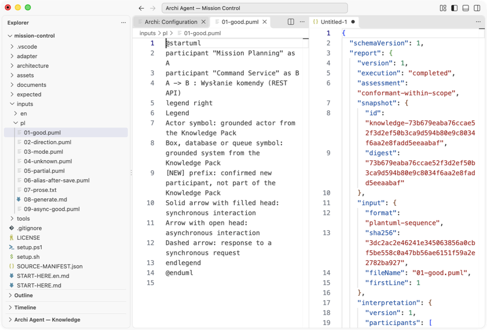
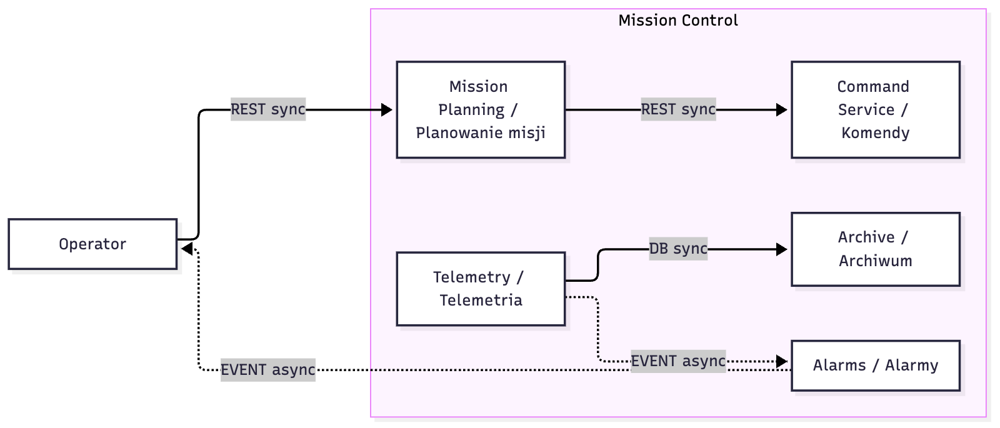
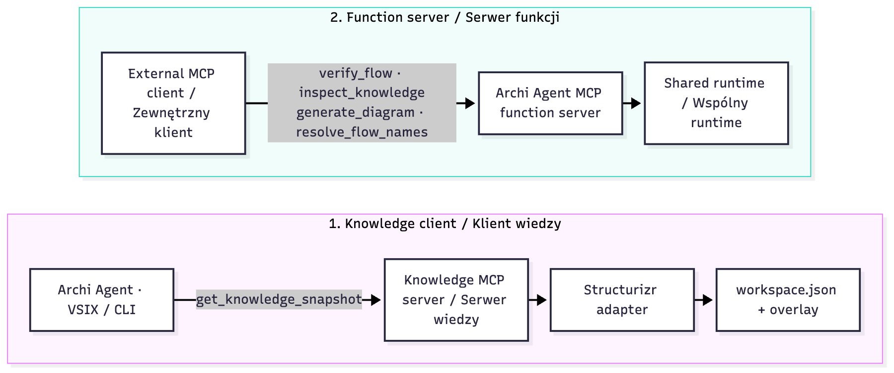

[English](START-HERE.en.md) · [Publiczne paczki](https://github.com/Setech-pl/archi-agent/releases/tag/v0.3.0-alpha.8)

# Mission Control — zacznij tutaj

Gotowy syntetyczny model jest w `architecture/`. Pierwszy wynik uzyskasz przez **Verify Flow na PlantUML, bez LLM**. Nie budujesz wiedzy przed rozpoczęciem.





## 1. Pobranie i instalacja

Pobierz [ZIP projektu](https://github.com/Setech-pl/archi-agent/releases/download/v0.3.0-alpha.8/archi-agent-demo-mission-control-0.3.0-alpha.8.zip) i rozpakuj do nowego lokalnego folderu. Obsługiwane są spacje i polskie znaki. Wymagany jest desktopowy VS Code **1.91+**. Wybierz [VSIX Core](https://github.com/Setech-pl/archi-agent/releases/download/v0.3.0-alpha.8/archi-agent-core-0.3.0-alpha.8.vsix) do podstawowych ćwiczeń lub [VSIX Full](https://github.com/Setech-pl/archi-agent/releases/download/v0.3.0-alpha.8/archi-agent-full-0.3.0-alpha.8.vsix) do opcjonalnego offline OCR PL/EN. Przed instalacją sprawdź `SHA256SUMS` wydania. Oba profile mają wspólny runtime.

**Extensions → … → Install from VSIX…**, włącz dokładnie jeden profil, potem **Developer: Reload Window**. Dotychczasowy użytkownik Full może pozostać przy Full. Przy zmianie profilu ustawienia są wspólne, ale klucze SecretStorage osobne dla ID rozszerzeń: wprowadź klucz ponownie. Użytkownik VSIX nie potrzebuje klonowania repo, npm, osobnego Node, Javy ani PlantUML. Produkt otwiera tekst diagramu; graficzny podgląd wymaga osobnego renderera.

## 2. Otwarcie gotowego źródła

**File → Open Folder**: wybierz rozpakowany folder `mission-control`. W terminalu VS Code w tym folderze uruchom:

- macOS/Linux: `sh ./setup.sh`
- Windows PowerShell: `powershell -NoProfile -ExecutionPolicy Bypass -File .\setup.ps1`

Przeczytaj dołączony skrypt przed uruchomieniem. Setup tworzy tylko `.vscode/settings.json`, odmawia nadpisania istniejącego pliku i zapisuje rzeczywiste ścieżki absolutne. Nie rozwija `${workspaceFolder}`. Jeżeli VS Code pyta o Workspace Trust, zaufaj temu syntetycznemu projektowi.

Jeśli masz już ustawienia, zachowaj ich wpisy. W **Preferences: Open Workspace Settings (JSON)** dodaj obiekt poniżej. MODEL zastąp przez **Copy Path** z `architecture/workspace.json`, OVERLAY przez Copy Path z `architecture/overlay` w Explorerze. W JSON podwój znaki `\` ze ścieżek Windows.

```json
"archiAgent.architectureSource": {
  "kind": "structurizr-json",
  "sourceId": "mission-control",
  "modelPath": "MODEL",
  "overlayPath": "OVERLAY"
}
```

**Archi: Configuration → Knowledge Management**: oczekuj poprawnego Structurizr JSON, **1 aktora, 6 systemów, 6 relacji**, bez pominiętych komponentów. Systemy obejmują system nadrzędny i pięć kontenerów. **Archi: Knowledge Browser**: rozwiń źródło, systemy i relacje; sprawdź oryginalne ID i osobne pochodzenie pól JSON/nakładki. Provider nie jest potrzebny. Aliasy do podstawowych scenariuszy są już gotowe.


DOC2 pokazuje te same kontrolki i liczby Big Bank; pierwszy obraz powyżej pochodzi z tego projektu. [Pochodzenie DOC2](https://github.com/Setech-pl/archi-agent/blob/v0.3.0-alpha.8/docs/assets/screenshots/README.md).

## 3. Pierwszy wynik bez modelu

Otwórz `inputs/pl/01-good.puml`, pozostaw cały dokument aktywny bez zaznaczenia. **Archi: Verify Flow (Sequence / prose) → Use active document**. Oczekiwany JSON: `report.execution = completed`, `report.assessment = conformant-within-scope`, `report.modelCalls = 0` i jeden zgodny krok. `evidence` zawiera rzeczywiste odwołania do źródeł i nakładki. To zgodność w załadowanym zakresie, nie dowód kompletnej poprawności architektury. W przykładach negatywnych anuluj picker nazw, aby zachować nierozstrzygnięte ustalenie.

Raport zapisz jawnie przez **File → Save As** pod nową nazwą w `reports/`. Weryfikacja nie używa ART1 i nie zapisuje raportów automatycznie.

## 4. Izolowane ćwiczenia weryfikacji

Wszystkie pliki są gotowe; odpowiedniki EN są w `inputs/en/`. Każdy błędny przykład zmienia jeden problem. Kontrakt maszynowy jest w `expected/verification.json`.

| Plik w inputs/pl/ | Oczekiwany wynik przed zapisem nowego aliasu |
| --- | --- |
| 01-good.puml | conformant-within-scope, sync, zero wywołań modelu |
| 02-direction.puml | discrepancies; direction-mismatch + relationship-not-in-model |
| 03-mode.puml | discrepancies; interaction-mode-conflict: async dla relacji sync |
| 04-unknown.puml | inconclusive / needs-resolution; unknown-element; anuluj mapowanie Unknown Gateway |
| 05-partial.puml | inconclusive; syntax-not-covered dla nieobsługiwanego autonumber; znany krok nadal oceniony |
| 06-alias-after-save.puml | początkowo unknown-element dla Komendami; po ćwiczeniu 6 zgodność |
| 09-async-good.puml | conformant-within-scope dla znanej relacji asynchronicznej |


Dokładna dołączona legenda określa znaczenie strzałek. Nie zmieniaj jej: sama strzałka nie dowodzi trybu ani odpowiedzi. Weryfikacja Component i C4 nie jest zaimplementowana. Brak relacji oznacza brak w załadowanym zakresie, nie dowód jej nieistnienia.

## 5. Własny model i cztery diagramy

**Archi: Configuration → LLM Provider**: wybierz **LM Studio** (`http://127.0.0.1:1234/v1`) albo **Ollama** (`http://127.0.0.1:11434/v1`), uruchom lokalny serwer z załadowanym modelem, wybierz profil, odśwież **Available models**, wybierz jeden **Selected model** i **Apply**. Model musi obsługiwać żądania strukturalnego JSON produktu. Dostępność, jakość i wymagania sprzętowe zależą od wybranego modelu.

Alternatywnie wybierz **Anthropic**, **OpenAI** lub **OpenRouter**, użyj **Set / Replace Key**, wybierz dostępny model i **Apply**. Klucz trafia do SecretStorage, nigdy do projektu. Cloud korzysta z Twojego konta i może być płatny. **Check Provider Configuration** sprawdza zastosowaną konfigurację. Edycje pozostają draftem do Apply; Discard przywraca stan zastosowany.

Otwórz `inputs/pl/08-generate.md`, **Archi: Create Diagram → Sequence → Use the active editor document**. Powtórz dla **Component**. Oczekuj uczestników/zależności z tego źródła oraz powiązanego raportu JSON. Dla **C4 Context** i **C4 Container** wybierz system **Mission Control**. Context pokazuje aktora i system; Container pięć kontenerów oraz otoczenie połączone relacjami źródłowymi. Udane generowanie to jeden plan i jeden review na tym samym snapshotcie. Brak retry/repair/fallbacku. Unverified lub failed nie jest zaliczonym wynikiem.

## 6. Proza, świadoma decyzja i trwały alias

Otwórz `inputs/pl/07-prose.txt`, Verify Flow, **Use active document → Prose (one interpretation request)**. Zamierzona interpretacja zachowuje dosłowne **Komendami**. W pickerze świadomie wskaż **Mission Control / Command Service**, obejrzyj ID i provenance, potwierdź. Kontynuacja wykorzystuje tę samą interpretację, bez kolejnego żądania LLM. Oczekuj conformant-within-scope po mapowaniu. Żywy model może błędnie zinterpretować prozę: przed akceptacją sprawdź krok i dowody interpretacji.

W powiadomieniu wybierz **Save confirmed aliases**, obejrzyj proponowaną edycję `architecture/overlay/aliases.md` i zatwierdź natywne potwierdzenie zapisu. Dopiero wtedy alias jest trwały. Ponownie zweryfikuj `inputs/pl/06-alias-after-save.puml`: conformant-within-scope, zero LLM i bez pickera nazw. Samodzielne packi i MCP obsługują decyzje sesyjne, bez tego zapisu aliasów SRC1. `inputs/en/07-prose.txt` jest gotowym odpowiednikiem angielskim bez odmiany nazwy.

## 7. Oryginalna para diagram/raport ART1

Pozostaw otwarty podgląd poprawnie wygenerowanego diagramu i raport. **Archi: Save Diagram and Report**: wybierz oryginalny wynik według typu/czasu/UUID, zatwierdź natywny dialog miejsca docelowego. Powstaną `archi-agent-results/<UTC>-<UUID>/diagram.puml` i `report.json`. ART1 zachowuje oryginalną zamrożoną parę z provenance; edycja podglądu nie zmienia zapisywanych bajtów. Zapis nie wywołuje modelu. Zamknięcie obu podglądów usuwa wybór z pamięci sesji.

## Bezpieczne powtórzenie i własne dane

Zachowaj pobrany ZIP. Aby powtórzyć zapis aliasu od początku, rozpakuj drugą kopię i wykonaj setup; nie nadpisuj roboczej nakładki. Wyniki dostają nowe foldery UUID. Raporty zapisuj pod nowymi nazwami. Po przeniesieniu projektu utwórz ustawienia z nowymi ścieżkami, zachowując stary plik. Paczka nie zawiera ścieżek autora, kluczy ani prywatnych endpointów.

Podmień **kopię** `architecture/workspace.json` na własny Structurizr JSON, zachowaj stabilne oryginalne ID, dopasuj trzy tabele nakładki i source_id. Sprawdź Configuration przed użyciem. Obsługiwane są people, systems, containers i statyczne relacje; components/deployment/views poza projekcją. Brak DSL i bezpośredniego importu EA. Płaski pack Markdown nie zapewnia hierarchii C4. Sprawdź fakty przed wysłaniem wybranego minimalnego kontekstu do providera.

Owner smoke **DEFERRED**; żywy LLM i dodatkowe platformy natywne **NOT_RUN**. Testy syntetyczne dowodzą integracji, nie jakości modelu. Naprawy AUD-003/004 są zawarte; AUD-005/006 pozostają otwarte. Automatyzacja widocznego UI była niedostępna; runtime i kontrolowane testy Host nie dowodzą UI PASS. Zapis jest kontrolowany, bez atomowej publikacji wielu plików/crash recovery.

W każdym raporcie wspólne informacyjne `source-not-covered` opisuje sekcję views poza projekcją importu. Nie zmienia zgodnej oceny obsługiwanego kroku; tabela ćwiczeń wymienia dodatkowy izolowany problem.

## 8. CLI i oba kierunki MCP (opcjonalne, wymagają Node)



Tylko te zaawansowane ćwiczenia procesów wymagają **Node.js >=22.12.0** w PATH. Pobierz [tarball CLI/MCP](https://github.com/Setech-pl/archi-agent/releases/download/v0.3.0-alpha.8/archi-agent-cli-0.3.0-alpha.8.tgz), sprawdź SHA-256 i rozpakuj przez `tar -xzf archi-agent-cli-0.3.0-alpha.8.tgz`. Powstanie `package/bin/`. Bez npm install i repozytorium. W terminalu projektu uruchom poniższe, zastępując cytowaną ścieżkę rzeczywistą absolutną ścieżką do package:

```sh
node tools/setup-cli.mjs "/absolute/path/to/package"
node tools/knowledge-server.mjs --check-source mission-control
node tools/run-cli.mjs good
node tools/run-cli.mjs direction
node tools/run-cli.mjs partial
```

Setup tworzy nowe JSON w `local-config/` z rzeczywistymi ścieżkami i odmawia nadpisania istniejących. Korzysta z lokalnego adaptera Structurizr już w paczce CLI. Check ma zwrócić `valid`, 1 aktora / 6 systemów / 6 relacji. CLI zwraca odpowiednio **0 / 1 / 2**: zgodność, wykazaną rozbieżność i częściową nierozstrzygającą ocenę. Niezerowe wyjścia ostatnich dwóch poleceń są oczekiwane. Każdy stdout to jeden wersjonowany wynik JSON. Utwórz `reports/` i dopisz `> reports/cli-good.json`, aby zachować raport; diagnostyka pozostaje na stderr.

### Klient wiedzy → serwer wiedzy

`node tools/knowledge-server.mjs` jest uruchamialnym serwerem wiedzy stdio; cisza podczas oczekiwania na MCP jest prawidłowa. Zakończ Ctrl+C. Rzeczywisty klient uruchamia własny proces, nie łączy się z tą instancją terminala. Gotowy `local-config/archi-agent.json` zawiera źródła `mission-local`, `mission-mcp` oraz jawne command knowledgeServers. Obejrzyj kompletny wygenerowany JSON z readRoots i względnymi lokatorami wejść; providers mogą być puste.

```sh
node tools/run-cli.mjs good mission-mcp
```

Oczekuj rzeczywistego procesu serwera `get_knowledge_snapshot`, świeżego snapshotu i conformant-within-scope, bez LLM. W VS Code otwórz **Preferences: Open User Settings (JSON)**, skopiuj tam **tylko** `archiAgent.knowledgeServer` z `local-config/vscode-user-settings.json`. Konfiguracja programu jest dozwolona wyłącznie w zakresie **User**. W `.vscode/settings.json` projektu zastąp `archiAgent.architectureSource` przez `{"kind":"mcp","sourceId":"mission-control"}`. Configuration → Validate / Refresh, Knowledge Browser i Verify Flow dla `01-good.puml`: oczekuj tych samych liczb i oceny, z provenance MCP. Nie umieszczaj knowledgeServer w Workspace. Aby wrócić do lokalnego SRC1, przywróć obiekt źródła z ćwiczenia 2; zrób to przed trwałym zapisem aliasu. Nie nadpisuj innych ustawień User.

### Zewnętrzny klient → serwer funkcji Archi Agent

```sh
node tools/call-functions.mjs
```

Przykład bez zależności uruchamia **serwer funkcji Archi Agent**, negocjuje MCP, listuje cztery funkcje i wywołuje `verify_flow` na `mission-mcp`. Serwer funkcji uruchamia następnie osobny proces serwera wiedzy. Oczekuj `meta.adapter = mcp`, conformant-within-scope w `outcome.report.report.assessment`; bez LLM. Polecenie kończy się po wyniku i zamyka stdio. `local-config/function-client.json` zawiera gotowe command/args do konfiguracji mcpServers zewnętrznego klienta. Argumenty `verify_flow`: `{"source":"mission-mcp","input":{"root":"project","path":"inputs/en/01-good.puml"},"format":"plantuml-sequence"}`; `inspect_knowledge`: `{"source":"mission-mcp","limit":20}`. Ten kierunek udostępnia funkcje Archi Agent, nie zastępuje jego źródła architektury.

Adapter opisuje [adapter/README.md](adapter/README.md), dołączono [aktualne źródło](adapter/adapter.ts). Gotowy adapter nie wymaga budowania. Własny adapter to osobne opcjonalne ćwiczenie programistyczne ze źródeł tagu wydania i `npm ci`, z zachowaniem znormalizowanego kontraktu i transportu.

## 9. Dokumenty, ekstrakcja, review i NOWY pack

Źródło demo jest już gotowe. To ćwiczenie tworzy **inny** samodzielny pack z małego `documents/pl/mission-notes.md` albo odpowiednika EN, opisującego dodatkową relację Planning → Archive. Nie scalaj go z `architecture/` i nie nadpisuj źródła demo.

Skonfiguruj providera (ćwiczenie 5). **Archi: Build Knowledge Pack from Documents**, wybierz projekt, jeśli pojawi się picker, następnie jeden notes w natywnym pickerze. Oczekuj jednego żądania ekstrakcji i propozycji **pending** w Knowledge Pack Review. Sprawdź każdy cytat, explicit/inferred, odwołanie i wartość. W razie potrzeby zmień opis przez **Edit proposed row → Apply row edit**. Akceptuj albo odrzucaj wszystkie wiersze, akceptując końce przyjętych relacji. Pending i brakujące zależności mają blokować zapis.

**Validate and preview**: obejrzyj pięć dokładnych plików Markdown. W razie potrzeby utwórz katalog nadrzędny `new-packs/`. Wskaż go przez **Choose new pack folder**, wpisz nową nieużywaną nazwę, np. `mission-reviewed-pl-1`, i wybierz **Save**. Oczekuj pięciu plików poprawnego packa z częściowym pokryciem i metadanymi dowodów; aktywna architektura pozostaje oryginalnym demo. **Save and use** dodatkowo przełącza aktywne źródło i maskuje Structurizr przez null; wybierz świadomie, a przed powtarzaniem ćwiczeń źródłowych przywróć poprzednie ustawienia. Review/zapis nie wywołuje ponownie LLM. Kolejna ekstrakcja może dać inne propozycje modelu. Zawsze zapisuj nowy pack w nowym folderze.

## 10. Opcjonalny offline OCR — Full

Zmień profil na **Full** zgodnie z instalacją VSIX: wyłącz Core i reload, włącz Full i reload. `documents/pl/mission-scan.pdf` oraz `documents/en/mission-scan.pdf` to krótkie syntetyczne skany rastrowe. Obok są PNG i transkrypcja zamierzonego tekstu. PDF nie zawiera warstwy tekstowej.

Otwórz skan, uruchom **Archi: Convert to Markdown** (albo wskaż skan podczas Build Knowledge Pack), wybierz **Auto OCR** / OCR all pages w pickerze. Oczekuj lokalnego tekstu z Operatorem, Planowaniem/Archiwum i Telemetrią/Alarmami, oznaczeń stron OCR i braku confidence. Sama konwersja nie potrzebuje providera; ekstrakcja kandydatów dodatkowo potrzebuje Twojego providera i jednego żądania. Core Auto ma zgłosić **ocr-unavailable**, bez przekazania częściowego Markdown do ekstrakcji. Full zawiera OCR PL/EN i niczego nie pobiera automatycznie. Sprawdź znaki z transkrypcją: OCR wymaga review i nie jest zweryfikowaną prawdą. Wynik zapisz w `reports/`, nigdy na oryginalnym skanie.
