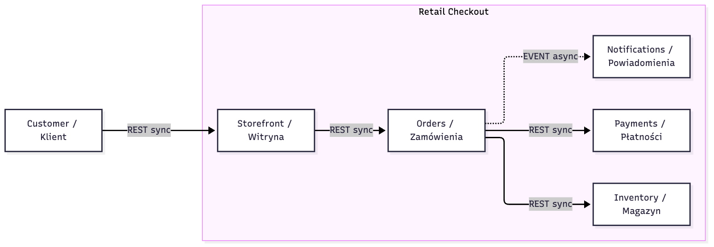
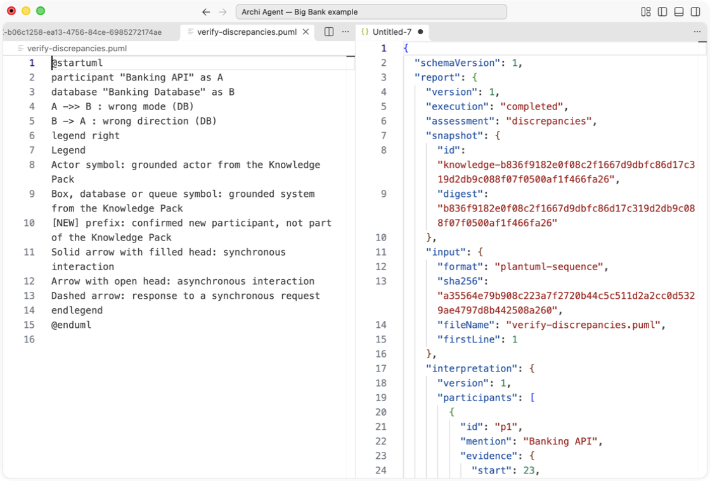

[Polski](START-HERE.pl.md) · [Public packages](https://github.com/Setech-pl/archi-agent/releases/tag/v0.3.0-alpha.8)

# Retail Checkout — start here

A complete synthetic architecture is already in `architecture/`. The first result uses **Verify Flow on PlantUML, without an LLM**. You do not need to build a Knowledge Pack.




## 1. Download and install

Download this [project ZIP](https://github.com/Setech-pl/archi-agent/releases/download/v0.3.0-alpha.8/archi-agent-demo-retail-checkout-0.3.0-alpha.8.zip) and extract it into a new local folder. Spaces and Polish characters are supported. Desktop VS Code **1.91+** is required. Pick [Core VSIX](https://github.com/Setech-pl/archi-agent/releases/download/v0.3.0-alpha.8/archi-agent-core-0.3.0-alpha.8.vsix) for this first exercise, or [Full VSIX](https://github.com/Setech-pl/archi-agent/releases/download/v0.3.0-alpha.8/archi-agent-full-0.3.0-alpha.8.vsix) for optional offline PL/EN OCR. Verify the release `SHA256SUMS` before installation. Core and Full run the same product runtime.

Use **Extensions → … → Install from VSIX…**, enable exactly one profile, and **Developer: Reload Window**. Existing Full users may keep Full. When changing profiles, shared settings stay, but cloud keys belong to each extension ID and must be entered again. Normal VSIX use needs **no clone, npm, separate Node, Java or PlantUML**. Archi Agent opens diagram text; a graphical preview requires an additional PlantUML renderer.

## 2. Open the ready source

Use **File → Open Folder** on the extracted `retail-checkout` folder. Open VS Code's integrated terminal in that folder and run:

- macOS/Linux: `sh ./setup.sh`
- Windows PowerShell: `powershell -NoProfile -ExecutionPolicy Bypass -File .\setup.ps1`

Setup only creates `.vscode/settings.json`, refuses to overwrite it, and writes absolute local paths. It does not expand `${workspaceFolder}`. Read the bundled script before running it. Trust this synthetic workspace if VS Code requests Workspace Trust.

For an existing settings file, preserve its entries. In **Preferences: Open Workspace Settings (JSON)**, add the following object, replacing MODEL and OVERLAY with **Copy Path** from `architecture/workspace.json` and `architecture/overlay` in Explorer (JSON-escape Windows backslashes):

```json
"archiAgent.architectureSource": {
  "kind": "structurizr-json",
  "sourceId": "retail-checkout",
  "modelPath": "MODEL",
  "overlayPath": "OVERLAY"
}
```

Run **Archi: Configuration → Knowledge Management**. Expect **1 actor, 6 systems, 6 relationships**, valid Structurizr JSON and zero omitted components. The 6 systems include the parent software system and 5 containers. Then **Archi: Knowledge Browser**: expand the source, systems and relationships; inspect original IDs and separate JSON/overlay field provenance. No provider is needed. The alias tables are already complete for the basic scenarios.


This DOC2 reference shows the same controls with Big Bank counts; the first image above is this project. [DOC2 capture provenance](https://github.com/Setech-pl/archi-agent/blob/v0.3.0-alpha.8/docs/assets/screenshots/README.md).

## 3. First result — no model

Open `inputs/en/01-good.puml`, keep the whole document active without a selection, run **Archi: Verify Flow (Sequence / prose)** and choose **Use active document**. Expected JSON: `report.execution = completed`, `report.assessment = conformant-within-scope`, `report.modelCalls = 0`, one conformant step. Read `evidence` for actual source and overlay references. This is conformance within the loaded scope, not a proof of complete architecture correctness. Cancel any name picker in negative examples to keep the original unresolved finding.

Save the report explicitly with **File → Save As** under a new `reports/` filename. Verification does not use ART1 and does not automatically save reports.

## 4. Isolated verification exercises

Every file is ready; PL equivalents are in `inputs/pl/`. Each negative example changes one concern. `expected/verification.json` is the machine-readable contract.

| File (inputs/en/) | Expected before saving the new alias |
| --- | --- |
| 01-good.puml | conformant-within-scope, sync, zero model calls |
| 02-direction.puml | discrepancies; direction-mismatch + relationship-not-in-model |
| 03-mode.puml | discrepancies; interaction-mode-conflict (async used for a sync relation) |
| 04-unknown.puml | inconclusive / needs-resolution; unknown-element; cancel mapping for Unknown Gateway |
| 05-partial.puml | inconclusive; syntax-not-covered for the unsupported autonumber directive; known step still evaluated |
| 06-alias-after-save.puml | unknown-element for Magazynem initially; conformant after exercise 6 |
| 09-async-good.puml | conformant-within-scope for the known asynchronous relation |



The exact bundled legend assigns arrow semantics. Do not change it: an arrow alone does not establish sync/async/response meaning. C4 and Component verification are not implemented. No source relation means “absent from loaded scope”, not “impossible”.

## 5. Configure your model, then generate four diagrams

Open **Archi: Configuration → LLM Provider**. Choose **LM Studio** (`http://127.0.0.1:1234/v1`) or **Ollama** (`http://127.0.0.1:11434/v1`), start its local server with your model loaded, select the profile, refresh **Available models**, select one **Selected model**, and **Apply**. A model must support the product's structured JSON requests. Model availability, quality and machine requirements depend on your chosen model.

Alternatively choose **Anthropic**, **OpenAI** or **OpenRouter**, use **Set / Replace Key**, select an available model, and **Apply**. Keys are stored in VS Code SecretStorage, never in this project. Cloud calls use your account and may cost money. **Check Provider Configuration** checks the applied selection. Configuration edits remain drafts until Apply; Discard restores applied values.

Open `inputs/en/08-generate.md`, run **Archi: Create Diagram**, choose **Sequence**, then **Use the active editor document**. Repeat with **Component**. Expect grounded participants/dependencies from this source and a linked JSON report. For **C4 Context** and **C4 Container**, choose software system **Retail Checkout**; these exercises use source type and hierarchy. Context shows the actor and system; Container shows the five containers and source-supported surrounding interactions. Successful generation uses one plan and one review request on one frozen snapshot. There is no retry/repair/fallback. An unverified or failed model response is not a passing result.

## 6. Prose, explicit meaning and persistent alias

Open `inputs/pl/07-prose.txt`, run Verify Flow, **Use active document → Prose (one interpretation request)**. The intended interpretation retains literal **Magazynem**. When prompted, consciously map it to **Retail Checkout / Inventory**, inspect its original ID and provenance, and confirm. The same interpretation is reused without another model request. Expected assessment after the mapping: conformant-within-scope. The real model may interpret prose imperfectly: inspect the interpreted step and evidence before accepting.

Choose **Save confirmed aliases** in the completion notification, inspect the proposed edit to `architecture/overlay/aliases.md`, and approve the native save confirmation. Only then is the new alias persistent. Reopen `inputs/en/06-alias-after-save.puml` and verify: expected conformant-within-scope with zero LLM requests and no name picker. Standalone packs/MCP support session decisions, not this SRC1 alias save. `inputs/en/07-prose.txt` is a ready English counterpart without inflection.

## 7. Save the original diagram/report pair (ART1)

With a successful generated diagram preview and its report still open, run **Archi: Save Diagram and Report**, select the original result by type/time/UUID and approve the native destination dialog. Expect `archi-agent-results/<UTC>-<UUID>/diagram.puml` and `report.json`. ART1 stores the original frozen pair, including provenance; editing a preview does not replace the saved bytes. Save performs no model call. Closing both result previews removes its in-memory save choice.

## Repeat safely and use your own data

Keep the downloaded ZIP unchanged. For a fresh alias exercise, extract a second copy and run setup there; do not overwrite a working overlay. Results use new UUID folders. Save reports under new names. When moving a project, create settings again with the new paths (preserve the previous file first). No author paths, keys or private endpoints are bundled.

Replace a **copy** of `architecture/workspace.json` with your Structurizr JSON, retain stable original IDs, update all three overlay tables and source_id, then validate in Configuration before use. People, systems, containers and static relationships are supported; components/deployment/views are outside projection. DSL and direct EA import are unavailable. A flat Markdown pack does not provide the hierarchy C4 requires. Review facts before sending the selected minimal context to your provider.

Owner smoke **DEFERRED**; live LLM and Windows ARM64 runtime **NOT_RUN** during preparation; AUD-003–006 **OPEN**. Synthetic transport tests prove integration, not live-model quality. Native UI evidence is macOS ARM64. New-folder saves are guarded, without atomic multi-file publication/crash recovery. [Feature/evidence matrix](https://github.com/Setech-pl/archi-agent/blob/v0.3.0-alpha.8/docs/demo1-verification.md).

Every report also includes the shared informational `source-not-covered` for Structurizr views outside the import projection. It does not invalidate a conformant supported step; the exercise table lists the additional isolated concern.

## Capability Map — current checkout and local EA1 VSIX only

The published ZIP/VSIX above does not contain EA1. With a new local EA1 candidate, open this current folder and follow the [Capability Map tutorial](../../docs/en/capability-map.md). Select `architecture/enterprise.json`; no setup, software source or provider is needed. [Rendered reference](assets/capability-map.png) · [PlantUML](assets/capability-map.puml).

## Local EA1b candidate: Capability Map through CLI/MCP

Published DEMO1 ZIPs are unchanged. With fresh local EA1b packages and this checkout catalog, follow the [Capability Map tutorial](../../docs/en/capability-map.md) and complete [CLI/MCP guide](../../docs/en/cli-mcp.md#capability-map-with-no-model--local-ea1b-candidate). The same Retail catalog works locally and through get_enterprise_snapshot v1, without an LLM; software knowledge v1 remains separate.

## Value Stream and Application Landscape

Open the Retail demo's `architecture/enterprise-views.json`, then **Archi: Create Diagram → Enterprise Architecture**.
Choose **Value Stream** for the purchase-to-receipt journey or **Application Landscape** for the portfolio.
Select the active document (captured including unsaved changes) or the same local file.
These views need no model/provider and make zero LLM calls. They also work with an explicitly versioned
enterprise MCP source. The report accompanies the editable PlantUML; graphical preview needs a separate renderer.

For Value Stream choose a stream and stages. The view preserves declared order and original ordinals;
shared capability mappings are explicit. Context, outcomes, evidence, declared coverage and exclusions
remain in the report. A partial source cannot establish that a capability is absent in the company.
For Landscape choose the whole portfolio or a business domain and an optional defined rating scale.
Ungrouped applications remain visible in the whole portfolio. Missing owner/lifecycle/rating means
unknown; a rating of zero has its explicit scale meaning. Several applications do not prove redundancy.
If the view exceeds a limit, select fewer stages, domains or applications; there is no clipping.

To build your own data, use **Archi: Build Enterprise Catalog**, review the capability proposal and save.
Then **Archi: Update Enterprise Catalog** offers **Add / change business domain**, **Add / change stream
and explicit stage order**, **Change application, owner, lifecycle or rating**, and **Define explicit rating scale**.
These are guided forms; manual JSON editing is optional. Use stable IDs across rename, select capability
mappings explicitly and confirm stage order. To revise a stream, retain existing stage IDs and enter the
intended ordered list; omitted stages are shown in before/after review before acceptance.

**Value Stream / Landscape proposals from materials** reuses selected text, the captured whole document,
a typed description or selected files, bounded conversion, provider configuration and one explicit model call.
Extraction requires evidence for every supplied field; proposal mode keeps unsupported order as a proposal.
**Review new view proposal and choose IDs** shows original field basis/evidence, then guided forms bind
identities and references. Review differences, explicitly accept/reject every change, acknowledge warnings,
and approve **Save catalog**. Acceptance is a user decision, not a quote in an old source. Dependencies must
be resolved explicitly before deletion. A conflict preserves foreign disk bytes; inspect the buffer and start
a new update session. Keep `enterprise-updates/` companion reports with the catalog. Use **Save Diagram and
Report** to retain the original generated ART1 pair; editing a preview does not change that original.

This prerelease keeps owner smoke deferred. Live model quality and additional native platforms are not
proven by synthetic tests. Visible UI automation may be unavailable; package/runtime and Extension Host
checks are reported separately. The historical safe-conflict observation remains open.

### Enterprise CLI and MCP — no provider

Extract the CLI/MCP TGZ separately. It needs Node >=22.12, without npm or extra dependencies.
Run `node tools/setup-cli.mjs /absolute/extracted/package` from this project. It exclusively creates
`local-config/` files; preserve existing files. `retail` and `retail-mcp` select the same v3 catalog
locally or through real stdio; `retail-v1` and `retail-v2` retain earlier examples.
Run `node /absolute/extracted/package/bin/archi-agent.cjs diagram generate --config /absolute/retail-checkout/local-config/archi-agent.json --source retail --type value-stream --stream purchase-to-receipt --format json`.
Replace the type with `application-landscape` and omit `--stream` for Landscape; add
`--color-scale maturity` to see explicit zero versus unknown. Use `--source retail-mcp` for parity.
The generated `function-client.json` config starts the same function MCP server. No file writes or
model calls occur when generating a view. Keep personal `local-config/` outside shared demo archives.
